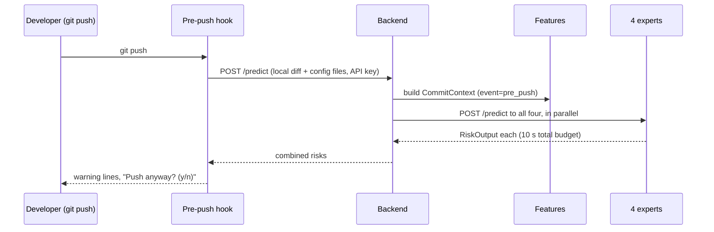

# Architecture

## 1. What the system does

It watches Node.js projects on GitHub and does two things:

1. **Before a run (prediction):** four experts each estimate the risk of their failure type
   for a commit and explain why, using SHAP. The warning reaches the developer through the
   **pre-push hook** (before `git push`) and a **PR note** (after push, while CI runs).
2. **After a failed run (diagnosis):** a router sends the failure to the right expert (or
   two), which diagnoses it with an LLM grounded in verified past fixes (RAG). A developer
   accepts, rejects, modifies or asks for a revision. Confirmed fixes that pass a re-run go
   back into that expert's knowledge base.

It is an **observer**: GitHub runs everything as normal. Nothing is blocked or skipped.

## 2. Components

| Component | Folder | Kind | Owner |
|---|---|---|---|
| Collector | `services/collector` | CLI, run daily | Shared |
| Features | `services/features` | Library + CLI, used by the backend and replay | Shared |
| Backend API (includes the router and orchestration) | `services/api` | FastAPI service | Shared |
| LLM gateway | `services/llm_gateway` | FastAPI service, holds the only LLM key | Shared |
| Dashboard | `services/dashboard` | React + Vite + TypeScript | Shared |
| Pre-push hook | `tools/pre-push-hook` | Small Node.js script on developers' machines | Shared |
| Dependency expert | `experts/dependency` | FastAPI service + queue worker | Member 1 |
| Build expert | `experts/build` | FastAPI service + queue worker | Member 2 |
| Test expert | `experts/testing` | FastAPI service + queue worker | Member 3 |
| Infra expert | `experts/infra` | FastAPI service + queue worker | Member 4 |
| Shared libraries | `shared/` (contracts, db, embeddings, sanitise, github) | Python packages | Shared |

Until each member builds their expert, a **stub** stands in for it (see `docs/experts/README.md`).

## 3. Flows

### 3.1 Pre-push (prediction before push)



- **Budget: 10 seconds total.** Experts that miss it show as "not ready". On any error the hook prints "unavailable" and lets the push continue.
- Not interactive (no terminal attached)? Print the warning and continue.

### 3.2 Live push (PR note)

1. The GitHub App sends a `push` or `pull_request` webhook to `POST /webhooks/github`.
2. The backend builds a `CommitContext` (event `push` or `pull_request`) through the GitHub API using the App's installation token.
3. It calls all four experts' `POST /predict` in parallel, with a **2-minute budget**.
4. It saves each `RiskOutput` and posts a GitHub **check run** (or PR comment) with the alerts. Results that arrive late update the same check (the API re-asks the experts that were not ready a few times, then finishes the check; the check is never `failure`).

### 3.3 Failure diagnosis

```mermaid
sequenceDiagram
    participant GH as GitHub App webhook
    participant API as Backend + router
    participant Q as Redis queue
    participant W as Expert worker
    participant L as LLM gateway
    participant UI as Dashboard
    GH->>API: workflow_job / workflow_run completed (failure)
    API->>API: fetch failed job, steps, log; sanitise; route (rules)
    API->>Q: RoutedFailure on diagnose:<expert> (1 or 2 experts)
    Q->>W: job
    W->>W: parse log, retrieve similar verified cases (hybrid search)
    W->>L: structured diagnosis request
    L-->>W: JSON answer (validated)
    W->>API: POST /diagnoses (Diagnosis)
    UI->>API: GET /failures/{id}
    UI->>API: POST /reviews (ReviewDecision)
    API->>W: POST /review on the expert
```

- If the developer confirms the cause and a later run passes, the expert writes a `VerifiedCase` into its own collection.
- An expert that thinks the failure isn't its own returns `status="misrouted"`.

### 3.4 Replay (history → training data and evaluation)

`replay` is a CLI in `services/features`. For each stored historical run it builds a
`CommitContext` with `event="replay"` and `history_cutoff` = the run's `created_at`, then
calls the experts and stores results in replay tables. **Replay never touches GitHub.**
The same code path builds each expert's training dataset, so training and serving match.

### 3.5 Collection

The collector runs daily on each member's laptop and fills that member's `raw` schema
through the GitHub REST API. Details in `docs/DATA.md`.

## 4. Endpoints

### Backend (`services/api`, port 8000)

| Endpoint | Called by | Does |
|---|---|---|
| `POST /webhooks/github` | GitHub App | Verifies `X-Hub-Signature-256`, handles push, PR and job/run completion |
| `POST /predict` | Pre-push hook | Header `Authorization: Bearer <personal API key>`. Body: local diff payload. Returns all four risks |
| `POST /diagnoses` | Expert workers | Saves a `Diagnosis` |
| `POST /reviews` | Dashboard | Saves a `ReviewDecision`, forwards it to the expert |
| `GET /commits/{sha}/risks` | Dashboard | Risks for a commit |
| `GET /runs` | Dashboard | History: predictions next to actual outcomes |
| `GET /failures/{id}` | Dashboard | A failure and its diagnoses |
| `POST /api-keys`, `DELETE /api-keys/{id}` | Dashboard settings | Issue / revoke a pre-push hook key |
| `GET /auth/github/login`, `GET /auth/github/callback` | Dashboard | "Sign in with GitHub" (OAuth through the GitHub App); callback sets the `piq_session` cookie |
| `GET /auth/me`, `POST /auth/logout` | Dashboard | Who is signed in (401 if nobody); clear the session |
| `GET /me/api-keys`, `POST /me/api-keys`, `DELETE /me/api-keys/{id}` | Dashboard settings | The signed-in user's own hook keys (session cookie) |
| `GET /failures?repo=&limit=` | Dashboard | Failure list with diagnosis count and latest review |
| `GET /health` | Anyone | Status of the backend and each expert |

### Every expert (ports 8101 dependency, 8102 build, 8103 test, 8104 infra)

| Endpoint | Does |
|---|---|
| `POST /predict` | `CommitContext` in, a JSON array of `RiskOutput` out (one item for commit-scoped experts; the Test expert returns one per test job) |
| `POST /review` | `ReviewDecision` in; later writes a `VerifiedCase` if the re-run passes |
| `GET /health` | Running, loaded model version, knowledge-base size |
| Worker (no endpoint) | Consumes `diagnose:<expert>` from Redis, posts `Diagnosis` to the backend |

### LLM gateway (`services/llm_gateway`, port 8200, internal only)

| Endpoint | Does |
|---|---|
| `POST /complete` | `{expert, prompt_version, messages, json_schema}` → validated JSON. Enforces the per-expert spending cap, caches identical requests, logs every call with cost |

`LLM_PROVIDER=mock` returns canned, schema-valid answers from fixtures. Tests always use it.

## 5. How messages travel

| Message | Transport |
|---|---|
| `CommitContext` → `list[RiskOutput]` | Synchronous HTTP (`POST /predict`) |
| `RoutedFailure` | Redis queue (RQ), one queue per expert |
| `Diagnosis` | HTTP callback to the backend |
| `ReviewDecision` | HTTP, dashboard → backend → expert |
| `VerifiedCase`, `FailureLabel` | Written to the database, never sent |

All bodies are contract JSON. See `shared/contracts/README.md`.

## 6. Data ownership

There is **no shared server**. Each member runs the whole stack locally with Docker and
keeps **their own PostgreSQL database**, holding data for their own repos. Teammates share
data with `make export-data` / `make import-data` (database dump + logs archive).

Inside each database:

| Schema | Written by | Read by |
|---|---|---|
| `raw` | Collector (and the backend for GitHub App data) | Everyone |
| `platform` | Backend | Everyone |
| `dependency`, `build`, `testing`, `infra` | That expert only | That expert only |

For integration testing and the final demo, everyone imports their trained model and
knowledge base onto **one demo machine**, which runs all services together.

## 7. Technology stack

| Layer | Choice |
|---|---|
| Collection | Python, httpx, GitHub REST API, `raw.githubusercontent.com` for file contents |
| Storage | PostgreSQL 17 + pgvector (Docker), gzipped logs on disk |
| Queue | Redis + RQ |
| Processing | unidiff, tree-sitter (JavaScript/TypeScript grammars), per-framework log parsers |
| ML | pandas, scikit-learn, LightGBM/XGBoost, SHAP, Optuna, MLflow (local tracking only) |
| LLM | Hosted API (provider to be chosen), behind the LLM gateway; mock provider until then |
| Embeddings | `ibm-granite/granite-embedding-small-english-r2` (384 dimensions) via sentence-transformers, local |
| Retrieval | Hybrid: PostgreSQL full-text search + pgvector, merged by reciprocal rank fusion |
| Backend | FastAPI, Pydantic v2, SQLAlchemy 2 + Alembic |
| Frontend | React + Vite + TypeScript, Tailwind, Recharts |
| Hook | Node.js 22 script |
| GitHub integration | GitHub App (webhooks, check runs, OAuth sign-in); smee.io to reach laptops |
| Tooling | uv, ruff, mypy, pytest, pre-commit, Docker Compose, GitHub Actions CI |

## 8. Folder structure

```
pipelineiq/
├── CLAUDE.md
├── .claude/agents/            # Claude Code subagents (implementer, reviewer, scaffolder, doc-writer)
├── Makefile
├── docker-compose.yml
├── pyproject.toml              # uv workspace root
├── .env.example
├── config/
│   ├── repos/<expert>.yaml     # each member's repo list
│   ├── file_tags.yaml          # file-tagging patterns
│   └── router_rules.yaml       # routing patterns per expert
├── docs/                       # these documents
├── shared/
│   ├── contracts/              # the seven messages (Pydantic)
│   ├── db/                     # SQLAlchemy models + Alembic migrations
│   ├── github/                 # REST client: auth, rate limits, pagination
│   ├── sanitise/               # secret scrubbing + identity hashing
│   ├── embeddings/             # embedding model + hybrid search
│   └── tests/
├── services/
│   ├── collector/
│   ├── features/               # tagging, CommitContext builders, replay CLI
│   ├── api/                    # backend, router, orchestration, GitHub App
│   ├── llm_gateway/
│   └── dashboard/
├── experts/
│   ├── _template/              # copy this to start an expert
│   ├── dependency/             # Member 1
│   ├── build/                  # Member 2
│   ├── testing/                # Member 3
│   └── infra/                  # Member 4
├── tools/pre-push-hook/
├── models/                     # gitignored: exported model bundles
├── data/                       # gitignored: logs, dumps, datasets
└── scripts/                    # one-off utilities (e.g. rerun_check.py)
```

## 9. Running it locally

`docker compose up` starts PostgreSQL, Redis, the backend, the LLM gateway and the four
experts (stubs until replaced). The dashboard runs with `pnpm dev`. The collector runs
from the command line or a scheduled task. To receive GitHub App webhooks on a laptop,
run a smee.io client forwarding to `http://localhost:8000/webhooks/github`.

## 10. Security and privacy

- Logs are sanitised **before** they're written to disk or the database.
- Author and reviewer identities are salted SHA-256 hashes; the salt lives only in `.env`.
- Pre-push API keys are stored hashed; only the developer sees the plain key, once.
- Only sanitised text is ever sent to the LLM gateway.
- Only public repos are collected for research. Private repos would only come in through
  the GitHub App, with the owner's explicit installation.
