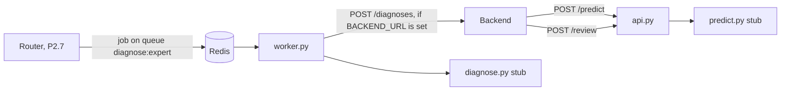

# Expert template

**In one sentence:** the starting point for the four experts. It holds a stub API and a stub diagnose worker, so the whole flow can run before anyone has a model.

**Status:** stub · **Owner:** shared template (each member owns their own copy in `experts/<name>/`) · **Plan tasks:** P2.1

## What it does

An expert is a small service that looks at a commit or a failed pipeline run. The API answers two questions for the backend. The first is "how risky is this commit?" The second is "what went wrong in this run?" The worker does the second job in the background.

There are four experts: dependency, build, test and infra. They all have the same shape, so the backend can call them the same way. This folder is that shape with fake answers.

The fake answers are fixed or based on a hash. A hash is a fixed fingerprint of some text, so the same input always gives the same fingerprint. The stub answers are always valid messages, so the team can test the full flow before a real model exists. Each fake part is replaced one at a time later.

Terms used below:

- **FastAPI** is the Python web framework for the API. **uvicorn** is the program that runs it.
- **Redis** is a fast store. **RQ** (Redis Queue) is the library that holds jobs in Redis and runs them in a worker.
- **Contract** is a message shape defined in `shared/contracts/`. Services only talk to each other through contracts. See `shared/contracts/README.md`.
- **Container** is a box that runs one program with its own files. **Docker Compose** starts several containers from `docker-compose.yml`.

## How it works

1. The backend sends a `CommitContext` (a commit and its changed files) to `POST /predict`.
2. The stub hashes the commit's `head_sha` (its commit ID) into a number from 0.01 to 0.2. It returns one `RiskOutput` with a threshold of 0.5 and `alert` set to false.
3. When a failed run is routed to this expert, a job goes on the Redis queue `diagnose:<expert>`. The worker checks the job is a valid `RoutedFailure`.
4. The stub writes fixed root-cause text. It copies the last non-empty line of the log into one evidence line. It fills `details` with this expert's detail model.
5. If `BACKEND_URL` is set, the worker posts the `Diagnosis` to the backend's `POST /diagnoses`. If it is not set, the worker only returns the diagnosis.
6. `POST /review` takes a developer's decision on a diagnosis and logs it. It does not store it yet.



Nothing enqueues jobs in the normal flow yet. The router that does this is task P2.7. Until then, the worker is tested by calling its job function directly.

## Endpoints

| Call | Input | Output | Notes |
|---|---|---|---|
| `POST /predict` | `CommitContext` as JSON. Optional header `X-Deadline-Ms` | `200` with a JSON list of `RiskOutput` | An invalid body gets `422`. The deadline header is read and logged only. |
| `POST /review` | `ReviewDecision` as JSON | `204`, no body | Logs `decision_id`, `diagnosis_id` and `decision`. Never logs the comment text. |
| `GET /health` | none | `{"status": "ok", "model_version": "stub", "kb_cases": 0}` | `kb_cases` is the size of the knowledge base. It is 0 until one exists. |

The worker's job function is `process_failure` in `worker.py`. It takes the job payload as a dictionary and returns a `Diagnosis`.

## How to run it

Run the tests from the repo root, in Git Bash:

```bash
# the whole repo (ruff, mypy and pytest)
make check

# only this template's tests
uv run pytest experts/_template/tests
```

**Expected:** all tests pass. The tests need no Redis, no Docker, no database and no network. The backend is faked with respx, a mocking library for HTTP calls.

To start the stub APIs and workers in Docker:

```bash
make up-experts
```

This builds the four experts' images and starts their APIs and workers, using the `experts` profile in `docker-compose.yml`. Plain `make up` starts only Postgres and Redis. `make down` stops everything, including the experts.

The API ports are bound to `127.0.0.1` only, so other computers cannot reach them: dependency 8101, build 8102, test 8103, infra 8104. When it works, `curl http://127.0.0.1:8101/health` returns the health JSON above.

**Not yet verified:** the Docker images and the compose entries were not built or run in P2.1. Treat `make up-experts` as untested until someone runs it.

## Inputs and outputs

| | What | Where / format |
|---|---|---|
| In (predict) | `CommitContext` | HTTP `POST` body, JSON |
| In (review) | `ReviewDecision` | HTTP `POST` body, JSON |
| In (worker) | `RoutedFailure` | Redis queue `diagnose:<expert>`, as a dictionary |
| Out (predict) | list of `RiskOutput` | HTTP response, JSON array |
| Out (review) | nothing | HTTP `204` |
| Out (worker) | `Diagnosis` | Returned by the job. Posted as JSON to `BACKEND_URL/diagnoses` if set |

## Settings

| Setting | Where | Default | What it changes |
|---|---|---|---|
| `EXPERT_PORT` | `Dockerfile` (ENV), each API in `docker-compose.yml`, `.env.example` | `8101` in the Dockerfile | The port uvicorn listens on inside the container. |
| `REDIS_URL` | Read by the worker. Set in `docker-compose.yml` | `redis://127.0.0.1:6379/0` in code | Which Redis the worker takes jobs from. |
| `BACKEND_URL` | Read by the worker. Empty in `docker-compose.yml` | empty | If empty, the worker does not post. If set, it posts each diagnosis there. |
| `BACKEND_TIMEOUT_SECONDS` | Read by the worker. `10` in `docker-compose.yml` | `10` | How long the worker waits for the backend before it gives up. |

Compose also sets `DATABASE_URL` for the experts. The stub code does not read it yet.

## Example

Both examples come from the tests and their fixtures.

**Predict.** The fixture `commit_context.json` is a push to `main` that changes `src/index.ts`. The response is one commit-scoped `RiskOutput`:

- `model_version` is `stub`.
- `probability` is between 0.01 and 0.2.
- `threshold` is 0.5 and `alert` is false.

**Diagnose.** The fixture `routed_failure.json` is a failed step named `Run npm test`. Its log excerpt ends with the line `npm ERR! Found: react@18.2.0`. The worker returns a `Diagnosis` with:

- `status` set to `diagnosed` and `confidence` set to 0.0.
- One evidence line, `source` set to `log`, with the text `npm ERR! Found: react@18.2.0`.
- An empty `retrieved_cases` list.
- Fixed placeholder text as the root cause.

If the log excerpt is empty, the evidence line becomes `failed step: Run npm test`. The test `test_empty_log_excerpt_falls_back_to_step_name` checks this.

## Starting your expert

The four stub folders already exist, and each one was made with these steps. Your member folder is already there, so **edit it in place**. Do not copy the template over it. Read this section when you start a new expert, or to see what each part of a folder is for.

Assume the new package is `<pkg>` (the folder name plus `_expert`, for example `dependency_expert`) and the port is `<port>`.

1. **Copy the template.** Run `cp -r experts/_template experts/<name>`, then delete any `__pycache__` folders in the copy.
2. **Rename the package.** Run `mv experts/<name>/src/expert_template experts/<name>/src/<pkg>`. Then list the files that still say `expert_template` with `grep -rl expert_template experts/<name> --exclude-dir=__pycache__`. Change each one with `sed -i 's/expert_template/<pkg>/g' <file>`.
3. **Edit `src/<pkg>/config.py`.** This is the only file with expert-specific values:
   - `EXPERT`: one of `Expert.DEPENDENCY`, `Expert.BUILD`, `Expert.TEST` or `Expert.INFRA`. This sets the `expert` field in every output, and the queue name.
   - `DEFAULT_PORT`: your port from the table below.
   - `DB_SCHEMA`: your schema name (`dependency`, `build`, `testing` or `infra`). The schema is created by `docker/postgres/init/01-init.sql`.
   - `make_details`: the detail model for your expert. Use `DependencyDetails`, `BuildDetails`, `BehaviourDetails` or `InfraDetails`, from `shared/contracts`.
4. **Edit `pyproject.toml`.** Set `name` to `pipelineiq-expert-<name>`, set `description`, and set `packages` to `["src/<pkg>"]`.
5. **Edit `Dockerfile`.** Change `--package pipelineiq-expert-template` to your package name. Change the `CMD` module from `expert_template.api:app` to `<pkg>.api:app`. Set `EXPERT_PORT` in `ENV` and the `EXPOSE` line to your port.
6. **Set the port.** The four ports are: dependency 8101, build 8102, test 8103 and infra 8104. The number must match `config.py`, the Dockerfile and compose. Pick a port that no other expert uses.
7. **Update the lock file.** Run `uv lock`. The Dockerfile installs with `--frozen`, so the build fails if `uv.lock` does not include your package. Commit `uv.lock` with your change.
8. **Update the root `pyproject.toml`.** Add `experts/<name>/src` and `experts/<name>/tests` to the `files` list under `[tool.mypy]`. Add `$MYPY_CONFIG_FILE_DIR/experts/<name>/src` to `mypy_path`. Nothing goes in `exclude`. The `experts/*` pattern already picks up any folder that has a `pyproject.toml`, and `exclude` only holds empty folders.
9. **Add compose entries.** Copy the `<name>-api` and `<name>-worker` pair in `docker-compose.yml`. Change the service names, the image name, the Dockerfile path, `EXPERT_PORT` and the port mapping. Set the worker's command to `python -m <pkg>.worker`.
10. **Rename the test files.** Rename `tests/test_template_api.py` to `tests/test_<name>_api.py`, and `tests/test_template_worker.py` to `tests/test_<name>_worker.py`. The test folders have no `__init__.py`, so pytest needs each test file name to be unique across the whole repo. The `expert_template` imports inside are fixed by step 2.
11. **Check.** Run `make check`. Then write `docs/experts/<member>.md` (labels, features, model plan and diagnosis details), fill in `config/repos/<member>.yaml`, your rows of `config/file_tags.yaml` and your patterns in `config/router_rules.yaml`, and run the collector backfill. `docs/experts/README.md` has the full list.

## Replacing the stubs

Replace one stub function at a time. Run `make check` after each change. These are the stub functions:

| Function | File | What it does now |
|---|---|---|
| `predict` and `stub_probability` | `predict.py` | Returns a hash-based probability. |
| `diagnose` | `diagnose.py` | Returns fixed text and one log line. |
| `make_details` | `config.py` | Returns a detail model with `"other"` values. |
| `post_review` | `api.py` | Logs the decision and stores nothing. |
| `get_health` | `api.py` | Returns `kb_cases` 0. |

Keep each function's signature and return type. The contracts in `shared/contracts/` must keep holding. Never edit `shared/contracts/`. Raise a change with the team if you need one.

Some tests check stub values, not only the shape. When you replace a function, update these assertions with it:

- `test_predict_returns_valid_stub_risk_outputs` checks `model_version == "stub"`, a probability below 0.2 and `alert` false.
- `test_health` checks `model_version` and `kb_cases`.
- The worker tests check the exact evidence line and the empty `retrieved_cases` list.

The shape checks in these tests should keep passing. The value checks will fail on purpose once the stub is replaced.

## Limitations and known issues

- **Stub only.** There is no model, no LLM call and no knowledge base. The LLM gateway comes in P2.4.
- **Deadline is ignored.** `/predict` reads `X-Deadline-Ms` and only logs it. It does not stop early or return `degraded` yet.
- **Reviews are not stored.** `/review` only logs.
- **No database access.** `db.py` only declares the schema name. The stub has no tables and never connects to Postgres.
- **No login.** No endpoint checks who is calling. The `127.0.0.1` port binding in compose is the only protection. Do not expose these ports.
- **The `port()` helper is not used.** `config.py` has a `port()` function that reads `EXPERT_PORT`, but no code calls it. The real port comes from the Dockerfile's `ENV` and from compose.
- **`.env.example` sets one `EXPERT_PORT`.** If you run an expert outside Docker with `.env` loaded, it uses that one port. Set the port for each run.
- **No retry setting in the worker.** When the backend post fails, the job raises an error, so RQ marks it failed. How retries work depends on how the queue is set up, which comes with the router in P2.7.
- **The queue loop is not tested.** The tests call `process_failure` directly. `main()`, which starts the RQ worker loop, has no test.
- **Docker is untested.** The images and compose entries were not built or run in P2.1.

Every `# DEFAULT:` choice in this template:

1. `Dockerfile`: Python 3.12.8 on Debian bookworm, pinned to a fixed tag.
2. `Dockerfile`: uv 0.13.1, the version the lock file was written with, pinned.
3. `config.py`: `DEFAULT_PORT = 8101`, from the port table in `docs/experts/README.md`.
4. `predict.py`: `THRESHOLD = 0.5`, fixed by `docs/experts/README.md` for the stub.
5. `predict.py`: the stub probability is kept between 0.01 and 0.2, so stubs never alert.
6. `diagnose.py`: `STUB_CONFIDENCE = 0.0`, because nothing was analysed.
7. `worker.py`: backend timeout of 10 seconds when `BACKEND_TIMEOUT_SECONDS` is unset.
8. `worker.py`: Redis fallback of `redis://127.0.0.1:6379/0` when `REDIS_URL` is unset.

## Related

- `docs/experts/README.md`: the expert interface and the "Starting your expert" steps.
- `docs/experts/test.md`: the Test expert's design, as an example for your own design doc.
- `shared/contracts/README.md`: the message shapes this template uses.
- `docs/ONBOARDING.md`, section 9: the steps for team members.
- The four stubs: `experts/dependency/README.md`, `experts/build/README.md`, `experts/testing/README.md` and `experts/infra/README.md`.
- `docker-compose.yml`: the expert services, in the `experts` profile.
- `docs/PLAN.md`, tasks P2.1 (this template), P2.4 (LLM gateway) and P2.7 (router).
