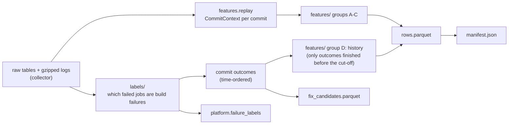

# Build expert

**In one sentence:** the Build and Code Quality expert. It turns stored CI history into a labelled dataset of commits that did or did not break the build (type errors, lint, formatting, bundling), trains and evaluates a model that predicts that risk before CI runs, serves it with reasons at `POST /predict`, and diagnoses failed jobs with the matching error lines and similar past fixes.

**Status:** working end to end on test data (dataset, training, `/predict` with risk factors, knowledge base, diagnosis worker); first run on the real collection pending · **Owner:** Member 2 · **Plan tasks:** P2.1, B1–B12 (see `docs/PLAN.md`)

## What it does

GitHub Actions runs a project's compiler, linter, formatter and bundler on every push and pull request. When one of them fails, the build is red even though the tests never ran. This expert will predict that risk before the run and explain it, and diagnose such failures afterwards.

To learn that, it needs examples. The dataset builder reads the CI runs the collector stored, decides for every failed job whether it was a build or code-quality failure (and which tool: `tsc`, ESLint, Prettier or a bundler), rebuilds what each commit changed, and writes one row per commit with 99 features and the labels. It also mines "fix candidates": a build failure followed by a green commit on the same branch, which will seed the knowledge base for diagnosis.

Training (`build-train`) reads a frozen dataset and answers the proposal's questions: does a LightGBM model beat the two simple baselines (H1), how long before CI ends does a correct warning come (H2), and which feature groups matter (H3). It writes a model bundle and a report with all the tables. A small helper (`build-label-check`) lets two people check a sample of the labels by hand and measures their agreement.

Serving: when `BUILD_MODEL_DIR` names a model bundle, `POST /predict` computes the same 99 features for the incoming commit (history from the dataset's `outcomes.parquet`, only before the commit's cut-off), returns the calibrated probability, the high-precision threshold and alert, sub-risks for `tsc`, `lint` and `bundler`, and up to five risk factors with plain-language reasons. Without a bundle the P2.1 stub answers, so the platform runs before a model exists.

Diagnosis: the worker reads the failed job's full log, runs the same parsers and rules as the dataset, and either answers `misrouted` (pointing to the dependency, test or infra expert) or fills `BuildDetails` with the tool and the error locations, cites the error lines, retrieves similar past failures and their fixes from the knowledge base (`build.kb_cases`, built from the mined fix candidates with `build-kb`), and writes the root cause and the fix steps. An LLM may rewrite that text through the team's gateway when `BUILD_LLM=on`; it may only cite retrieved cases.

`build-demo` runs both on real stored commits and failed jobs and writes `build_demo.md`, the evidence that the whole expert works.

The design (labels, features, model plan) is in `docs/experts/build.md`.

## How it works



1. **Read** the member's repos, the runs of build-relevant workflows, their jobs, steps and logs (`dataset/source.py`). Nothing calls GitHub.
2. **Parse each log once** (`parsing/`): remove timestamps and colour codes, split the log into steps, find the step GitHub marked as failed, and recognise tsc, ESLint, Prettier and bundler output with error codes and file locations. Also note signs of other causes (dependency errors, out of memory, test failures).
3. **Label each failed job** (`labels/rules.py`): a fixed list of rules, first match wins. Each decision names its rule and a confidence (high, medium, low). Claimed jobs become shared `FailureLabel`s.
4. **Group runs by commit**: one row per head SHA, using first attempts only. The cut-off is the earliest run's creation time.
5. **Rebuild the commit** with the shared replay builder and compute feature groups A (code change), B (build-tool config) and C (CI environment).
6. **Add history** (group D) from the outcomes of earlier commits, counting each only from the moment its runs finished.
7. **Write** `rows.parquet`, `fix_candidates.parquet`, `job_decisions.parquet` (every failed job the rules looked at) and `manifest.json` (with checksums) to `data/datasets/build/<version>/`, and store the job labels.

Training (`model/`), step by step:

1. **Load** `rows.parquet` (`model/data.py`). Fault-injected rows are left out; missing values stay missing (LightGBM handles them).
2. **Split by time** (`model/splits.py`): the oldest 70% of commits train, the next 15% validate, the newest 15% test. A commit whose CI finished after the next part began is dropped (its label was still unknown then).
3. **Baselines** (`model/baselines.py`): "same as the last build on this branch", and "the last run printed a TypeScript error or at least *t* ESLint warnings" (*t* chosen on validation).
4. **Model** (`model/train.py`): LightGBM with a class weight for the imbalance. The number of trees is chosen by time-ordered cross-validation inside the train part (3 expanding windows), because one small validation part alone made it noisy. Calibrated on validation (isotonic), with two thresholds: best F1 (for comparing with the baselines) and high precision (D03, the operating point). The main model is trained with 5 seeds and the report gives mean ± sd, so a lucky or unlucky run shows; the first seed's model is exported.
5. **Evaluate** (`model/evaluate.py`): test metrics per target and per repo, lead time of correct warnings, SHAP top factors, retraining without each feature group, and leave-one-repo-out.
6. **Export** (`model/export.py`): `models/build/<version>/` with one folder per target (`model.txt`, `calibrator.json`, `model.json`), `metrics.json` and `report.md`. Versions are frozen.

## How to run it

```bash
# 1. Check the repos with your own token (writes data/reports/build_screen-<date>.md)
uv run --env-file .env python scripts/build_screen.py

# 2. Collect: pass 1 (everything except passing-job logs), then daily top-ups
uv run --env-file .env collector backfill --member build --logs failed
uv run --env-file .env collector daily --member build --logs failed
uv run --env-file .env collector fill-logs --member build --limit 5000   # optional, when there is time

# 3. Build a frozen dataset from what is stored
uv run --env-file .env build-dataset --version v1

# 4. Train and evaluate (no database needed): writes models/build/m1/report.md
uv run build-train --dataset v1 --version m1

# 5. Knowledge base and real examples (predictions + diagnoses) -> models/build/m1/build_demo.md
uv run --env-file .env build-kb --dataset v1
uv run --env-file .env build-demo --dataset v1 --model models/build/m1

# 6. Serve the model
BUILD_MODEL_DIR=models/build/m1 uv run --env-file .env uvicorn build_expert.api:app --port 8102

# 7. Manual label check: a blind sheet for two people, then the agreement
uv run build-label-check sample --dataset v1
uv run build-label-check score --key data/datasets/build/v1/label_check_key.csv \
  --sheet personA.csv --sheet personB.csv

# this expert's tests only
uv run pytest experts/build/tests
```

**Expected** (step 3): one summary line and the output folder. On the test scenario (`tests/build_scenario.py` seeded into Postgres) it prints `build/demo: 9 commits (4 with a build failure), 1 fix candidates, 5 job labels stored; skipped: all_runs_cancelled=1, run_not_completed=1`. Running it again with the same version stops with "already exists; datasets are frozen".

## Inputs and outputs

| | What | Where / format |
|---|---|---|
| In | Runs, jobs, steps, commits, changed files, config snapshots | `raw` schema (Postgres) |
| In | Sanitised job logs | `DATA_DIR/logs/…/<job_id>.log.gz` |
| Out | One row per commit: ids, labels, 99 features | `data/datasets/build/<version>/rows.parquet` |
| Out | Mined fix cases | `…/fix_candidates.parquet` |
| Out | Every failed job the rules looked at: decision, rule, sub-label, error excerpt, GitHub link | `…/job_decisions.parquet` |
| Out | Each commit's known outcome (for history features when serving) | `…/outcomes.parquet` |
| Out | What was built, counts, versions, checksums | `…/manifest.json` |
| Out | Model bundle, `metrics.json`, `report.md` | `models/build/<version>/` |
| Out | Label check sheet and key | `…/label_check_sheet.csv`, `…/label_check_key.csv` |
| Out | `RiskOutput` per commit (`POST /predict`); `Diagnosis` per routed failure (worker) | HTTP JSON; posted to `${BACKEND_URL}/diagnoses` |
| Out | Knowledge base of past fixes | `build.kb_cases` (Postgres, pgvector) |
| Out | Real examples for the evidence pack | `models/build/<version>/build_demo.md` and `.json` |
| Out | Job labels (`category="build"`, `is_final=false`) | `platform.failure_labels` |

## Settings

| Setting | Where | Default | What it changes |
|---|---|---|---|
| `--version` | CLI | required | Output folder; an existing one is never overwritten |
| `--from`, `--to` | CLI | all stored runs | Window of commits written (90 days before `--from` are still read for history) |
| `--repo` | CLI | all enabled build repos | Limit to some repos |
| `--no-write-labels` | CLI | labels are written | Skip storing `FailureLabel`s |
| `DATABASE_URL`, `DATA_DIR` | `.env` | `<checkout>/data` | Where raw data and logs are read |
| Repo list | `config/repos/build.yaml` | | Which repos the collector covers |
| Training settings | `config/build_model.yaml` | 70/15/15 split, embargo on, precision 0.80 | Split, targets, threshold, leave-one-repo-out minimum, ablation groups, LightGBM parameters |
| `--no-loro`, `--no-ablation`, `--no-sub-targets` | `build-train` | all run | Skip parts of the evaluation (faster) |
| `BUILD_MODEL_DIR` | `.env` | unset (stub) | Model bundle served by `/predict` |
| `BUILD_LLM`, `LLM_GATEWAY_URL` | `.env` | off | LLM rewrite of diagnosis text through the gateway |
| `EMBEDDING_PROVIDER` | `.env` | granite | `fake` uses the offline embedder for the knowledge base (no model download) |

## Example

A pull request adds `import { missingHelper } from './helpers'` to `src/api.ts` and turns on `"strict": true` in `tsconfig.json`. The `pnpm run typecheck` step fails with seven `error TS…` lines. The job is labelled `tsc`, rule `build_step_tool_error`, confidence high. The commit's row has `y_build=1`, `y_tsc=1`, `top_error_codes="TS6133,TS2322,TS2307,TS18048"`, `tsconfig_strictness_lines=1`, `imports_added=1`. Six hours later a commit on the same branch removes the import and passes: that pair becomes a fix candidate with `overlap_paths=["src/api.ts"]`. (This is the scenario in `tests/build_scenario.py`.)

## Limitations and known issues

- The log fixtures are real output of TypeScript 5, ESLint 9, Prettier 3, Vite 6, webpack 5, esbuild, Vitest 3 and npm, wrapped in GitHub Actions log framing by hand, plus two real CI logs from the first backfill (oxfmt; a repo-specific lint script). See `tests/fixtures/logs/README.md`.
- Repo-specific checks (for example prisma's `lint:framework-vocabulary`) match no known tool: they are labelled `build_other` (rule `build_step_no_signature`), and the diagnosis cites the script's own message lines.
- Biome, oxlint, stylelint, Rollup CLI and Next.js have patterns but no real fixture yet. Failures from those tools that the parsers miss still get `build_step_no_signature` when the step is a build step.
- History features only see commits inside the loaded data, so the first weeks of a collection have thin history.
- Rebuilding each commit by replay runs a few Postgres queries per commit; a large repo takes minutes. History for 15,000 commits in one repo took about 25 s in a timing test.
- `last_lint_warnings` / `last_type_errors` depend on which logs were fetched: with `--logs failed`, they only exist where a build job failed until `fill-logs` has fetched the passing logs.
- Line-level patch patterns stand in for a syntax tree (docs/experts/build.md section 4).
- History at serving time comes from the dataset the model was trained on (`outcomes.parquet`), so it is only as fresh as the last `build-dataset`; a repo not in it gets `status="degraded"`. A `build.commit_outcomes` table kept up to date by the daily sync is the next step.
- Knowledge-base cases are mined automatically and marked `reviewed: false`; PLAN B10 asks for a person to review them. By default only fixes that touched a file named in the errors are kept (`--all` keeps every candidate). Only cases of the same kind (tsc, eslint, format, bundler) are offered, and only when they share at least 30% of the distinctive words (error codes, rule ids, identifiers) with the failure; that share is the similarity shown. Only the fix commit's subject line is kept.
- The LLM gateway has only a mock provider (decision O5), so `BUILD_LLM` stays off and the diagnosis text is written from the parsed errors and the retrieved fixes.
- Serving and diagnosis `# DEFAULT:` choices: factors with a zero, "no" or missing value are not shown as reasons; confidence 0.9/0.7/0.5 from the rule's high/medium/low; at most 5 evidence lines, 20 locations and 3 cases; a failed install step counts as dependency, any other setup step as infra; the evidence for a declined job is the first problem line of the failed step.
- Training: the code-embedding variant (section 6) is not built yet. The exported model is the one trained on the train part only (not retrained on train + validation). With `--logs failed`, the warning-rule baseline is weak until `fill-logs` has run (the report says how many commits have warning counts).
- Training `# DEFAULT:` choices: class weight = negatives / positives; the operating threshold must catch at least `min_positives` (5) validation failures; leave-one-repo-out validates on the newest 20% of the other repos; models under `<checkout>/models/build`; top-factor templates show `N` for the value; a TypeScript error in the last run outranks any lint count in the warning rule; the label check samples first attempts only, 8 per claiming rule and 30 declined jobs, with 3 error locations (600 characters) per job.
- `# DEFAULT:` choices: `PARSER_VERSION = "1"`, `LABEL_RULES_VERSION = "1"` (bump when labels change); 7/30/90-day history windows; `MONOREPO_ROOTS` (folders whose second level is a package); 7-day fix window; 10 error locations per fix candidate; 90 days of history before `--from`; 5,000 ids per SQL batch; datasets under `<DATA_DIR>/datasets/build`.
- The dataset builder imports the features library (`features.replay`) directly to rebuild commits. Serving still receives `CommitContext` through the contract (decision D43).
- The stub defaults from P2.1 (port 8102, 0.5 threshold, 0.01–0.2 probabilities, Dockerfile versions) are listed in `experts/_template/README.md`.

## Facts

| Name | Value |
|---|---|
| Package | `build_expert` (in `src/build_expert/`) |
| Port | 8102 (`EXPERT_PORT`) |
| Queue | `diagnose:build` |
| Detail model | `BuildDetails` (`tool`: tsc, eslint, bundler, other) |
| Database schema | `build`: `kb_cases` (created by `build-kb`). Labels go to `platform.failure_labels` |
| `/predict` scope | Commit. One output per commit |
| Commands | `build-dataset`, `build-train`, `build-label-check`, `build-kb`, `build-demo` (see `[project.scripts]` in `pyproject.toml`) |

## Related

- `docs/experts/build.md`: the design (labels, features, dataset, model plan).
- `scripts/README.md`, section "Build screen": checking the repo list with a token.
- `services/collector/README.md`: collection, the two passes (`--logs failed`, `fill-logs`) and skipped runs.
- `services/features/README.md`: the replay builder used to rebuild commits.
- `experts/_template/README.md`: the stub API and worker this expert started from.
- `docs/PLAN.md`, tasks P2.1 and B1–B12.
