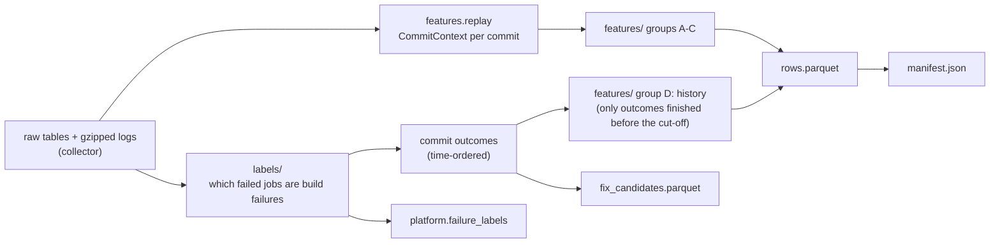

# Build expert

**In one sentence:** the Build and Code Quality expert. It turns stored CI history into a labelled dataset of commits that did or did not break the build (type errors, lint, formatting, bundling); its prediction API and diagnosis worker are still stubs.

**Status:** dataset pipeline working (labelling, features, dataset builder); `/predict` and the worker are stubs · **Owner:** Member 2 · **Plan tasks:** P2.1, B1–B6 (see `docs/PLAN.md`)

## What it does

GitHub Actions runs a project's compiler, linter, formatter and bundler on every push and pull request. When one of them fails, the build is red even though the tests never ran. This expert will predict that risk before the run and explain it, and diagnose such failures afterwards.

To learn that, it needs examples. The dataset builder reads the CI runs the collector stored, decides for every failed job whether it was a build or code-quality failure (and which tool: `tsc`, ESLint, Prettier or a bundler), rebuilds what each commit changed, and writes one row per commit with 99 features and the labels. It also mines "fix candidates": a build failure followed by a green commit on the same branch, which will seed the knowledge base for diagnosis.

The design (labels, features, model plan) is in `docs/experts/build.md`.

## How it works



1. **Read** the member's repos, the runs of build-relevant workflows, their jobs, steps and logs (`dataset/source.py`). Nothing calls GitHub.
2. **Parse each log once** (`parsing/`): remove timestamps and colour codes, split the log into steps, find the step GitHub marked as failed, and recognise tsc, ESLint, Prettier and bundler output with error codes and file locations. Also note signs of other causes (dependency errors, out of memory, test failures).
3. **Label each failed job** (`labels/rules.py`): a fixed list of rules, first match wins. Each decision names its rule and a confidence (high, medium, low). Claimed jobs become shared `FailureLabel`s.
4. **Group runs by commit**: one row per head SHA, using first attempts only. The cut-off is the earliest run's creation time.
5. **Rebuild the commit** with the shared replay builder and compute feature groups A (code change), B (build-tool config) and C (CI environment).
6. **Add history** (group D) from the outcomes of earlier commits, counting each only from the moment its runs finished.
7. **Write** `rows.parquet`, `fix_candidates.parquet` and `manifest.json` (with checksums) to `data/datasets/build/<version>/`, and store the job labels.

## How to run it

```bash
# 1. Check the repos with your own token (writes data/reports/build_screen-<date>.md)
uv run --env-file .env python scripts/build_screen.py

# 2. Collect: pass 1 (everything except passing-job logs), then daily top-ups
uv run --env-file .env collector backfill --member build --logs failed
uv run --env-file .env collector daily --member build --logs failed
uv run --env-file .env collector fill-logs --member build --limit 5000   # optional, when there is time

# 3. Build a frozen dataset from what is stored
uv run --env-file .env build-dataset --version v1

# this expert's tests only
uv run pytest experts/build/tests
```

**Expected** (step 3): one summary line and the output folder. On the test scenario (`tests/build_scenario.py` seeded into Postgres) it prints `build/demo: 9 commits (4 with a build failure), 1 fix candidates, 5 job labels stored; skipped: all_runs_cancelled=1, run_not_completed=1`. Running it again with the same version stops with "already exists; datasets are frozen".

## Inputs and outputs

| | What | Where / format |
|---|---|---|
| In | Runs, jobs, steps, commits, changed files, config snapshots | `raw` schema (Postgres) |
| In | Sanitised job logs | `DATA_DIR/logs/…/<job_id>.log.gz` |
| Out | One row per commit: ids, labels, 99 features | `data/datasets/build/<version>/rows.parquet` |
| Out | Mined fix cases | `…/fix_candidates.parquet` |
| Out | What was built, counts, versions, checksums | `…/manifest.json` |
| Out | Job labels (`category="build"`, `is_final=false`) | `platform.failure_labels` |

## Settings

| Setting | Where | Default | What it changes |
|---|---|---|---|
| `--version` | CLI | required | Output folder; an existing one is never overwritten |
| `--from`, `--to` | CLI | all stored runs | Window of commits written (90 days before `--from` are still read for history) |
| `--repo` | CLI | all enabled build repos | Limit to some repos |
| `--no-write-labels` | CLI | labels are written | Skip storing `FailureLabel`s |
| `DATABASE_URL`, `DATA_DIR` | `.env` | `<checkout>/data` | Where raw data and logs are read |
| Repo list | `config/repos/build.yaml` | | Which repos the collector covers |

## Example

A pull request adds `import { missingHelper } from './helpers'` to `src/api.ts` and turns on `"strict": true` in `tsconfig.json`. The `pnpm run typecheck` step fails with seven `error TS…` lines. The job is labelled `tsc`, rule `build_step_tool_error`, confidence high. The commit's row has `y_build=1`, `y_tsc=1`, `top_error_codes="TS6133,TS2322,TS2307,TS18048"`, `tsconfig_strictness_lines=1`, `imports_added=1`. Six hours later a commit on the same branch removes the import and passes: that pair becomes a fix candidate with `overlap_paths=["src/api.ts"]`. (This is the scenario in `tests/build_scenario.py`.)

## Limitations and known issues

- The log fixtures are real output of TypeScript 5, ESLint 9, Prettier 3, Vite 6, webpack 5, esbuild, Vitest 3 and npm, wrapped in GitHub Actions log framing by hand (see `tests/fixtures/logs/README.md`). Add sanitised logs from the first backfill.
- Biome, oxlint, stylelint, Rollup CLI and Next.js have patterns but no real fixture yet. Failures from those tools that the parsers miss still get `build_step_no_signature` when the step is a build step.
- History features only see commits inside the loaded data, so the first weeks of a collection have thin history.
- Rebuilding each commit by replay runs a few Postgres queries per commit; a large repo takes minutes. History for 15,000 commits in one repo took about 25 s in a timing test.
- `last_lint_warnings` / `last_type_errors` depend on which logs were fetched: with `--logs failed`, they only exist where a build job failed until `fill-logs` has fetched the passing logs.
- Line-level patch patterns stand in for a syntax tree (docs/experts/build.md section 4).
- `/predict` and the diagnose worker are still the P2.1 stubs.
- `# DEFAULT:` choices: `PARSER_VERSION = "1"`, `LABEL_RULES_VERSION = "1"` (bump when labels change); 7/30/90-day history windows; `MONOREPO_ROOTS` (folders whose second level is a package); 7-day fix window; 10 error locations per fix candidate; 90 days of history before `--from`; 5,000 ids per SQL batch; datasets under `<DATA_DIR>/datasets/build`.
- The dataset builder imports the features library (`features.replay`) directly to rebuild commits. Serving still receives `CommitContext` through the contract (decision D43).
- The stub defaults from P2.1 (port 8102, 0.5 threshold, 0.01–0.2 probabilities, Dockerfile versions) are listed in `experts/_template/README.md`.

## Facts

| Name | Value |
|---|---|
| Package | `build_expert` (in `src/build_expert/`) |
| Port | 8102 (`EXPERT_PORT`) |
| Queue | `diagnose:build` |
| Detail model | `BuildDetails` (`tool`: tsc, eslint, bundler, other) |
| Database schema | `build`. No tables yet (labels go to `platform.failure_labels`) |
| `/predict` scope | Commit. One output per commit |
| Command | `build-dataset` (`build_expert.dataset.cli:main`) |

## Related

- `docs/experts/build.md`: the design (labels, features, dataset, model plan).
- `scripts/README.md`, section "Build screen": checking the repo list with a token.
- `services/collector/README.md`: collection, the two passes (`--logs failed`, `fill-logs`) and skipped runs.
- `services/features/README.md`: the replay builder used to rebuild commits.
- `experts/_template/README.md`: the stub API and worker this expert started from.
- `docs/PLAN.md`, tasks P2.1 and B1–B12.
