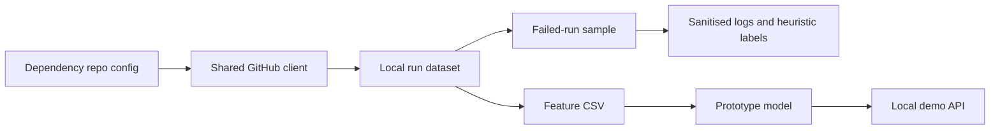

# Dependency prediction experiment

**In one sentence:** This folder holds Member 1's early data and model experiment; it is not
the production Dependency expert.

**Status:** Experimental · **Owner:** Member 1 · **Plan task:** P4.13

## What it does

The experiment collects recent workflow runs from the repositories in
`config/repos/dependency.yaml`, records dependency-file changes, converts those records into a
small CSV, and trains a baseline model. The dataset and model are generated files, so they live
under the ignored `data/` and `models/` folders and are not committed.

The official expert endpoint remains the contract-based stub. The stand-alone API in this
folder accepts a different input and returns a different response; it is for local experiments
only.

## How it works

1. The extractor uses the configured Dependency repositories and shared GitHub client.
2. The extractor stores only runs that changed a dependency manifest or lockfile in the JSON
   dataset, then automatically refreshes the matching feature CSV.
3. The sample labeler selects failed runs, fetches their failed-job logs, sanitises each log, and
   records heuristic matches without saving log text.
4. The trainer reads the filtered feature CSV, compares simple Logistic Regression and XGBoost
   baselines, and saves a local model.
5. The optional stand-alone API demonstrates that model, separately from the expert service.



## How to run it

Choose repositories from `config/dependency_repository_groups.yaml` with `--group`, specify a
repository directly with `--repo`, or fill in `config/repos/dependency.yaml` and use that
curated list. The groups are research candidates, not an approved or automatically enabled
collection list. Do not put a token in either config file or in source code; provide
`GITHUB_TOKEN` through the private `.env`.

```bash
uv run --env-file .env --package pipelineiq-expert-dependency python -m dependency_expert.prototype_dataset --group backend_frameworks
# Collect just one newly selected repository:
uv run --env-file .env --package pipelineiq-expert-dependency python -m dependency_expert.prototype_dataset --repo expressjs/express
# Add more repositories by repeating --repo:
uv run --env-file .env --package pipelineiq-expert-dependency python -m dependency_expert.prototype_dataset --repo expressjs/express --repo nestjs/nest
# Optional: rebuild the feature CSV from the JSON without calling GitHub:
uv run --package pipelineiq-expert-dependency python -m dependency_expert.features.prototype
uv run --package pipelineiq-expert-dependency --extra prototype python experts/dependency/research/prototype/model_trainer.py
# Fetch and label a reproducible sample of 50 failed runs:
uv run --env-file .env --package pipelineiq-expert-dependency python experts/dependency/research/prototype/sample_and_label.py
```

The labeler uses the shared rate-limited GitHub client and reads `GITHUB_TOKEN` from `.env`.
It writes `data/datasets/dependency/labeled_sample_50.json`. Adjust `--sample-size`, `--seed`,
`--dataset`, or `--output` to change the sample or paths. It never saves log text.

Use `python -m dependency_expert.prototype_dataset --help` to see all options, or `--group` with
one of `backend_frameworks`, `frontend_and_build_tools`, `database_and_orms`,
`utils_and_testing`, `personal_and_misc`, `New_one`, or `top_nodejs_repos`. You can also add
the repo to `config/repos/dependency.yaml` and run the extractor without `--group` or `--repo`.
The extractor appends only unseen repository/run/attempt records to the existing JSON dataset,
so new records join existing data instead of replacing it. After each collection, it
automatically refreshes these ignored local files:

- `dependency_runs_dataset.json`: only runs with at least one changed dependency file.
- `dependency_features.csv`: features from those same runs; the trainer uses this CSV by
  default.

Running the feature command manually rebuilds the CSV from the existing JSON; it does not
contact GitHub. The extractor needs enabled repositories in the config. The trainer needs
enough records and both outcome labels in its training subset.

To start the separate demo API after training:

```bash
uv run --package pipelineiq-expert-dependency --extra prototype python experts/dependency/research/prototype/app.py
```

It listens on localhost port 5000. It does not implement the expert contract.

## Inputs and outputs

| | What | Where / format |
|---|---|---|
| In | Repositories and workflow history | `config/repos/dependency.yaml`, GitHub API |
| In | Workflow outcome and changed dependency files | Local JSON, filtered to dependency-change runs |
| In | Failed-job logs | GitHub Actions API, sanitised in memory |
| Out | Dependency-change run records | `data/datasets/dependency/prototype/dependency_runs_dataset.json` |
| Out | Experimental feature rows | `data/datasets/dependency/prototype/dependency_features.csv` |
| Out | Sample heuristic labels and safe pattern IDs | `data/datasets/dependency/labeled_sample_50.json` |
| Out | Trained baseline | `models/dependency/prototype/xgboost_model.pkl` |

## Settings

| Setting | Where | Default | What it changes |
|---|---|---|---|
| GitHub token | `.env` as `GITHUB_TOKEN` | None | Authenticates the shared GitHub client |
| Collection window | CLI `--days` | 90 days | Limits runs fetched by the prototype |
| Label sample | CLI `--sample-size`, `--seed` | 50, 42 | Selects a reproducible number of failed runs |
| Dataset/model paths | CLI options or module defaults | Ignored local folders | Selects local inputs and outputs |

## Example

A run that changed `package.json` and `package-lock.json` becomes one feature row with
`has_package_json_change=1` and `has_lockfile_change=1`. Its label is based on the workflow
conclusion, not on a verified root cause.

## Limitations and known issues

- This is not a production model, and its labels do not prove that a dependency change caused a
  workflow failure.
- Keeping only dependency-file changes selects relevant candidate runs; it does not prove that
  a failure was caused by the dependency change.
- The sample labeler's regex matches are heuristic candidates, not verified root causes. A run
  with no known pattern is marked `no_dependency_pattern_match`, not proven to be unrelated;
  unavailable or incomplete logs are marked `undetermined`. Review labels manually before using
  them as ground truth.
- The sample labeler sanitises logs before inspecting them and stores neither log text nor matched
  text excerpts. GitHub API access may be rate-limited, and expired or inaccessible logs remain
  undetermined.
- The small feature set, repository sampling and current validation do not establish model
  quality. Treat training metrics as exploratory only.
- The old local JSON/CSV/model files are ignored artifacts. Review and sanitize data before
  sharing it; do not commit these generated files.
- The demo API uses a standalone request/response shape and is not connected to backend fan-out,
  the pre-push hook, or the expert's contract endpoint.
- `# DEFAULT:` the prototype looks back 90 days, matching the collection window in
  `docs/DATA.md`.

## Related

- [Dependency expert](../README.md)
- [Dependency expert design](../../../docs/experts/dependency.md)
- [Plan](../../../docs/PLAN.md), task P4.13
