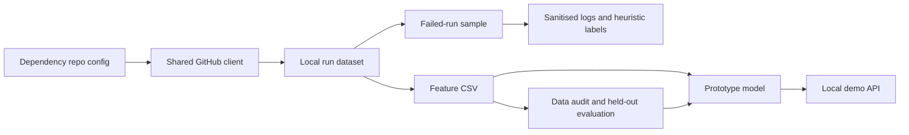

# Dependency prediction experiment

**In one sentence:** This folder holds Member 1's early data and model experiment; it is not
the production Dependency expert.

**Status:** Experimental · **Owner:** Member 1 · **Plan task:** P4.13

## What it does

The experiment collects recent workflow runs from the repositories in
`config/repos/dependency.yaml`, records dependency-file changes, converts those records into a
small CSV, and trains a baseline model. The dataset and model are generated files, so they live
under the ignored `data/` and `models/` folders and are not committed.

The official expert endpoint remains the contract-based stub. The stand-alone API in this
folder accepts a different input and returns a different response; it is for local experiments
only.

## How it works

1. The extractor uses the configured Dependency repositories and shared GitHub client.
2. The extractor stores only runs that changed a dependency manifest or lockfile in the JSON
   dataset, then automatically refreshes the matching feature CSV.
3. The sample labeler selects failed runs, fetches their failed-job logs, sanitises each log, and
   records heuristic matches without saving log text.
4. The label auditor merges final manual run labels with features by repository, run ID, and
   attempt; duplicate labels and conflicts are reported separately.
5. The evaluator audits the CSV and compares a majority baseline with Logistic Regression while
   holding out entire repositories.
6. The trainer reads the filtered feature CSV, compares simple Logistic Regression and XGBoost
   baselines, and saves a local model.
7. The optional stand-alone API demonstrates that model, separately from the expert service.



## How to run it

Choose repositories from `config/dependency_repository_groups.yaml` with `--group`, specify a
repository directly with `--repo`, or fill in `config/repos/dependency.yaml` and use that
curated list. The groups are research candidates, not an approved or automatically enabled
collection list. Do not put a token in either config file or in source code; provide
`GITHUB_TOKEN` through the private `.env`.

```bash
uv run --env-file .env --package pipelineiq-expert-dependency python -m dependency_expert.prototype_dataset --group backend_frameworks
# Collect just one newly selected repository:
uv run --env-file .env --package pipelineiq-expert-dependency python -m dependency_expert.prototype_dataset --repo expressjs/express
# Add more repositories by repeating --repo:
uv run --env-file .env --package pipelineiq-expert-dependency python -m dependency_expert.prototype_dataset --repo expressjs/express --repo nestjs/nest
# Optional: rebuild the feature CSV from the JSON without calling GitHub:
uv run --package pipelineiq-expert-dependency python -m dependency_expert.features.prototype
# Merge final labels with matching features and write audit/training CSVs:
uv run --package pipelineiq-expert-dependency python experts/dependency/research/prototype/prepare_master_dataset.py
uv run --package pipelineiq-expert-dependency --extra prototype python experts/dependency/research/prototype/evaluate_dataset.py
# Extract sanitized-log features for reviewed master records (writes only flags/status, no log text):
uv run --env-file .env --package pipelineiq-expert-dependency python -m experts.dependency.research.prototype.extract_log_features
# Evaluate reviewed dependency_failure vs other_failure labels, holding out whole repositories:
uv run --package pipelineiq-expert-dependency --extra prototype python -m experts.dependency.research.prototype.evaluate_verified_model
.venv/Scripts/python.exe experts/dependency/research/prototype/train_log_only_model.py
# Audit sanitized log patterns behind XGBoost false negatives (prints snippets, saves no logs):
uv run --env-file .env --package pipelineiq-expert-dependency python -m experts.dependency.research.prototype.analyze_false_negative_logs
uv run --package pipelineiq-expert-dependency --extra prototype python experts/dependency/research/prototype/model_trainer.py
# Fetch and label a reproducible sample of 50 failed runs:
uv run --env-file .env --package pipelineiq-expert-dependency python experts/dependency/research/prototype/sample_and_label.py
```

The labeler uses the shared rate-limited GitHub client and reads `GITHUB_TOKEN` from `.env`.
It writes `data/datasets/dependency/labeled_sample_50.json`. Adjust `--sample-size`, `--seed`,
`--dataset`, or `--output` to change the sample or paths. It never saves log text.

To make a first, bounded scan for possible dependency errors, run:

```bash
uv run --env-file .env --package pipelineiq-expert-dependency python experts/dependency/research/prototype/sample_and_label.py --mode candidates --scan-limit 100 --seed 42
```

This checks at most 100 failed runs, with only one run per repository and commit. Runs are
chosen reproducibly and spread across repositories where possible. The default output is
`data/datasets/dependency/labeled_candidate_batch_100.json`; it contains only runs whose
sanitised logs match a known package-manager error pattern, plus the safe pattern IDs and job
links. Commits already scanned in another candidate batch are skipped, including commits whose
logs did not match a dependency pattern; commits with final labels in nearby sample or candidate
batch files are skipped too. Each output records every scanned repository/commit pair so later
batches can avoid repeating those API requests. When upgrading the original batch file, add its
recorded scan history before running another batch; legacy candidate outputs without scan history
can only exclude the commits present in their candidate records.
A scan of 100 runs may produce fewer than 100 candidates, or none. A match is only a
lead for manual review: it is not a verified `dependency_failure`. The scan makes GitHub API
requests for jobs and logs, so rate limits or unavailable logs can affect the result. Raw logs
and matching text are never saved.

To create a second batch in a separate file:

```bash
uv run --env-file .env --package pipelineiq-expert-dependency python experts/dependency/research/prototype/sample_and_label.py --mode candidates --scan-limit 100 --seed 42 --output data/datasets/dependency/candidates_batch_2.json
```

The second scan excludes all recorded commit keys from other candidate batch files and all
manually reviewed commits found in sample and candidate files. It still selects at most 100 new
distinct commits; the number of matching candidates may be lower.

To draw a random control sample from failed runs whose complete failed-job logs do not match any
known dependency pattern, run:

```bash
uv run --env-file .env --package pipelineiq-expert-dependency python -m experts.dependency.research.prototype.sample_and_label --mode controls --sample-size 50 --scan-limit 100 --seed 42 --output data/datasets/dependency/random_control_batch_50.json
```

The scanner selects distinct commits reproducibly, checks at most 100 per invocation, and saves
up to 50 controls. A run is included only when every failed-job log for the selected attempt was
fetched, sanitised, and had zero known dependency-pattern matches. Runs with a match or unavailable
logs are not controls; they are not silently classified as `other_failure`. The output includes
safe run/job metadata, job links, and all repository/commit keys actually scanned, but no log
text. It excludes commits already scanned in candidate/control batches and commits with final
labels in the review files. All controls remain unverified for manual review; the scan can return
fewer than 50 if there are not enough eligible runs or complete zero-match logs within the cap.
The command logs each repository and run ID before requesting its jobs and logs. A GitHub request
failure is recorded without log contents, and that run is skipped rather than labeled; the scan
continues with the next run. Control-mode requests use a 15-second timeout and no retry so a
single unavailable run does not incur the general client's multi-retry delay. Output is checkpointed
as valid JSON after each scan, including when Ctrl+C interrupts it or another error escapes. Check
`scan_status` before using the output:
`complete`, `complete_with_errors`, `interrupted`, or `incomplete`. Runs attempted before an
interruption or request error are recorded in `scanned_commits` so later batches do not repeat
them. The 15-second/zero-retry setting is a scanner default; adjust it only if the research team
agrees that slower requests are preferable to skipping transient failures.
Job logs larger than the default 5 MiB are marked `too_large` and are not sanitised or pattern
matched; a run with such a log cannot qualify as a control. The shared client streams limited
responses and stops reading when the content length or received bytes exceed the cap. The
dependency-error patterns used for matching are simple literal/character-class expressions; the
scan pause alone does not prove catastrophic regex backtracking.

## Failure-labeling policy

Use the same evidence-based rules for every manually reviewed run and job. Dataset label values
are lowercase: `dependency_failure`, `other_failure`, and `uncertain`.

### `dependency_failure`

Choose this when the log explicitly ties the failure to package-manager setup, dependency
installation, lockfile consistency, package resolution, or a required package/module that cannot
be found. Examples include:

- An error during `npm install`, `npm ci`, `pnpm install`, or `yarn install`.
- Lockfile or resolution errors such as `ERR_PNPM_OUTDATED_LOCKFILE`, `ERESOLVE`, `ETARGET`,
  `EALLOWGIT`, or `ERR_PNPM_IGNORED_BUILDS`.
- A required package/module missing during type-check, build, or test, such as `TS2307`,
  `MODULE_NOT_FOUND`, or `Cannot find module`.

The error must identify a dependency or package problem; a generic network failure or a failed
workflow is not enough by itself.

### `other_failure`

Choose this when the log gives a clear cause unrelated to dependency setup or resolution, for
example:

- A unit, integration, or end-to-end test assertion failure, or a coverage threshold failure.
- A type-checking or code error other than a missing package/module.
- A syntax or runtime incompatibility.
- An external API, DNS, or network service failure.
- A repository policy, pull-request rule, or custom check failure.

### `uncertain`

Choose this when the available evidence does not support a reliable cause, including:

- Logs are truncated or unavailable and the error details cannot be recovered.
- Only a generic exit code is visible.
- The log shows multiple conflicting causes and the relevant failure cannot be isolated.

Do not infer `dependency_failure` solely from a failed workflow, a dependency-file change, or a
heuristic pattern match. Save the selected label, a short reason grounded in the log, reviewer
(`labelled_by="manual"`), and final status (`is_final=true`). These rules make review consistent
and auditable; labels are human judgments from available log evidence, not proof by themselves
that a dependency change caused the failure.

Use `python -m dependency_expert.prototype_dataset --help` to see all options, or `--group` with
one of `backend_frameworks`, `frontend_and_build_tools`, `database_and_orms`,
`utils_and_testing`, `personal_and_misc`, `New_one`, or `top_nodejs_repos`. You can also add
the repo to `config/repos/dependency.yaml` and run the extractor without `--group` or `--repo`.
The extractor appends only unseen repository/run/attempt records to the existing JSON dataset,
so new records join existing data instead of replacing it. After each collection, it
automatically refreshes these ignored local files:

- `dependency_runs_dataset.json`: only runs with at least one changed dependency file.
- `dependency_features.csv`: features from those same runs; the trainer uses this CSV by
  default.

The feature CSV includes the workflow `attempt` as part of its run identity. Older source rows
without that field are exported with attempt `1` (`# DEFAULT:`); this preserves the prior
single-attempt data shape but does not recover historical rerun attempts absent from the source.
Regenerate the feature CSV before running the label audit so it has the current schema.

The label audit reads final run-level labels from `labeled_*.json`, candidate batch JSON files,
and random control JSON files. For random-control files, only final labels in the `controls` list
are loaded; pending controls remain unreviewed and are ignored.
It preserves every final labeled source row in `audit_full_records.csv`, including duplicate
source entries and labels excluded from training. It writes conflicting composite keys to
`audit_label_conflicts.csv` and excludes those keys from the training table rather than choosing
a label silently. `master_training_table.csv` contains one feature-matched row per consistent
`dependency_failure` or `other_failure` key; `uncertain`, `mixed_failure_causes`, and unknown
labels remain in the audit but are not used for training. Matching uses
`(repository, run_id, attempt)`. Unmatched labels are reported and omitted from the training
table. Source JSON files are never modified. The random control scan is a separate operation; it
does not modify the audit or training table and its unlabeled records are not automatically
treated as negative examples.

Running the feature command manually rebuilds the CSV from the existing JSON; it does not
contact GitHub. The extractor needs enabled repositories in the config. The trainer needs
enough records and both outcome labels in its training subset.

The evaluator reads the CSV, rejects malformed rows and conflicting duplicate run IDs, removes
identical duplicates from the analysis, and writes
`data/datasets/dependency/prototype/evaluation_report.json`. Its split holds out whole repositories
so runs from the same repository do not appear in both training and test data. The report
compares a majority-class baseline with Logistic Regression using accuracy, balanced accuracy,
precision, recall, F1 and ROC-AUC where applicable. `--seed` and `--test-size` can be set to
repeat or adjust the split.

The `extract_log_features.py` command fetches the recorded failed-job logs for each binary master
row, sanitizes each log in memory, and records fourteen boolean indicators plus fetch-completeness
metadata. Raw or sanitized log text is never written. It produces
`log_derived_features.csv` and `master_training_table_with_log_features.csv`. Rows with any
unavailable or oversized failed-job log are marked incomplete; the verified-label evaluator
excludes those rows rather than treating unavailable evidence as a negative feature. On reruns,
complete rows and incomplete rows without transport failures are reused. Incomplete transport
requests are retried up to two additional times with backoff; HTTP failures such as 410 and
oversized logs remain incomplete. Pass `--refresh` after changing regex rules to recompute every
record from the logs instead of reusing completed feature rows.

The separate `evaluate_verified_model.py` evaluates `verified_label`
(`dependency_failure` vs `other_failure`) using five-fold `GroupKFold` by repository. It compares
a fold-fitted majority dummy with Logistic Regression and a small XGBoost baseline. Model inputs
are explicitly limited to structured dependency-file and sanitized-log indicators; `verified_reason`
and raw log text are excluded. The report is written to
`data/datasets/dependency/evaluation_report_verified.json`. It also writes out-of-fold errors from
the best-accuracy model to `data/datasets/dependency/misclassified_records_best_model.csv` for
manual inspection. Treat metrics as exploratory given the small manually labeled sample; this
evaluation does not establish that dependency changes caused the failures or show production
performance. The report includes a same-fold ablation with `has_package_manager_cache_miss`
removed, to show whether that potentially noisy signal helps either model. Cache misses are kept in
the extracted audit table but excluded from model inputs because they represent ordinary CI cache
restores and the ablation showed no metric change.

`analyze_false_negative_logs.py` cross-references the best model's out-of-fold false negatives with
their failed-job IDs, sanitizes fetched logs in memory, and prints candidate diagnostic patterns.
It does not persist log text or excerpts.

To start the separate demo API after training:

```bash
uv run --package pipelineiq-expert-dependency --extra prototype python experts/dependency/research/prototype/app.py
```

It listens on localhost port 5000. It does not implement the expert contract.

## Inputs and outputs

| | What | Where / format |
|---|---|---|
| In | Repositories and workflow history | `config/repos/dependency.yaml`, GitHub API |
| In | Workflow outcome and changed dependency files | Local JSON, filtered to dependency-change runs |
| In | Failed-job logs | GitHub Actions API, sanitised in memory |
| Out | Dependency-change run records | `data/datasets/dependency/prototype/dependency_runs_dataset.json` |
| Out | Experimental feature rows | `data/datasets/dependency/prototype/dependency_features.csv` |
| Out | Data quality and held-out evaluation report | `data/datasets/dependency/prototype/evaluation_report.json` |
| Out | Sample heuristic labels and safe pattern IDs | `data/datasets/dependency/labeled_sample_50.json` |
| Out | Sanitised-log heuristic candidates for manual review | `data/datasets/dependency/labeled_candidate_batch_100.json` |
| Out | Trained baseline | `models/dependency/prototype/xgboost_model.pkl` |

## Settings

| Setting | Where | Default | What it changes |
|---|---|---|---|
| GitHub token | `.env` as `GITHUB_TOKEN` | None | Authenticates the shared GitHub client |
| Collection window | CLI `--days` | 90 days | Limits runs fetched by the prototype |
| Label sample | CLI `--sample-size`, `--seed` | 50, 42 | Selects a reproducible number of failed runs |
| Dataset/model paths | CLI options or module defaults | Ignored local folders | Selects local inputs and outputs |

## Example

A run that changed `package.json` and `package-lock.json` becomes one feature row with
`has_package_json_change=1` and `has_lockfile_change=1`. Its label is based on the workflow
conclusion, not on a verified root cause.

## Limitations and known issues

- This is not a production model, and its labels do not prove that a dependency change caused a
  workflow failure.
- Keeping only dependency-file changes selects relevant candidate runs; it does not prove that
  a failure was caused by the dependency change.
- The sample labeler's regex matches are heuristic candidates, not verified root causes. A run
  with no known pattern is marked `no_dependency_pattern_match`, not proven to be unrelated;
  unavailable or incomplete logs are marked `undetermined`. Review labels manually before using
  them as ground truth.
- The sample labeler sanitises logs before inspecting them and stores neither log text nor matched
  text excerpts. GitHub API access may be rate-limited, and expired or inaccessible logs remain
  undetermined.
- The small feature set, repository sampling and current validation do not establish model
  quality. Treat training metrics as exploratory only.
- The evaluator's target is whether a workflow failed, not whether a dependency change caused
  that failure. Its repository-held-out metrics are a basic baseline check, not production
  validation or causal evidence.
- The old local JSON/CSV/model files are ignored artifacts. Review and sanitize data before
  sharing it; do not commit these generated files.
- The demo API uses a standalone request/response shape and is not connected to backend fan-out,
  the pre-push hook, or the expert's contract endpoint.
- `# DEFAULT:` the prototype looks back 90 days, matching the collection window in
  `docs/DATA.md`.

## Related

- [Dependency expert](../README.md)
- [Dependency expert design](../../../docs/experts/dependency.md)
- [Plan](../../../docs/PLAN.md), task P4.13
