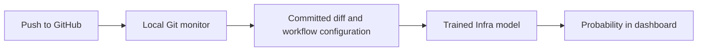

# Connect a repository and see Infra predictions

Connect one GitHub repository branch in the dashboard. The local monitor checks Git every five
seconds. It sends each newly observed revision to the saved
`src/infra_expert/model/infra-v4-no-history.joblib` model. No training happens during a push.



## Run on Windows

1. Start the Infra API in PowerShell and leave the terminal running:

   ```powershell
   Set-Location "C:\Users\prasa\Documents\Research\FInal\Final_Research"
   & .\.venv\Scripts\python.exe -m uvicorn infra_expert.api:app --host 127.0.0.1 --port 8104
   ```

2. Start the prediction dashboard in another terminal:

   ```powershell
   Set-Location "C:\Users\prasa\Documents\Research\FInal\Final_Research\services\dashboard"
   npm run dev
   ```

3. Open the localhost URL printed by Vite, usually `http://127.0.0.1:5173`. If the port is busy,
   Vite prints another port. This is the prediction dashboard; the separate React test project's
   own page does not display predictions.

4. Enter `https://github.com/OWNER/REPOSITORY`, select its existing branch, and click
   **Connect repository**. Public repositories need no token. Private repositories use Git's
   existing credentials on this computer, just as `git fetch` does. SSH URLs such as
   `git@github.com:OWNER/REPOSITORY.git` work too. Do not paste a token in the URL.

5. The first result is labelled **Initial branch snapshot**. It analyzes the current repository
   state. When the connection is ready, edit and commit in your normal project, then push:

   ```powershell
   git add <the-file-you-edited>
   git commit -m "Test infrastructure prediction"
   git push origin <the-connected-branch>
   ```

6. Within about five seconds plus fetch and prediction time, the dashboard displays
   **Remote branch update detected**, the SHA, changed-file count, probability and model version.
   Compare the SHA with `git rev-parse HEAD`. Pushes from other computers also work. Recent
   predictions appear below the form. Manual scenarios do not create live push events.

7. **Disconnect** stops monitoring. Connecting another repository stops the previous monitor.
   API shutdown also stops the monitor. After restarting the API, connect again.

## How the result is produced

The monitor reads Git objects in a separate bare cache under `data/infra-monitor/`; it never
executes the target project's scripts. All current workflow files are included, even if only
application code changed. Config snapshots are sanitised before sending to the API. Files larger
than the 200,000-character snapshot limit produce an error instead of a partial prediction.
The first connection includes the full tree. Later updates compare against the last revision
successfully delivered to the model. Failed deliveries are retried.

The number is the model's estimated probability of infrastructure failure, not the actual GitHub
Actions result. This artifact has failed unseen-repository validation; a low score can accompany
a real failure. The system preserves its learned score and threshold rather than forcing a high
number for deliberately broken configuration. RAG and LLM diagnosis are not involved.

Polling observes branch tips, not individual GitHub push events. Multiple pushes between checks
are combined into one diff. Deleted branches produce a connection error. Force pushes compare
against the previously observed tip. CI may begin before the prediction appears because remote
monitoring occurs after GitHub receives the push. Use the optional pre-push hook for earlier feedback.

Defaults: five-second Git polling, 1.5-second dashboard refresh, editable branch `main`, port 8104,
and 50 recent predictions kept in memory. API restart clears prediction history. The monitor
checkpoints successful revisions on disk and republishes its latest revision on reconnect.
This feature runs as a single-user local system with one API worker bound to `127.0.0.1`.
It requires Git and the workspace checkout; the connection manager is not available in the
standalone expert Docker image. It does not complete the team's GitHub App or webhook tasks.

## Optional pre-push hook

Install or refresh the hook in the repository whose pushes should be analyzed:

```powershell
Set-Location "C:\Users\prasa\Documents\Research\FInal\Final_Research"
& .\.venv\Scripts\python.exe scripts\install_infra_demo_hook.py "C:\path\to\your\project"
```

The hook uses `/monitor/predict` and lets Git continue if prediction fails. Refresh old hooks
pointing to `/predict` with this command. Running both modes can produce two labelled results
for a SHA: local pre-push and remote push.

## Command-line monitor

For troubleshooting, run with a GitHub URL or a local Git remote:

```powershell
& .\.venv\Scripts\python.exe scripts\infra_monitor.py --repo "https://github.com/OWNER/REPOSITORY.git" --branch main
```

`--once` performs one poll. CLI mode publishes predictions without managing the dashboard's
connection status. Use the dashboard Connect control for normal operation.
