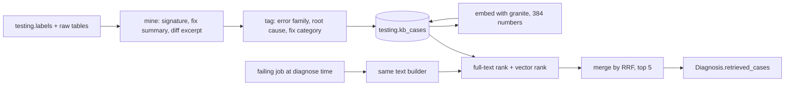
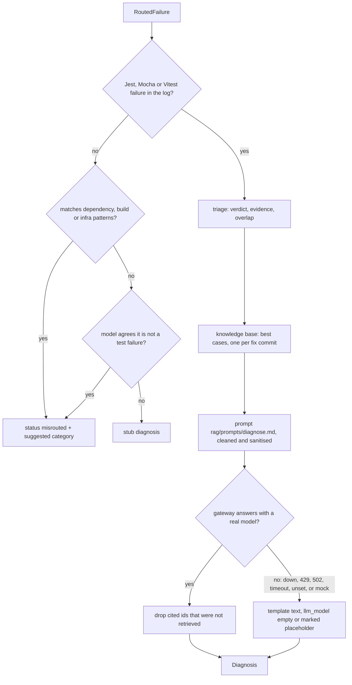

# Test expert (testing)

**In one sentence:** the Test and App Behaviour expert. It predicts how likely a test job is to fail, using a trained LightGBM model, and explains failures in test runs. Its prediction works per test job, not per commit.

**Status:** the expert is real end to end (P4.12): `/predict` serves the trained model v4 (`lightgbm-v4`), the worker triages, retrieves from the knowledge base and writes the diagnosis through the LLM gateway; the stub only answers when a bundle or the database is missing (see "Real and fallback" below). Log parsers, results extraction, features, labels, datasets and models are built. Models v5 and v6 are candidates, not served (v6 is not better than v4, see `reports/v6_vs_v4.md`). Reasons now come from SHAP-style contributions (P4.8). The diagnosis worker does real triage (genuine, flaky or unclear, P4.9), attaches up to 5 similar past cases from a knowledge base (P4.10) and writes the root cause and remediation through the LLM gateway, or from a template when no real model is available (P4.11; only the mock gateway provider exists so far) · **Owner:** Member 3 · **Plan tasks:** P2.1, P4.1 to P4.12

> **Read this first.** The "What it does" and "How the test-job logic works" sections describe the original P2.1 stub. The stub still runs, but only as the fallback. The trained model is described in "Serving the trained model" and the sections after it.

## What it does

This is a copy of the expert template, set up for test failures. It has an API with `/predict`, `/review` and `/health`, and a worker that writes diagnoses. Both return valid messages with fixed or hash-based answers.

The one real difference from the other experts is in `/predict`. It looks for test jobs in the commit and returns one prediction per test job. If it finds none, it returns one commit-scoped prediction, like the other experts do.

The shared rules, the endpoints and the steps to replace the stubs are in `experts/_template/README.md`. Read that first.

## How the test-job logic works

1. For each job in `workflow_jobs`, the stub looks at its `run:` commands.
2. A job counts as a test job if one command matches the heuristic below.
3. Each test job gets one `RiskOutput` with `scope` set to `job`, and `workflow_path` and `job_key` copied from that job.
4. If no job counts, or there are no jobs, the stub returns one commit-scoped output instead.
5. Every output in one commit gets the same probability, because it comes from the hash of `head_sha` only.

The heuristic matches these commands:

- `npm test`, `npm run test`, `yarn test` or `pnpm test`, with an optional suffix such as `test:unit`.
- `npx jest`, `npx mocha` or `npx vitest`.
- The bare words `jest`, `mocha` or `vitest` anywhere in a command.

Python test runs such as `pytest` do not match. A job like that falls back to the commit-scoped output.

The fixture `commit_context_multi_job.json` has a `unit` job in `ci.yml`, an `integration` job in `e2e.yml` and a lint job. The tests check that the prediction returns one job-scoped output for `unit` and one for `integration`. A commit with only the lint job gets one commit-scoped output.

## Facts

| Name | Value |
|---|---|
| Package | `testing_expert` (in `src/testing_expert/`) |
| Port | 8103 (`EXPERT_PORT`) |
| Queue | `diagnose:test`. Not `diagnose:testing`, because the expert's enum value is `test`. |
| Detail model | `BehaviourDetails`. `verdict` is `"unclear"`, `framework` is `"other"`, `failing_tests` is the name of the first failed step, and `suggest_rerun` is false. |
| Database schema | `testing`. No tables yet. |
| `/predict` scope | Job, for each test job. Commit when there are none. |
| Docker | Image `pipelineiq-expert-testing`. Compose services `testing-api` and `testing-worker`. |

## How to run it

```bash
# the whole repo
make check

# only this expert's tests
uv run pytest experts/testing/tests
```

**Expected:** all tests pass. To start the stub in Docker, run `make up-experts`. That was not run in P2.1.

## Test results extraction (P4.2, v1 + full scope)

What it does: reads job logs from `data/logs/`, runs the log parsers, and stores which tests ran
and how they ended in `testing.test_results` (with a stable id per test in `testing.test_ids`).
`testing.log_parses` has one row per log read: the framework, whether parsing worked, a short failure
reason, and the granularity the reporter gave (`test`, `file` or `none`).

Two scopes:

- **v1 (default mode):** failed job attempts, plus every other attempt of the same job on the same commit.
- **Full scope (`--all`):** EVERY stored job log, passing or failing, that is not yet in `log_parses`.
  A log with no Jest, Mocha or Vitest run is recorded as "not a test job" and writes no rows.

Rows are `test` granularity (one test) or `file` granularity (the reporter printed only files, or a
whole file failed to run). Each row says which. Mocha lists every test but not its file; Jest and
Vitest usually list files only, and a failing test is also named in the failure details.

How it stays fast and safe: parsing runs in several processes (`--workers`), results are written in
batches of 200 jobs, each batch with `COPY` into temporary tables followed by set-based inserts. A job that already has a `log_parses` row is skipped, so an interrupted
run resumes where it stopped, and re-writing a job replaces its earlier rows (idempotent).
`--sample N` reads a random N logs, for a throughput trial.

**What is not stored (a choice).** Storing every passing test of every passing log would be about 130
million rows (Mocha prints 1,000+ tests per run). A passing or skipped *test-level* row is kept only
when that test has failed somewhere in the data (`prune_passing` in `extract.py`). File-level rows and
all failed rows are always kept. A test that never failed has a fail rate of 0 whether or not its passes
are stored, so the history features lose nothing they could use.

Run it (database and logs must be present):

```
make migrate-testing    # creates the testing tables and indexes (migrations t0001 to t0003)
uv run --env-file .env python -m testing_expert.extract --member test --all            # full scope
uv run --env-file .env python -m testing_expert.extract --member test --all --sample 2000   # trial
uv run --env-file .env python -m testing_expert.extract --member test                  # v1 scope
```

**Real run (2026-10-29, 10-core Mac).** Trial: 2,000 random logs at 157 logs/s. Full run: 269,564 logs in
980 s (275 logs/s, about 16 minutes), no parse failures. Together with the v1 run all 288,330 stored logs
are parsed: 204,849 are test jobs (Jest 57,636, Mocha 97,168, Vitest 49,339, other 706) and 83,481 are not
test jobs. The table now holds 17.1 million result rows (13.4M test level, 3.7M file level, 4.9 GB with
indexes, 58,490 distinct test ids).

**Coverage of the 212,000 labelled attempts of dataset v3:**

| | attempts | share |
|---|---|---|
| no stored log (mostly passing jobs whose log was not collected) | 43,527 | 20.5% |
| log read, not a test runner | 2,181 | 1.0% |
| test job, reporter listed nothing usable (`none`) | 37,597 | 17.7% |
| test job with parsed results | 128,695 | 60.7% |
| of those: per test | 74,574 | 57.9% of parsed |
| of those: per file | 54,121 | 42.1% of parsed |

By framework (parsed results, per test / per file / none): Mocha 53,354 / 0 / 18,265; Jest 3,609 / 38,806 /
11,157; Vitest 16,922 / 15,315 / 8,175. "None" means the job's CI used a reporter or flags that print no
per-test or per-file lines (a summary only), so no results can be recovered from the log.

## Pre-run features (P4.4, v1 + v2 + per-test history)

What it does: turns one test job attempt into a row of numbers the model can read, using only what
was known before the run started (`history_cutoff` = the run's `created_at`). Code in
`src/testing_expert/features/`, one module per group:

| Group | Module | Examples |
|---|---|---|
| Change size | `change_size.py` | files, lines added and deleted, source / test / config split |
| Source-test link | `source_test_link.py` | source changed with no test changed |
| Test config | `config_change.py` | jest / vitest / mocha / playwright config changed |
| Test dependencies | `dependencies.py` | package.json or lockfile changed, test-library version bumped |
| History | `history.py` | fail rate over 7 / 30 / 90 days, recency-weighted flip rate, failures in a row, re-runs |
| History by runner OS | `history.py` (`h_os_*`) | the same history numbers, counting only earlier runs on the same OS as this job (linux / windows / macos / unknown) |
| What changed in tests | `test_changes.py` (`tw_*`) | new async tests, un-awaited promises, `setTimeout`, real timers, `Date.now()`, `Math.random()`, unmocked network calls, changed timeouts, `.only` / `.skip`, file-level shared state, setup with no `after*` cleanup |
| Run setup | `run_setup.py` | runner OS, matrix size, pull request or push, default branch |
| Repo | `repo.py` | average test-job duration, test framework |
| History per test / file | `history_tests.py` (`ht_*`) | failing and flaky tests of the job over 30 / 90 days, last run's failing tests, fail rate and last outcome of the test files this commit changes |

History is kept per job key (the workflow's YAML key, or the job name without its `(matrix)` part),
not per test (v1 cut). A past job only counts if it finished strictly before the cutoff. Tunables
are in `config/test_features.yaml`. `features/descriptions.yaml` has one plain-language sentence
per feature for the later SHAP explanations. Still not built: the optional code vector.

**`tw_*` (what changed in tests).** Counts of risky constructs the commit ADDED in its changed
JavaScript / TypeScript test files, found with tree-sitter. The database keeps only each file's
patch (the diff), not the file before and after. So each hunk is rebuilt as the new text (unchanged
lines plus added lines), parsed on its own, and a pattern counts only if it starts on an added line.
It is best-effort: a hunk can start in the middle of a block, so edge cases can be missed. A commit
with no test file gets zeros; a commit whose test files have no usable patch (missing, over 200,000
characters, GitHub-truncated) gets empty values (unknown), never fake zeros. `tw_test_files_parsed`
says how many files were read. Network calls only count when the file shows no mock (`jest.mock`,
`nock`, `msw`, ...). `tw_missing_cleanup` counts setups (timers, listeners, servers, spies, env or
global writes) in a file whose patch has no `afterEach` / `afterAll` hook. On the real data, 47% of
test-job rows have a parsed test diff, 53% changed no test file, 0.1% are unknown. One parse per
commit, shared by all its jobs.

**`h_os_*` (history by runner OS).** Same 13 numbers as `h_*`, but within the job key AND the same
OS. The OS comes from `raw.jobs.runner_os`, else the `runs-on` labels, else the job name; unresolved
`${{ matrix.os }}` names become `unknown` (its own bucket). Only attempts finished before the
cutoff count.

**`ht_*` (history per test and per file, 15 features).** Built from the parsed test results (P4.2).
Same series as `h_*` (one job key), and only attempts that finished strictly before the cutoff count.
Job level: `ht_parsed_runs_30d/90d` (earlier runs with readable results), `ht_last_run_failed_tests`
(tests that failed in the job's latest earlier run), `ht_persistent_failing_tests` (failed in both of the
last two runs), `ht_failed_tests_30d/90d` (distinct failing tests), `ht_flaky_tests_30d/90d` (distinct tests
that both failed and passed in the window). Touched files: for the test files this commit changes,
`ht_touched_test_files`, `ht_touched_files_with_history`, `ht_touched_fail_rate` (failed runs divided by
runs seen), `ht_touched_max_flip_rate`, `ht_touched_last_failed`, `ht_touched_failures_90d`.
**Granularity is recorded** in `ht_test_level` (1 = the job's reporter lists individual tests, as Mocha
does; 0 = files only, as Jest and Vitest usually do). Per-file history needs file names, so Mocha jobs
(test names only) get job-level numbers but no "touched file" numbers. Passing tests that never failed
are not stored (see P4.2), so there is no "number of tests run" feature, and per-file rates use only
file-level rows. Missing history is empty (`None`), counts are 0. Caveat from the data: the Jest repo's
own test suite deliberately runs failing fixture tests, so its `ht_` numbers are large; the model sees that
as a repo trait. Serving computes the same numbers with `loader.load_test_history`, one series only.

Two entry points, same code underneath: `compute_features(conn, run_id, attempt, job_id)` for one
job (serving) and `compute_features_batch(conn, keys)` for many (the dataset builder). Both read
the `raw` tables only.

Try it on one real repo (read-only):

```
uv run --env-file .env python -m testing_expert.features --repo vitest-dev/vitest
```

**Expected:** a line like `31587 rows in 3.8s`, then one sample row. All test-like job attempts
of all repos (285,665 rows) take about 110 seconds with the v2 groups (about 28 s in v1); the `ht_` group
adds about 9 minutes on the full dataset because it reads 17 million result rows (the v4 dataset build takes about 12 minutes).

Tree-sitter is pinned to `tree-sitter==0.25.2`: version 0.26.0 crashed the Python process
(segfault) on real patches.

Known limits: matrix cells of one job key share one history (a Windows cell sees Linux outcomes);
"test job" for the repo-level duration is a name match (`test|spec|jest|mocha|vitest|e2e|unit`);
the matrix size is the number of jobs with the same key in the run, not the parsed YAML matrix;
the framework comes from sparse `package.json` snapshots, else a word in the job key.

## Labelling (P4.3, v1)

What it does: gives every test job attempt one label, following `docs/experts/test.md` section 3. Labels go to
`testing.labels` and, for failed attempts, are copied into `platform.failure_labels` as `FailureLabel` rows
(category `test`).

Which attempts: a job counts as a test job when its series (repo, workflow file, job name) had at least one
attempt that the P4.2 parsers recognised as a test job. This is needed because passing logs were not parsed in v1.
Skipped jobs are left out.

| Label | Rule |
|---|---|
| `pass` (high) | attempt 1 passed and no attempt of that job on the same commit failed |
| `flaky` (high) | failed, and another attempt or run of the same job passed on the same commit |
| `flaky` silent (low) | failed, never passed on that commit, and a child commit that changed only docs passed |
| `genuine` (high) | failed, never passed on that commit, and a commit within 7 days on the same branch that touched the failing test file made the job pass |
| `genuine` low (v3, `persistent_failure_streak`) | failed, never passed on that commit, the log shows a test runner, and the job had failed on 3 or more consecutive earlier attempts spread over 2 or more other commits |
| `unclear` | anything else, or the failed job has no log |
| `not_test` | cancelled, or the failed job's log shows no test runner |

The streak rule (added for dataset v3) exists because a job that is simply broken, failing commit after commit with no
fix that touches the failing test file, used to land in `unclear` and drop out of training. It is low confidence
(nothing confirmed a fix), so the "high" training variant leaves it out. `# DEFAULT:` in `labels/rules.py` explains
the reading of "kept failing" (constants `STREAK_MIN`, `STREAK_MIN_OTHER_SHAS`). Real data: 492 attempts moved from
`unclear` to `genuine`. Most long failure "streaks" in the data are matrix legs or re-runs of one commit, not
consecutive commits, so only streaks over 2 or more other commits count.

A pass that follows a failure on the same commit is a rerun pass and gets no label. Failed attempts that
another category also claimed get `is_final = false`. `pass` and `not_test` are not copied to
`platform.failure_labels`, which is for failed jobs.

Run it (safe to run again; it replaces the earlier rule labels in one transaction, about 30 seconds):

```
make migrate-testing    # adds the unique index (migration t0002)
uv run --env-file .env python -m testing_expert.labels --member test
```

It prints the label counts per rule and per repo and writes the manual-review sample to `data/reports/`:
`test_labels_sample.csv` (what the reviewer sees: repo, commit, job, failing tests, log path, empty
`human_label` and `ai_prelabel` columns) and `test_labels_sample_key.csv` (the rule labels, kept apart so the
reviewer is blind). About 50 rows per label (flaky split by confidence), fixed seed. After the reviewer fills
`human_label` (pass, flaky, genuine, unclear, not_test):

```
uv run python -m testing_expert.labels --kappa data/reports/test_labels_sample.csv   # Cohen's kappa
uv run python -m testing_expert.labels --kappa FILE --rater ai_prelabel               # same for the AI column
```

Known limits: a failed job whose log shows no Jest, Mocha or Vitest (for example `node:test` or Playwright) is `not_test`, so
a broken job on an unparsed runner is still left out. Only the failing test file is used for the genuine rule, because P4.2 did not store stack frames.
A single failure with no re-run counts as "kept failing". Commits that never ran this job are invisible to the
7-day window. A test series found by the loose P4.2 heuristic can pull in non-test jobs.

## Dataset builder (P4.5, v1 and v2)

What it does: freezes the labelled attempts and their pre-run features into one table that the baselines and
the model train on. Output: `data/datasets/testing/<version>/rows.parquet` and `manifest.json` (build date,
git commit, repos, row counts per label, feature list, the v1 cuts, sha256 of the parquet file).

One row per attempt labelled `pass`, `flaky` or `genuine` (unclear and not_test are left out). Columns: keys
(`run_id`, `attempt`, `job_id`, `repo`, `created_at`, `series_key`), target (`label` = `pass` / `genuine_fail` /
`flaky_fail`, `label_confidence`, `rule_name`, `genuine_strict`) and every feature from `feature_names()`.
`genuine_strict` is true when the job failed in at least two attempts on that commit.
Train variants: all rows, "high" (drop low confidence), "strict" (genuine only if `genuine_strict`).

How: the builder reads `raw` and `testing.labels` directly and calls the same feature code the live expert
uses, with each row's history cutoff set to its run's `created_at`. It does not go through the replay CLI;
the features are the same. A finished version is frozen: the command refuses to overwrite it without `--force`.

```
uv run --env-file .env python -m testing_expert.dataset --version v1    # about 45 seconds
uv run --env-file .env python -m testing_expert.dataset --version v2    # about 90 seconds
uv run --env-file .env python -m testing_expert.dataset --version v3    # about 3 minutes
uv run --env-file .env python -m testing_expert.dataset --version v4    # about 12 minutes
```

The version is an argument. `v1` keeps its original 41 features (so it stays reproducible after new feature
groups were added). `v2` has the same rows and labels plus two new feature groups, 68 features in all:
`tw_*` (14, the tree-sitter test-change group; empty means unknown, 0 means the commit changes no test) and
`h_os_*` (13, job history counted only on the same runner OS). Its manifest says `"frozen": false`: labels are
still rule labels, so v2 is not frozen until the human kappa round (P4.3) is done. `v3` has the same 68 features and
rows as v2 plus the 492 streak rows (212,000 rows; genuine 2,324, flaky 823), after the P4.3 streak rule; it is also
`"frozen": false`, with a `label_changes` note in the manifest. `v4` has the same 212,000 rows and labels as v3 (nothing was rewritten in the database) plus the 15 `ht_*`
features, 83 in all; it is `"frozen": false` with a `kappa_note` (the human label check is still pending). v1 to v3 files are untouched
(v2 and v3 are built without `ht_`). Remaining cuts, listed in the
manifest: no daily collector (one-off data, no newer runs), no new repos (same 16), P4.2 and P4.3 still at v1 scope.

## Real and fallback (P4.12)

The stub is no longer a mode you pick: it only answers when the real part cannot run. `GET /status` on the API (and the `test worker starting:` line in the worker log) says which parts are real:

| Part | Real when | Fallback when it is missing |
|---|---|---|
| `/predict` model | a bundle loads from `TESTING_MODEL_BUNDLE` (v4 in Docker) | the stub risk (`model_version` "stub"); a database that fails only degrades the history features |
| Triage (verdict, evidence) | the triage bundle `models/testing/triage/v<N>` loads | the stub diagnosis, except misrouted logs, which are still recognised |
| Knowledge base | `DATABASE_URL` works and `testing.kb_cases` has rows | `retrieved_cases` is empty |
| Retrieval kind | the image has torch and an embedding model: full text plus vector | full text only (the Docker image has no torch, on purpose; it keeps the image small) |
| Narrative text | the gateway runs a real provider | the deterministic template (always the case with the mock provider) |
| Full log | `DATA_DIR` is set and the log file exists | the router's 20,000-character excerpt |

`status.mode` is `real` (model and triage loaded), `partial` or `stub`. `/health` keeps its documented body (`status`, `model_version`, `kb_cases`); the extra detail is in `/status`. The API process does not need the gateway or the logs, so its `/status` shows `llm_gateway: false` and `full_logs: false`; look at the worker banner for those.

### The demo stack (Docker, mock LLM)

```
docker compose --profile experts up -d --build testing-api testing-worker llm-gateway
curl -s localhost:8103/status        # mode real, lightgbm-v4, triage-v1, kb_cases 1233
curl -s localhost:8200/health        # {"status":"ok","provider":"mock"}
docker logs pipelineiq-testing-worker-1 | grep "worker starting"
```

(This starts only the three services plus Postgres and Redis; the other experts, the dashboard and the infra containers stay off.) What each piece is wired to in `docker-compose.yml`:
- **LLM gateway:** `llm-gateway` (port 127.0.0.1:8200, mock provider, writes `platform.llm_calls` to the same Postgres). The worker reaches it at `http://llm-gateway:8200`; set `EXPERT_LLM_GATEWAY_URL` to use another one, or to an empty string for template text only.
- **Backend:** the worker posts each diagnosis to `${EXPERT_BACKEND_URL}/diagnoses`. Unset, that is `http://host.docker.internal:8000`, the API running on your machine (`uv run --env-file .env uvicorn api.app:app --port 8000`; on Linux add `--host 0.0.0.0`). With the API as a Compose service (`make e2e`) the target sets `EXPERT_BACKEND_URL=http://api:8000`. An empty value posts nowhere.
- **Logs:** `./data/logs` is mounted read-only at `/data/logs` with `DATA_DIR=/data`, so triage reads the full log named by `log_ref`.
- **Config:** `config/` is mounted read-only; the parser and feature files are named by `TEST_LOG_PARSING_FILE` and `TEST_FEATURES_FILE` (without the parsing file the log cleaner silently stops cleaning).

**Replay a real failure** (the demo): `scripts/demo_route_failure.py` reads a stored failed job, routes it, lets the worker diagnose it and prints the result.
```
PYTHONPATH=. uv run --env-file .env python scripts/demo_route_failure.py --list          # flaky jobs never routed
PYTHONPATH=. uv run --env-file .env python scripts/demo_route_failure.py --job-id 120678085378
```
Then open the failure in the dashboard (`/failures/<id>`). `--no-wait` only enqueues; `--api-url` or `API_URL` points at a backend that is not on `127.0.0.1:8000`. The replay is marked `replay=true`, so nothing goes to GitHub. The `PYTHONPATH=.` part is only needed while the installed copy of `shared` in the virtualenv is older than the repository (`uv sync --all-packages` fixes that).

**Plug in a real LLM later.** In `services/llm_gateway`: add a provider class in `providers.py` (and return it from `get_provider` for a new name), set `LLM_PROVIDER=<name>` and `LLM_API_KEY=<key>` in `.env` (never in git), and put the model's prices and caps in `config/llm.yaml`; then `docker compose --profile experts up -d --build llm-gateway`. The Compose file already passes `LLM_PROVIDER` and `LLM_API_KEY` through to the gateway container. Nothing in this expert changes: any model name that does not start with `mock` is treated as real and its text is shown.

**One bug found while wiring this.** The RQ worker forks a child process for every job. A LightGBM model loaded in the parent before the fork makes the child wait forever (OpenMP threads do not survive a fork), so the worker's start-up banner only looks for the bundle folders and never loads a model (`status.readiness(load=False)`).

## Serving the trained model (P4.12, partial)

`POST /predict` now scores with the trained model instead of the stub. The stub is still there as a fallback.

**What happens on a request**
1. The service loads a model bundle once (a folder like `models/testing/v2/` with the model, calibrator, feature list and threshold).
2. It finds the test jobs in the commit's workflow files (same test-job check as the stub). No test job: it scores one commit-level row.
3. It builds the same features used for training. The test-change (`tw_*`), change-size, config and run-setup features come from the commit context itself, including the diffs of changed test files. History features (`h_*`, `h_os_*`, and `ht_*` for bundles that use them) come from the database when `DATABASE_URL` works and the repository is known.
4. An unknown repository, or no database, means "cold start": history is missing and the model handles that. If `DATABASE_URL` is set but the database fails, the output is marked `degraded`.
5. The answer is a normal `RiskOutput`: calibrated probability of failing, the bundle's threshold, the alert flag and `model_version` (for example `lightgbm-v2`). Each test job gets its own output; the highest one is the commit's headline risk.

**Picking a bundle.** Set `TESTING_MODEL_BUNDLE` to a bundle folder, or to a folder of versions (`models/testing`), in which case the newest `v<N>` is used. If it is not set, the newest bundle under `models/testing/` is used. If nothing can be loaded, the service logs a warning and answers with the stub (`model_version` "stub"). It never crashes because of the model. Only LightGBM bundles are served (v1 to v3, and the v4 two-model kind). Docker mounts `models/` and `config/` read-only into `testing-api`, so restart the container to pick up a new version.

**Reasons.** The "top factors" come from `src/testing_expert/explain.py` (see "Explanations (P4.8)" below).

**Known limits.** Loading the per-test history (`ht_*`) for one job series used to take up to about 4 seconds for big matrix jobs (it streams every stored result row), and serving paid that for every request even though v4 does not read `ht_*`. Now the history is loaded only if the bundle has an `ht_` column (`Bundle.history_mode`: `none`, `job` or `full`), and a bundle that needs only the job-level numbers uses `loader.load_job_test_history`, three small queries that take 0.8 to 1.8 s on the biggest series tested (same numbers as the full loader; see the v6 section). A repository with no history scores low by design: the model leans on history, so a brand-new repo gets little signal beyond the diff. Per-job outputs instead of one max output follow the contract (one prediction per test job).

Code: `src/testing_expert/serving.py`. Tests: `tests/test_serving.py` (tiny trained bundle in a temp folder; `tests/conftest.py` forces stub mode elsewhere).

## Explanations (P4.8)

Every prediction carries up to five reasons (`top_factors`, a list of `RiskFactor`). They answer "which facts about this commit pushed the risk up or down", never "what caused the failure".

1. **Contributions.** For one job, LightGBM's `pred_contrib` says how much each feature moved the model's score (this is the exact TreeSHAP value for tree models, in log-odds).
2. **Two models, one risk.** The served v4 bundle has two boosters, one for a genuine failure and one for a flaky one, and the risk is `1 - (1 - pg)(1 - pf)`. Each booster's contributions are weighted by that booster's share of the combined risk (`pg / (pg + pf)` and `pf / (pg + pf)`) and added. So a flaky-looking job is explained mostly by what the flaky booster saw. Older bundles (one booster, or two-stage) use their fail contributions directly. Both zero gives equal shares.
3. **Top N.** Features are ranked by absolute combined contribution; at most 5 are kept, and anything under 1e-6 is dropped. A positive score is `raises`, a negative one `lowers`.
4. **Plain words.** Each feature has a template in `features/descriptions.yaml` (for example "This job failed in 25% of its runs in the last 7 days"). When the value is not known the `missing` wording is used ("This job has no runs in the last 7 days") and the factor's value is `"unknown"`. Whole numbers such as a 1/0 flag print as `1`, not `1.0`. A reason is cut at 200 characters, the contract limit.
5. **Where.** For features about changed test code (`tw_*`), the factor carries the file and line of the first added line that matches (for example the `setTimeout` call).

The v6 "still failing" rule, when a bundle has one, adds its own first reason. Code: `explain.py` (one module, used by `serving.py`). Tests: `tests/test_explain.py`.

## Triage of a failed test job (P4.9)

When a test job has failed, the worker decides whether the failure is a **real bug in the change** (`genuine`), **flakiness** (`flaky`) or **unclear**, and says how sure it is. It suggests a re-run only for a confident `flaky` verdict. The result is in the `Diagnosis`: `details.verdict`, `details.verdict_confidence`, `details.suggest_rerun`, and one evidence line per piece of evidence. The root-cause and remediation text is still the stub text; the LLM narrative is P4.11.

**What it looks at** (each becomes a sentence in the diagnosis):

1. **Stack versus diff.** Did this commit change the failing test's file, or a file in its stack trace, or lines within 5 lines of a frame? A commit that touches the failing code points to a real bug.
2. **Error type.** Which family the error belongs to: assertion or snapshot mismatch, code error (leaning genuine); timeout, connection reset, port in use, network, out of memory, killed (leaning flaky). The families are regexes documented in `triage/evidence.py`.
3. **The failing tests' history.** How often they failed or flipped before, and on how many commits they both passed and failed.
4. **Same-commit evidence.** Other jobs on this commit that had already finished when this one failed: the same job passed earlier, other matrix legs passed or failed, the attempt number.
5. **Pre-run risk.** The pre-push model's flaky risk for this commit, read from the stored prediction when there is one.

**No peeking at the future.** The labels come from later events (a re-run that passes, a fix commit), so every query is cut at the failed job's finish time. Test history uses jobs finished strictly before it; same-commit evidence uses jobs finished at or before it. `tests/test_triage_leakage.py` adds later data of every kind and checks nothing changes.

**The classifier.** A small LightGBM on 45 numbers (unknown stays unknown, never zero) gives P(flaky), calibrated. Two floors turn it into a verdict: flaky at or above 0.917, genuine when P(genuine) is at least 0.502, otherwise unclear. The flaky floor was chosen on validation data to keep the false-flaky rate (real bugs called flaky) at or below 5%. Results, baselines, the ablation and the limits are in `reports/triage_v1.md`: on later failures it decides 83% of them, is right on 91% of those, and calls a real bug flaky for 4% of genuine failures. On repos it never saw, it ranks well but the floors are too strict, so re-check the floor on a new repo.

**Where it runs.** `diagnose.py` calls `triage/runtime.py`. It loads the bundle (`TESTING_TRIAGE_BUNDLE`, else the newest `models/testing/triage/v<N>`; this folder is separate from the pre-push bundles and the pre-push search never looks inside it), reads the full log from `DATA_DIR` when it can (else the router's 20,000-character excerpt), looks up the commit's files, same-commit jobs and test history in the database (`DATABASE_URL`), and scores. If there is no bundle, or the log shows no Jest, Mocha or Vitest failure, or anything breaks, the diagnosis is the old stub. With no database it still triages from the log alone.

**Build it again.**
1. `uv run --env-file .env python -m testing_expert.triage.dataset` (about 3 minutes) writes `data/datasets/testing/triage_v1/`.
2. `uv run --env-file .env python -m testing_expert.triage.train --out models/testing/triage/v1 --results experts/testing/reports/triage_v1.json` (about 5 minutes) runs the experiments and writes the bundle (`model.joblib`, `calibrator.joblib`, `features.json`, `floors.json`, `card.md`).

**Limits.** Rule labels only (human kappa pending); the strongest signal is same-commit evidence, which is also how flaky labels are made, so part of its strength is agreement with the rules. Test history and pre-run risk added nothing. New repos need their own floor check. `EvidenceLine.source` has no value for history, same-commit or pre-run evidence (contract v1.1.0), so those lines use `log` with a prefix ("History: ", "Same commit: ", "Pre-run model: "); a proposal for the contract is in the report. Code: `src/testing_expert/triage/` (`evidence.py` plain-code evidence, `loader.py` database reads, `gather.py` shared by training and serving, `features.py`, `model.py`, `train.py`, `dataset.py`, `runtime.py`). Tests: `tests/test_triage_*.py`.

## Knowledge base (P4.10)

**What it is.** A table of past failures whose outcome we know, so the diagnosis can say "this looked like that one, and this is what fixed it". A **case** is one of two things: a *genuine* failure that a later commit fixed (a commit within 7 days touched the failing test file, or a file in its stack trace, and then the job passed), or a *flaky* failure (the same commit passed when run again; the "fix" is the re-run). Cases are stored as `VerifiedCase(origin="mined")` in `testing.kb_cases`. Nothing here uses an LLM.



**How a case is built** (`src/testing_expert/kb/`):
1. `mine.py` picks labelled failures: genuine by `fix_commit_touches_file` (the fix commit is the one the label rule found), genuine streak rows by a second search for a commit touching a stack file (`stack_file_fix`), flaky by `rerun_pass_same_sha`. It reads the failing log, parses it (reusing the parsers and `signature()`), finds the passing run that proves the fix, and writes the case. The same failure in several matrix legs gives one case.
2. The **fix summary** is extractive and deterministic: the commit's first paragraph (trailers and emails removed), the changed files, and a few changed lines. The **diff excerpt** keeps only changed lines of the failing test and stack files, at most 1,500 characters. Everything is sanitised with `shared.sanitise` before it is stored.
3. `tags.py` adds tags from regexes in `config/test_kb.yaml`: `kind:`, `fam:` (error family, reused from `triage/evidence.py`), `rc:` (async_wait, concurrency, timeout, test_order_dependency, network, time_date, randomness, resource_leak, platform, or unspecified) and `fix:` (FlakyFix categories that make sense in JavaScript plus a few common JavaScript fixes; flaky cases get `fix:rerun`). Only small diffs (80 changed lines or fewer) are scanned for fix patterns.
4. `store.py` writes the rows (a fixed id per case, so running again updates instead of duplicating) and embeds the ones that have no vector yet, 32 at a time, committing after each batch.

**Retrieval** (`retrieve.py`). Two rankings, each the best 50: full text (`ts_rank` against an OR of the query's words) and vector (cosine distance). They are merged by reciprocal rank fusion and the top 5 are returned. Filters in SQL, always: a case must have been **known** (its fix or re-run passed) at the failure's finish time (no future leakage), and cases from the failure's own run or commit are left out (no self-retrieval). `permissive_only=True` also drops cases from non-permissive licences (list in `config/test_kb.yaml`), the switch for a commercial knowledge base (`docs/DATA.md` section 6); today every repo is MIT or Apache-2.0 so it removes nothing.

**In the diagnosis.** `diagnose.py` calls `retrieve_for_failure` after triage and puts the top cases in `Diagnosis.retrieved_cases` (`similarity` is the fused score divided by its best possible value; `source_url` is the fix commit, or the passing run for a flaky case). The narrative text stays the stub until P4.11, so `remediation.cites_case_ids` is still empty. No database, an empty table or a missing embedding model never fails a diagnosis: it gets no cases, or full-text-only cases.

**Run it** (database up, migrations applied with `make migrate-testing`, which now includes t0004):

```
uv sync --all-packages --extra embeddings                 # once: sentence-transformers and torch
uv run --env-file .env python -m testing_expert.kb build  # mine + tag + embed, about 2.5 min; safe to repeat
uv run --env-file .env python -m testing_expert.kb build --embed-only      # continue a stopped embedding
uv run --env-file .env python -m testing_expert.kb search "TimeoutError: Exceeded timeout of 5000 ms"
uv run --env-file .env python -m testing_expert.kb eval   # retrieval check, writes reports/kb_v1_metrics.json
```

**Expected:** `mined and stored 1233 cases`, `embedding: {"embedded": 1233, ...}`; a second run says `embedding 0 cases`. Results and the retrieval check are in `reports/kb_v1.md`.

**The model.** `ibm-granite/granite-embedding-small-english-r2` (384 numbers), run locally. The first run downloads about 100 MB into the Hugging Face cache (`EMBEDDING_CACHE_DIR` moves it). If the download or load fails, `build` stops with the error; it never switches to the fake embedder (`EMBEDDING_PROVIDER=fake` is refused outside tests). Loading takes about 14 s once cached, one query about 14 ms.

**Docker.** The worker image has no torch (it would add gigabytes), so inside Docker the worker finds cases by full text only; it logs a warning once and tries the model again after 5 minutes. For hybrid search in Docker, install the `embeddings` extra into the image and mount a cache folder, for example `./models/embeddings-cache:/home/expert/.cache/huggingface` with `EMBEDDING_CACHE_DIR` set; `models/` is already ignored by git. The worker also gets `config/` read-only (`TEST_KB_FILE`). `GET /health` on the API shows `kb_cases`, the number of cases in the table (0 when the database cannot be read).

**Limits.** All labels and tags are rules, none checked by a human; about 60% of cases get `rc:unspecified`. The "fix" of a genuine case is the first commit that touched the failing test file, and may be unrelated to the failure. Retrieval finds the same failing test and error family well, but the failure text barely predicts the kind of fix (see the report), and the plain top 5 often came from one fix commit (the diagnosis path now keeps one case per fix commit, P4.11). `kb build` does not delete cases that stopped qualifying. Contract gaps (flaky cases have no `origin` value, no field for links) are listed in the report.

`# DEFAULT:` choices are in `config/test_kb.yaml` (window, limits, licence list, retrieval sizes, tag patterns) and in `kb/*.py`: the primary-family precedence and the family-to-root-cause map in `tags.py`; the 5-minute vector retry in `retrieve.py`; the flaky-fix hint sentences in `mine.py`; the fixed case-id namespace in `mine.py`.

## Diagnosis (P4.11)

**What it does.** After triage says whether a failure looks genuine or flaky, the worker writes the
human part of the diagnosis: a root cause in plain words and a remediation (what to do next). It
asks a language model through the shared LLM gateway, with a fixed prompt and a fixed JSON answer
shape. If the model cannot be used for any reason, a small template writes the same fields from the
triage result and the best past case, so a diagnosis always comes back. The verdict, confidence,
evidence and `BehaviourDetails` always come from triage and never from the model.



**Steps**
1. `triage/` gives the verdict and evidence lines. `kb/retrieve.py` fetches the 25 best cases and keeps one per fix commit (before this, the top 5 were often five cases of the same fix), then the top 5.
2. `rag/prompt.py` fills `rag/prompts/diagnose.md`: the cleaned excerpt of the failing tests (names, error message, assertion diff, project stack frames; at most 3,000 characters), the triage verdict, confidence and evidence lines, the stack-versus-diff overlap and the cases (id, failure summary, fix summary, tags). Everything that came from a log or a case is run through the shared secret sanitiser, stripped of control characters, cut to a fixed size and wrapped in `<data>` tags that the prompt says are data, not instructions. If the sanitiser cannot run, no prompt is sent.
3. `rag/gateway.py` sends it to `${LLM_GATEWAY_URL}/complete` with a 20 second timeout and no retry. The reply must match the JSON schema (`rag/prompt.py`, `REPLY_SCHEMA`) or the gateway answers 502.
4. `diagnose.py` maps the reply: `root_cause`, `remediation` (summary, steps, optional `suggested_patch`), `llm_model` (the model name the gateway reports), `prompt_version`, `latency_ms`. The remediation may cite only the retrieved case ids: any other id is removed, a warning is logged and a "Diagnosis note" evidence line says how many were removed. Citing nothing is allowed. The confidence is the lower of the triage confidence and the model's own.
5. A log with no Jest, Mocha or Vitest failure is not a test failure. If it matches dependency, build or infra patterns (`config/test_diagnosis.yaml`) the answer is `status="misrouted"` with `suggested_category`, without asking the model. If it matches nothing, the model is asked and must say it is misrouted with a category; otherwise the old stub is returned. A test failure that also prints `npm ERR!` afterwards is never called misrouted.

**Reply schema.** `root_cause` (text, at most 900), `remediation` {`summary` (at most 400), `steps` (at most 6), optional `suggested_patch`}, `cited_case_ids` (list of text), `misrouted` (true or false), optional `suggested_category` (`dependency`, `build`, `infra`, `other`, `unknown`), `confidence` (0 to 1).

**When the model cannot be used.** The template (`rag/template.py`) writes the text and the diagnosis stays valid:
- Gateway URL unset, gateway unreachable, timeout, HTTP 429 (monthly cap), 502 (invalid answer twice), any other error, or an answer that cannot be mapped: `llm_model` and `prompt_version` are empty.
- Gateway running the **mock provider**: its answers are placeholders ("mock"), so they are never shown. The template text is used and `llm_model` reads `mock-1 (placeholder answers, text from template)`; `prompt_version` is still set because a prompt was sent.
- In every case one evidence line starting `Diagnosis note:` says why (the contract has no notes field).
- The template: a lead sentence for the verdict, the first failing test and its error family, up to two triage reasons that point the same way, and a remediation with steps. It quotes the fix of the best past case (a flaky case for a flaky verdict) only when the retrieval similarity is at least 0.6, and cites only that id.

**prompt_version.** The git object hash of `rag/prompts/diagnose.md` (the value `git hash-object` prints), first 12 characters. It is computed in Python from the file bytes, so it is the same inside Docker, where there is no `.git` and no git program. It changes whenever the prompt text changes. If the file's exact bytes differ from the committed ones (for example edited and not committed), the version still follows the bytes on disk.

**Example (mock gateway, typeorm failure).** Root cause: "Likely a real defect in this change, not flakiness. The failing test "query builder > soft-delete > ..." failed. This commit changed the failing test file ..."; remediation summary: "Read the failing assertion and the changed code it points to, then fix the code, or update the test if the new behaviour is intended."; one step quotes the closest past case and `cites_case_ids` holds its id; `llm_model` is `mock-1 (placeholder answers, text from template)`.

**Run it.**
```
# the Docker demo stack is described in "Real and fallback (P4.12)". By hand, without Docker:
# gateway, mock provider:
LLM_PROVIDER=mock uv run --env-file .env uvicorn llm_gateway.api:app --port 8200
# worker or one failure, pointing at it:
LLM_GATEWAY_URL=http://127.0.0.1:8200 uv run --env-file .env python -m testing_expert.worker
```
In Docker the `llm-gateway` service is started with the worker and `EXPERT_LLM_GATEWAY_URL` defaults to it; empty means template text only.

**Switching to a real model later.** Three things are missing, all outside this component: (1) a provider class in `services/llm_gateway/src/llm_gateway/providers.py` that calls the chosen vendor and is returned by `get_provider` for a new `LLM_PROVIDER` value; (2) set `LLM_PROVIDER` to that value; (3) put the key in `LLM_API_KEY` (`.env` only), plus real prices for the model in `config/llm.yaml`. Nothing in this expert changes: any model name that does not start with `mock` is treated as real. Until then the real-model path is tested only with a fake gateway, and the prompt has never been tried on a real model (wording, schema strictness and length are untested).

**Limits and `# DEFAULT:` choices.** `config/test_diagnosis.yaml` (all first guesses): timeout 20 s; excerpt 3,000 characters, 3 tests, 5 frames, 5 cases; template similarity floor 0.6; misroute patterns and minimum score 2.0. In code: pattern confidence for a misrouted answer is score / 6 capped at 0.9; model and triage confidence are combined with `min`; at most 12 evidence lines before the note; log scan limited to its last 200,000 characters. Known gaps: the model's `misrouted` flag is ignored when the log does contain a test failure; a failure with no triage bundle still gets the stub; the diagnosis note lives in evidence because the contract has no notes field; "closest past case" can still be a weak match (the KB report shows failure text barely predicts the fix kind); no human has rated the text.

## Model v3: label fix, new calibration, monotone constraints (P4.7 v3)

Three fixes on top of v2, measured one by one in `reports/v3_vs_v2.md` (run: `uv run --env-file .env python -m testing_expert.model.compare_v3`,
about 10 minutes; it also writes the bundle `models/testing/v3/`, v1 and v2 stay as they are).

1. **Labels** (dataset v3, above). Long failure streaks are now genuine failures instead of dropped rows.
2. **Calibration.** v2 used isotonic regression, which turns every low raw score into exactly 0.0 when no failure fell
   in that score range of the fit slice (5,579 of 42,300 test rows had P(fail) = 0.0). `model/metrics.py` now fits four
   calibrators per class: `isotonic`, `sigmoid` (Platt), `beta` (3-parameter) and `isotonic_floor`, and the new ones never
   output below 0.0001 per fail class (`MIN_PROB`, `# DEFAULT:`). The comparison picks by Brier score and ECE (the
   average gap between predicted and observed fail rate), not PR-AUC; v3 uses `beta`. Old bundles (v1, v2) still load: the
   calibrator file has a `kind` field, and old files without it are read as isotonic.
3. **Monotone constraints.** `MONOTONE_FEATURES` in `model/models.py` lists the features whose direction is obvious
   (more recent failures, a longer failure streak, a higher fail rate or flip rate, more re-runs, more `setTimeout`,
   real timers, `Math.random`, `Date.now`, unmocked network, unawaited promises, `.only` added, missing cleanup never
   lower the risk; more days since the last failure never raise it), each with a `# DEFAULT:` comment. LightGBM gives all
   classes of a multiclass model the same constraint, which would also push P(pass) up, so v3 is two-stage: a
   fail-vs-pass booster with the constraints (`model.txt`) and an unconstrained genuine-vs-flaky booster
   (`split_model.txt`). `serving.py` loads `split_model.txt` when it is there (the only serving change). The "top
   factors" of a v3 answer are the fail booster's contributions.

Result in short: the calibration fix removes the hard zeros at the same Brier score; the constraints give a tested
guarantee but no clear accuracy gain; the label fix gives more training signal. **Streaks are still under-scored**
(the model says about 2% where 13% fail, and "same as last outcome" beats it on those rows), because the calibration
slice contains streak rows that rarely failed. Read the report before trusting v3 over v2. Tests: `tests/test_model_v3.py`,
streak cases in `tests/test_labels.py`.

## Model v4: recent-history calibration, separate genuine and flaky models (P4.7 v4)

Same dataset (v3) and the same time splits as v3. Measured in `reports/v4_vs_v3.md` (run:
`uv run python -m testing_expert.model.compare_v4 --export`, about 5 minutes; it also writes the bundle
`models/testing/v4/`). v1 to v3 bundles stay as they are and still load.

1. **Calibration over more history.** v3 fitted the calibrator on the 10% calibration slice only. v4 also uses
   out-of-fold scores over the train period (each block is scored by a model trained only on earlier blocks), weights
   rows by recency (half-life 30 days) and fits a beta map per event (`fit_binary_calibrator` in `model/metrics.py`).
   Overall calibration improves (test ECE 0.0127 to 0.0071 on the same booster). It does not fix streak rows by itself:
   their failure rate swings from 2% to 15% between periods, so no pre-test choice can match the test period.
2. **Two separate models.** `model/models.py` trains genuine-vs-rest and flaky-vs-rest as independent boosters
   (`SeparateBooster`, kind `lightgbm_sep`), each with its own monotone constraints (`GENUINE_MONOTONE`,
   `FLAKY_MONOTONE`, each `# DEFAULT:`), balanced class weights, calibrator and threshold. P(fail) = 1 - (1 - pg)(1 - pf);
   `sub_risks` carries both class probabilities. The `RiskOutput` contract says `alert == probability >= threshold`, so
   the alert uses the combined score against one threshold; the per-class thresholds are in `threshold.json`.
3. **Serving.** `serving.py` also loads `kind: lightgbm_sep` bundles (`model_genuine.txt`, `model_flaky.txt`, a
   calibrator file with one map per class). That is the only serving change.

Result in short: v4 is better calibrated (ECE 0.0118 to 0.0066) and ranks genuine failures a little better (PR-AUC +0.012,
a real but small gain); the any-fail gain (+0.006) is within the noise; leave-one-repo-out is mixed. **Streaks are still
under-scored** (mean P about 3% where 13% fail) and "same as last outcome" still beats the model on those rows. Tests:
`tests/test_calibration_v4.py`, `tests/test_model_v4.py`.

## Model v5 candidate: per-test history (P4.5 v4, P4.7 v5)

Dataset v4 (212,000 rows, v3 labels, 83 features) adds the `ht_*` group. Compared with model v4 on the
same rows and time splits, with the same recipe, in `reports/v5_vs_v4.md` (run:
`uv run python -m testing_expert.model.compare_v5 --export --json data/reports/v5_results.json`, about 20
minutes; add `--from-json FILE --notes NOTES.json` to re-render the report).

Result in short: **not better, so v4 is still the model in service.** Any-fail PR-AUC 0.189 to 0.193 (the
interval includes zero), genuine PR-AUC falls 0.106 to 0.096, flaky rises 0.191 to 0.207, leave-one-repo-out
is a wash (0.205 against 0.201). Only the job-level `ht_` features carry signal (any-fail +0.018 with an
interval above zero); the touched-test-file features add noise. That sub-group was picked after looking at
the test slice, so it needs a validation-based re-check before shipping. The v5 bundle sits in
`models/testing_candidates/v5/` so that a service restart cannot pick it up by accident.

Tests: `tests/test_features_history_tests.py` (pure), `tests/test_features_db.py` (no leakage, real
Postgres), `tests/test_model_v5.py`, `tests/test_extract.py` (batching, idempotency, pruning).

**Where `--export` writes.** `compare_v5.py` writes its bundle to `models/testing_candidates/v5`, which the service
never reads. To ship v5, move the folder to `models/testing/v5` and rebuild `testing-api`; the service serves the
newest `v<N>` in `models/testing/`.

## Model v6 candidate: the "still failing" rule, a calibrated threshold (P4.7 v6)

**In one line: built and measured, not better than v4, so v4 is still served.** Report:
`reports/v6_vs_v4.md` (run: `uv run --env-file .env python -m testing_expert.model.compare_v6 --export models/testing_candidates/v6 --json data/reports/v6_results.json`, about 20 minutes; add `--from-json FILE --notes NOTES.json` to re-render the report). The bundle is in `models/testing_candidates/v6/`.

Three changes on top of v4, each decided without looking at the test slice:

1. **The "still failing" rule** (`model/rule.py`, in plain words). If this job's previous run failed, the model is not allowed to say less than what usually happens next. "Previous run" means the same job on the same runner OS when it has run there before, otherwise the job's overall history. The rule looks up how often rows with the same number of failures in a row went on to fail (buckets: 1, 2, 3 to 9, 10 or more; counted on train and calibration rows only) and the final probability is the larger of the model's and the rule's. In serving it adds the first reason, for example "This job already failed 74 times in a row on Windows; the failure is likely not caused by this push.", and a `still_failing` entry in `sub_risks`. The contract is untouched. The numbers are in a `rule.json` file in the bundle; a bundle without that file behaves exactly like v4.
2. **Threshold from the calibration slice.** The default is the point with the highest F1 on the 21,186 calibration rows. The curve, "precision at least 0.30" and "top 5% of pushes" are in the report. The test slice never chose a threshold.
3. **Job-level `ht_` features: left out.** Decided on the calibration slice and on out-of-fold scores of the train period, where they do slightly worse (any-fail PR-AUC -0.009 and -0.005). They would fit the time budget (0.8 to 1.8 s with the new fast loader), but they do not earn their place.

**What the measurement says.** The rule's probabilities are low (about 5 to 11% of such rows fail, 11.8% on the test slice), below the alert threshold 0.169, so it never raises an alert by itself at the default threshold; it also flattens the model's ordering inside the rows it touches, so any-fail PR-AUC falls from 0.189 to 0.170. Calibration gets slightly better (ECE 0.0066 to 0.0054). F1 at the default threshold is the same as v4 (0.108). Leave-one-repo-out is slightly positive for the rule (macro PR-AUC 0.198 to 0.208). The strong "same as last outcome" baseline (precision 0.56, recall 0.64 on streak rows) uses the previous run's *label*, which is only known later, so it cannot be reproduced from history available before a run; the deployable version ("previous run failed") is right only 13% of the time on those rows. The looser "top 5% of pushes" threshold (0.0769) gives test precision 0.157 and recall 0.306 (about twice the F1 of the default); choosing it is a product decision about how many alerts per 100 pushes the team accepts. On rows whose previous run passed, v4 and v6 are the same model: precision 0.72 and recall 0.06 at the default threshold.

**To ship it later** (if the team decides): move `models/testing_candidates/v6` to `models/testing/v6` and rebuild with `docker compose --profile experts up -d --build testing-api`. `serving.py` already reads `rule.json`, so nothing else changes. Tests: `tests/test_model_v6.py` (rule, operating points, ht decision, serving with a rule), `tests/test_features_db.py` (fast loader gives the same numbers as the full one).

**`# DEFAULT:` choices in v6.** Rule buckets 1, 2, 3 to 9, 10 or more and a minimum of 50 rows per bucket (`model/rule.py`); max-F1 on calibration as the default threshold, "precision >= 0.30" and "top 5%" as the other operating points, a 20-row support floor for threshold choice (`model/compare_v6.py`); the ht_ include rule (higher any-fail PR-AUC on the calibration slice and on out-of-fold train blocks, both); leave-one-repo-out uses the main run's calibrators; the job-level loader's 90-day window (`features/loader.py`).

## Limitations and known issues

- The diagnosis worker triages real failures (P4.9) and writes the narrative through the LLM gateway (P4.11), which today is the mock provider, so the text comes from the template; with no triage bundle it is the full stub (misrouted logs are still recognised). In Docker, knowledge-base retrieval is full text only (no torch in the image). The stack was exercised end to end on two replayed real failures, not on a broad sample, and no human has rated the diagnoses. Its `/predict` is trained (see "Serving the trained model"). See `experts/_template/README.md` for the limits that all four experts share.
- The test-job heuristic is simple on purpose. It can give false matches. A command like `npm install --save-dev jest` counts as a test job, because the bare word `jest` matches. It can also miss test runners it does not list. The real model replaces it.
- `# DEFAULT:` in `src/testing_expert/predict.py`: the heuristic above is the definition of a test job.
- `# DEFAULT:` in `src/testing_expert/predict.py`: every job in one commit gets the same stub probability.
- `# DEFAULT:` in `src/testing_expert/config.py`: `DEFAULT_PORT = 8103`, from the port table in `docs/experts/README.md`.
- The other `# DEFAULT:` choices (the Dockerfile versions, the 0.5 threshold, the 0.01 to 0.2 probability range, the confidence of 0.0, the 10 second backend timeout and the Redis fallback) are the same as in the template. They are listed in `experts/_template/README.md`.

## Log parsing

The package `testing_expert.parsing` reads the log of a failed job. For Jest, Mocha and Vitest logs it returns the failing tests (full name, file, error, stack frames), the per-test results the reporter printed, and the runner's summary. Any other log, such as a build error or a `node:test`, TAP or Playwright run, gets framework `other`.

- Full guide: `src/testing_expert/parsing/README.md`.
- Fixtures: real, sanitised logs in `tests/fixtures/logs/`, one folder per framework, each with a hand-checked expected result.
- Rebuild the fixtures from the local database (read-only): `uv run --env-file .env python -m testing_expert.parsing.make_fixtures [--suggest]`
- Check the parsers on about 2,000 real failed-job logs (read-only, not part of `make check`): `uv run --env-file .env python -m testing_expert.parsing.survey`

## Baselines and model training (P4.6 and P4.7, v1 and v2)

The package `testing_expert.model` trains the pre-run model on `data/datasets/testing/<version>/` (v1 or v2) and compares it with three simple baselines: always "pass", "same as the series' previous run", and a re-run heuristic ("flaky when 20% or more of the last 30 days' runs were re-runs"). Models are logistic regression and LightGBM, both with class weights. Probabilities are calibrated with isotonic regression on a calibration slice. A P(fail) threshold is chosen for precision 0.8 with the most recall.

- Run everything (about 8 minutes on the full data): `uv run --env-file .env python -m testing_expert.model train --dataset v1` (`--no-loro`, `--variants all`, `--no-mlflow` make it faster).
- Splits: temporal (earliest 70% train, 10% calibration, last 20% test) and leave-one-repo-out (repos with at least 20 non-pass rows). Variants: all, high (no low-confidence labels), strict (genuine only if failed 2 or more times on the SHA).
- Outputs: `models/testing/<version>/` (model, calibrator, features, threshold, card; v2 sits next to v1), `data/reports/testing_model_<version>.md`, MLflow runs in `mlruns/mlflow.db` (view with `mlflow ui --backend-store-uri sqlite:///mlruns/mlflow.db`). All are git-ignored.
- Missing values: LightGBM reads empty (None) features, such as unknown `tw_*`, as native missing. Logistic regression fills them with the training median and adds a missing-indicator column (`# DEFAULT:` in `model/models.py`).
- Compare two dataset versions on identical rows and splits, with ablations (minus `tw_`, minus `h_os_`) and a paired bootstrap of the PR-AUC difference (about 15 minutes): `uv run --env-file .env python -m testing_expert.model.compare --base v1 --new v2`. It writes `experts/testing/reports/v2_vs_v1.md`.
- On macOS LightGBM needs `brew install libomp`.
- Calibration: the calibration slice is split in time order. The first half fits the isotonic maps, the second half picks the P(fail) threshold (precision 0.8 with the most recall, else best F0.5). The second half holds few failures, so the threshold is noisy; read the test-slice precision and recall in the report.

## Related

- `experts/_template/README.md`: the template this copy came from.
- `docs/experts/README.md`: the expert interface.
- `docs/experts/test.md`: the Test expert's design doc.
- `shared/contracts/README.md`: `RiskOutput`, `BehaviourDetails` and `WorkflowJob`.
- `docs/PLAN.md`, task P2.1.

## `# DEFAULT:` choices added in P4.12

- `GET /status` is a separate endpoint, so `/health` keeps the body in `docs/experts/README.md` (and the stub tests keep passing unchanged).
- Compose: `EXPERT_BACKEND_URL` defaults to `http://host.docker.internal:8000` (post to the host API); empty disables posting. `./data/logs` is mounted read-only. The gateway runs the mock provider and binds `127.0.0.1:8200`.
- The Docker image stays without torch, so retrieval there is full text only.
