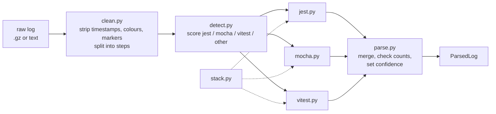

# Test log parsers

**In one sentence:** turns the raw log of a failed GitHub Actions job into a short, typed answer: which tests failed, with what error, in which file, and how many tests ran, so the Test expert does not have to read a million lines.

**Status:** working (steps 1 to 4 of P4.1: cleaning, stack frames, normalising, fixtures, the three parsers, the detector and the survey tool) · **Owner:** Member 3 (Test expert) · **Plan tasks:** P4.1

## What it does

A job log from GitHub is noisy. Every line starts with a timestamp, most have colour codes, and the test runner's report sits in the middle of setup, installs and cleanup. The same facts also look different in Jest, Mocha and Vitest. This package reads the log once and returns a `ParsedLog`:

- `framework`: `jest`, `mocha`, `vitest` or `other` (a runner we do not parse, or no tests at all, such as a build error). The values match `BehaviourDetails.framework` in `shared/contracts/diagnosis.py`.
- `failures`: one entry per failing test, with its full name (`describe > nested > test`), the file, the error type and message, the assertion diff, the stack frames and, for hooks, which hook failed.
- `results`: what the reporter printed per test or per file (passed, failed, skipped, todo) with durations.
- `summary`: the totals the runner printed (passed, failed, skipped, todo, total, failed files).
- `confidence`, `parsed_ok`, `warnings`: how far to trust all of the above (see below).

It never raises. If anything goes wrong the result has `parsed_ok=False` and a warning that names the exception type (never its text, which could contain log content).

## How it works



1. **Clean.** `clean.py` reads the log line by line, removes the timestamp, colour codes and `##[...]` markers, and splits it into workflow steps (each `Run <command>` group). Very long logs keep their head and tail. Lines stay up to 32 KB for storage; before the parsers look at a line it is cut at 2048 characters and stripped of trailing spaces (`parse.max_line_chars`), and every pattern is written to run in linear time, so a hostile line (minified code, a megabyte of spaces) cannot stall a worker.
2. **Detect.** `detect.py` looks for each runner's signature lines (a `Test Suites:` summary, `12 passing`, `Test Files`, a `Failed Tests` banner) and gives each framework a score. A parser runs when its score reaches a threshold. The step command (`yarn jest`) and the repo's configured framework only break ties, because the config is wrong for some repos (brianc/node-postgres says vitest but runs mocha).
3. **Parse.** Each parser reads the cleaned lines:
   - Jest: `  ● name › test` blocks (the `Summary of all failing tests` section when there is one), `PASS`/`FAIL` file lines, verbose `✓`/`✕` test lines, and the `Test Suites:` / `Tests:` summary.
   - Mocha: the `N passing / N failing` epilogue and its numbered failure blocks (the title is spread over several lines), plus spec-reporter test lines.
   - Vitest: the `Failed Tests` section (` FAIL  [project]  file > suite > test`, several lines can share one error), `Failed Suites`, `Unhandled Errors`, file and test lines, and the `Test Files` / `Tests` rows.
   - All three use `stack.py` to turn a stack line into a path with the runner workspace prefix removed (Windows drive letters, `file:///`, `webpack://`, `async`/`new` keywords) and to tell project code from dependencies, Node internals and unusable locations (browser URLs, `../` paths).
   - A parser builds at most `parse.max_failures` failures (1000). When a log has more, it stops reading failures, adds a warning and the result is marked `truncated`.
4. **Merge and check.** `parse.py` merges what the parsers found. A log can hold several runs (retries, one run per package); each run is checked against its own summary, so a retry that prints the same failure again still agrees. The confidence says how that went.

Confidence:

| Value | Meaning |
|---|---|
| 1.0 | the runner printed a summary and the failures found agree with it |
| 0.7 | a summary exists but the counts disagree (a trimmed log, a nested run, generated test names) |
| 0.4 | failures were found but no summary was printed (the job was killed) |
| 0.0 | nothing recognisable (no tests ran, or a runner we do not parse) |

`parsed_ok` is false only when the parser raised, or when the summary reports failures and no failing test or suite was found at all.

Other files: `normalise.py` replaces timestamps, durations, ports, addresses, temp paths and UUIDs so two failures that differ only in noise look the same (used for retrieval; `signature()` builds the short fingerprint). `make_fixtures.py` and `survey.py` are command-line tools (below). `models.py` holds the result types, `settings.py` loads `config/test_log_parsing.yaml`.

## How to run it

```python
from testing_expert.parsing import parse_log

result = parse_log(path_or_bytes_or_text, hint="jest")  # hint is optional
for failure in result.failures:
    print(failure.full_name, failure.file, failure.error_type)
```

```bash
# the tests (golden test per fixture, per-parser tests, never-raises, survey helpers)
uv run pytest experts/testing -q

# rebuild the fixtures from the local database (read-only; needs the DB and data/logs)
uv run --env-file .env python -m testing_expert.parsing.make_fixtures --suggest
uv run --env-file .env python -m testing_expert.parsing.make_fixtures

# check the parsers on about 2,000 real failed-job logs (read-only; not part of `make check`)
uv run --env-file .env python -m testing_expert.parsing.survey
uv run --env-file .env python -m testing_expert.parsing.survey --n 500 --seed 7
```

The survey prints the logs per framework, the number of exceptions (must be 0), the share of failed logs whose summary reports failures that yield at least one failing name (target 95%), the confidence spread, and the 10 worst misses by job id and repo only (no log text). It exits with 1 when an exception was caught or the target is missed.

Latest result (2,000 logs, seed 42, from 15,553 failed jobs with a stored log): 0 exceptions; of the 882 logs whose summary reports failures, 882 (100%) yield at least one failing name and 862 (97.7%) agree exactly with every summary (confidence 1.0); 954 logs (47.7%) are not parsed because they have no test output (build errors, installs, lint). The whole sample parses in about 30 s (slowest log about 2 s). A second sample (seed 7) gave 888 of 888 and 98.1%.

## Inputs and outputs

| | What | Where / format |
|---|---|---|
| In | a job log | `parse_log(source)`: log text, raw bytes (plain or gzip), a file path (`.log` or `.log.gz`) or a `CleanedLog` |
| In | repo framework hint (optional) | `parse_log(..., hint="mocha")`, used only to break ties |
| In | limits and rules | `config/test_log_parsing.yaml` (override the path with `TEST_LOG_PARSING_FILE`) |
| Out | the parse | `ParsedLog` (frozen dataclasses in `models.py`: `FailedTest`, `CaseResult`, `Summary`, `StackFrame`) |
| In (tests) | real fixtures | `experts/testing/tests/fixtures/logs/<framework>/*.log` with a hand-checked `*.expected.json` each, listed in `manifest.yaml` |

`FailedTest.kind` is `test` (a test or hook), `suite` (a whole file that could not run) or `unhandled` (an error vitest caught outside any test). `granularity` says what the reporter printed: `test` (every test), `file` (one line per file) or `none`.

## Settings

| Setting | Where | Default | What it changes |
|---|---|---|---|
| `clean.*` | `config/test_log_parsing.yaml` | 64 MiB input cap, 8 MiB head, 32 KiB line cap | how much of a huge log is read |
| `parse.max_line_chars` | same | 2048 | how much of each line the parsers look at |
| `parse.failure_raw_max_chars` | same | 8192 | size of the raw error text kept per failure |
| `parse.message_max_chars` | same | 4000 | size of the message part |
| `parse.max_body_lines` | same | 400 | lines read for one error block |
| `parse.max_failures`, `parse.max_results` | same | 1000, 50000 | failure blocks built before the parser stops (and `truncated` is set); results returned |
| `parse.test_file_pattern`, `parse.test_path_pattern` | same | `*.test.*`/`*.spec.*`, then tests folders | which stack frame names a Mocha failure's file |
| `parse.detect_min_score` | same | 3 | how sure the detector must be before a parser runs |
| `stack.*`, `normalise.*` | same | see the file | path mapping and retrieval normalisation |
| `fixtures.*` | same | seed 42, 64 KiB per fixture | the fixture tool |

## Example

A Mocha log ends like this:

```text
  74 passing (15s)
  1 failing

  1) encryption integration tests
       Tests that fields can be declared as encrypted:
     Error: Timeout of 2000ms exceeded. For async tests and hooks, ensure "done()" is called
      at listOnTimeout (node:internal/timers:585:17)
```

`parse_log` returns `framework="mocha"`, `summary.passed=74`, `summary.failed=1`, one failure named `encryption integration tests > Tests that fields can be declared as encrypted` with `error_type="Error"` and `file=None` (the stack has only Node internals), `confidence=1.0`, `granularity="none"` (this reporter prints nothing per test).

## Limitations and known issues

- **Paths are relative to the directory the tests ran from,** not always the repo root. The runner workspace prefix (`/home/runner/work/R/R/`, `D:\a\R\R\`) is removed, so a monorepo package that runs its tests from its own folder prints `src/x.ts` for `packages/p/src/x.ts` (typescript-eslint does this). P4.3 must match a path from the log on its suffix, or use the job's working directory, instead of assuming it is a repo-root path. A path that starts with `../` or is a browser URL (`http://localhost:3000/x.js`) gets kind `unknown` and `path=None` (the text stays in `StackFrame.raw`).
- **The parsing config must be found at run time.** `load_config` looks for `config/test_log_parsing.yaml` above the installed module, or at `TEST_LOG_PARSING_FILE`. The expert's Dockerfile does not copy `config/` and installs the package non-editable, so in a container the file is not found and `parse_log` returns `parsed_ok=False` with the warning "parsing config not found". Before any worker uses the parsers the Dockerfile needs `COPY config ./config` (in the runtime image) and `TEST_LOG_PARSING_FILE` set to its path. The Dockerfile has not been changed yet.
- **Mocha results have no file.** Mocha prints no file names, so `CaseResult.file` is always `None` for Mocha; only a failure gets a file, taken from its stack (and it can be `None` too).
- **The vitest dot reporter is tested on a synthetic log only.** No real fixture uses it (vite and svelte print file lines as well). The parser reads only the failure section and the summary for such a log and gives `granularity="none"`.
- **Remaining misses.** About 1% of the sampled logs with failures get confidence 0.7 (a log with more than 1000 failure blocks, such as eslint's 11,249, is one of them: it is marked `truncated`): vitest-dev's own tests (nested vitest runs print their own summaries), babel (child jest processes interleave with the main run), and typescript-eslint rule tests whose generated test names are multi-line code. The failures found are still returned; only the confidence says they may be incomplete.
- **Runners we do not parse.** `node:test`, TAP and Playwright are detected as `other` (no failures, confidence 0). The job's conclusion decides the label for those.
- **A passing job can print failures.** The puppeteer mocha runner prints `10 failing` for expected failures inside a successful job. The parser reports what the log says; the label comes from the job conclusion.
- **Mocha prints no file names,** so a failure's file comes from its stack and can be `None`. Vitest's default reporter lists only failing and slow tests, so its `results` are partial and `granularity` is `file`; passing tests there have no describe names.
- **Unique names.** A test that failed several times (retries) is one failure; two different tests with the same file and name also collapse into one (the counts then disagree and confidence drops to 0.7).
- **Trimmed fixtures** contain `[fixture trimmed: N lines omitted]` lines; the parsers treat them as ordinary lines, so summary counts can be higher than the failures left in the fixture (the expectation files say which).
- **Interleaved output.** When stdout and stderr interleave (some Windows runs), a failure's stack frames can appear after the summary and are not attached (mikro-orm fixture 94992812438).
- **No file-exists check.** Whether a path from the log exists in the commit is not checked here (P4.3 and P4.9 do that).
- **DEFAULT choices** (also marked `# DEFAULT:` in the code and config):
  - jest/vitest summary counts the runner omits (zero counts) read as 0; Mocha has no total, so `total = passing + failing + pending`;
  - several summaries in one log are added together (`summary_count` says how many); each run is checked against its own summary;
  - failures are unique per (kind, file, name); results are unique per (file, name) with the last print winning;
  - jest reads only `Summary of all failing tests` when a run has it; blocks in a run that reports no failures belong to another interleaved process; `● name` blocks under a `PASS` line are warnings;
  - a failing suite is named `Test suite failed to run` for both jest and vitest; an unhandled error is named `<section> > <first error line>`;
  - the detector weights, `parse.detect_min_score`, the vitest summary pairing window (300 lines) and the survey sample (2000 logs, seed 42, equal share per repo);
  - `framework` for a log with no recognisable runner is `other`, whatever the repo config says.

## Related

- Plan task P4.1 in `docs/PLAN.md`; spec in `docs/experts/test.md` section 8.
- `shared/sanitise/` scrubs logs before they reach disk; the fixtures are re-scrubbed by `make_fixtures.py` (emails become `user@example.invalid`).
- Next consumers: P4.2 (writes `results` and `granularity` to `testing.test_results`) and P4.3 (uses `failures[].file`, project frames, `parsed_ok` and `framework`).
