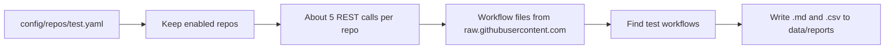

# Repository helper scripts

**In one sentence:** These scripts help choose dependency repositories and check whether configured repos are useful data sources.

**Status:** Working · **Owner:** shared · **Plan tasks:** P1.3, P4.14

## Load Dependency repository groups

`load_groups.py` adds candidate repos from `config/dependency_repository_groups.yaml` to
`config/repos/dependency.yaml`. Select one group, or deliberately select every group:

```bash
uv run python scripts/load_groups.py --group backend_frameworks
uv run python scripts/load_groups.py --all-groups
```

It merges candidates instead of replacing the config. Existing repository settings are kept,
and repos already present are not duplicated. New entries use `licence: TODO` and
`enabled: false`; this prevents guesses about licences from being treated as facts. Check the
licence on GitHub, replace `TODO` with its SPDX identifier (for example, `MIT`), and set
`enabled: true` for each repo you actually want to collect. Then run the Dependency collector
or prototype extractor.

Use `--groups-file` or `--config` to select different input/output files. The defaults point
to the project config files. `--group` and `--all-groups` cannot be used together.

## Re-run check script

The re-run check looks at every repo in a member's list on GitHub and writes a report saying
whether each repo is still a good place to collect failure data from.

## What it does

PipelineIQ learns from failed CI runs. Before the collector pulls data, the team needs to know if each repo has enough history and enough failures to be useful. GitHub only keeps 90 days of workflow runs, so a repo that is quiet or has short retention is a poor source.

The re-run check answers these questions for each repo in `config/repos/<member>.yaml`:

- How many runs happened in the last 90 days, and how many of them failed?
- How many of the newest runs were re-run? Re-runs are a sign of flaky tests.
- How far back does GitHub still keep runs? This is the real retention.
- Which workflow files look like they run tests?
- Does the licence in our config match the licence GitHub reports?

The script writes the answers to two files: a Markdown table you can read, and a CSV file you can open in a spreadsheet. Nothing is written to GitHub. The script only reads.

## How it works

1. The script reads the member's config file and skips repos marked `enabled: false`, unless you pass `--all`.
2. For each repo it asks GitHub's REST API (the web interface GitHub offers for programs to read data) a few questions. Each question is one "REST call". The repo's details come first, then the run counts, then the oldest run, then the list of workflow files.
3. It downloads each workflow file's text from `raw.githubusercontent.com`. These downloads are not REST calls, so they do not count against the hourly limit.
4. It checks each workflow file for test commands such as `npm test`, `jest`, `mocha` or `vitest`. Only the `test` member has this rule. For the other members, every workflow file counts as relevant.
5. It writes one row per repo to a Markdown file and a CSV file. A repo that fails gets an `ERROR` note and the other repos still run.



## How to run it

You need `uv` (the Python tool this project uses) and a GitHub token. The token is a password-like string that lets the script read GitHub. Keep it private.

Run these steps once from a fresh clone, in the repo folder.

1. Install the project. This also makes sure the installed `shared` package is up to date:

   ```bash
   make setup
   ```

   If the script later fails with an error about `shared` or `shared.github`, the installed copy is stale. Run this instead:

   ```bash
   uv sync --all-packages --reinstall-package pipelineiq-shared
   ```

2. Create your local settings file. It is git-ignored, so it stays on your machine:

   ```bash
   cp .env.example .env
   ```

   In PowerShell, use `Copy-Item .env.example .env`.

3. Open `.env` in an editor and set `GITHUB_TOKEN` to your GitHub token. Leave the other values as they are. The script does not read them.

4. Run the check:

   ```bash
   uv run --env-file .env python scripts/rerun_check.py --member test
   ```

   Running this command reads `.env` and passes its values to the script, so `GITHUB_TOKEN` is set.

Useful options:

| Option | What it does |
|---|---|
| `--member test` | Required. Which member's list to check. Only `test` has a detection rule. |
| `--all` | Also check repos marked `enabled: false`. Those rows show `no` in the Enabled column. |
| `--out-dir <folder>` | Write the reports to this folder instead of `data/reports`. A relative folder is relative to where you run the command. |
| `--config-dir <folder>` | Read the config from this folder instead of the repo's `config/`. The folder must contain `repos/<member>.yaml` and `workflow_detection.yaml`. |

### What you should see when it works

The script prints two lines that show where the files went. The paths are the real locations on your machine:

```
Report written: <repo>/data/reports/rerun_check-test-<YYYY-MM-DD>.md
CSV written:    <repo>/data/reports/rerun_check-test-<YYYY-MM-DD>.csv
```

The date is today's date in UTC, which can differ from your local date late in the day. Running again on the same day overwrites both files.

### Exit codes

| Exit code | Meaning |
|---|---|
| `0` | The reports were written. This is true even if some repos show `ERROR`. Read the Notes column. |
| `2` | Nothing was checked. Either `GITHUB_TOKEN` is not set, the config file is missing or invalid, the member name is unknown, or a command-line option is wrong. The message explains which. |
| `1` | The script crashed on something it did not expect (see Limitations). No report is written. |

## Inputs and outputs

| | What | Where / format |
|---|---|---|
| In | The member's repo list | `config/repos/test.yaml` (YAML) |
| In | Detection rule for `test` | `config/workflow_detection.yaml` |
| In | GitHub token | `GITHUB_TOKEN` in `.env` (read through `uv run --env-file .env`) |
| Out | Readable report | `data/reports/rerun_check-<member>-<YYYY-MM-DD>.md` (Markdown table, summary and legend) |
| Out | Spreadsheet report | `data/reports/rerun_check-<member>-<YYYY-MM-DD>.csv` (UTF-8, one row per repo, same columns) |

The whole `data/` folder is git-ignored. Reports are never committed.

## Reading the report

The Markdown file starts with a summary: how many repos were checked, how many were skipped as disabled, the window dates, the REST calls used, and the repos with errors or licence mismatches. The table has one row per repo. The legend at the bottom explains each column. The same columns appear in the CSV.

| Column | Meaning |
|---|---|
| Repo | The GitHub name, `owner/name`. |
| Enabled | `yes` or `no`, from the `enabled` flag in the config. Disabled repos only appear with `--all`. |
| Runs 90d | Workflow runs created in the last 90 days. The exact count from GitHub. |
| Failed 90d | Runs in that window that ended as `failure`. The exact count from GitHub. |
| Failure rate 90d | Failed 90d divided by Runs 90d. This is the true rate, not an estimate. |
| Sample n | How many runs are in the sample for the next two columns. This is the newest 100 runs of the window, or fewer if the repo has fewer. |
| Failure rate (sample) | The failure rate on the sample only. It favours recent runs. |
| Re-run share (sample) | The share of sample runs that were re-run at least once. A run counts as re-run when its `run_attempt` is above 1. A high value is a flaky-test signal. Sample only. |
| Oldest run | The creation date of the oldest run GitHub still lists. If the repo has more than 1,000 runs, the script cannot read that far back. The cell then says `older than <date>`. That date is only the 1,000th newest run. |
| Retention (days) | Today minus the Oldest run date. This is how much history can be collected. GitHub keeps at most 90 days. The cell shows `>N` when the 1,000-result limit applies. |
| Workflows | How many workflow files under `.github/workflows/` GitHub knows about for the repo. |
| Relevant workflows | The file names that the detection rule keeps for this member. Separated by `;`. For `test`, a file is relevant when one of its `run:` steps runs `npm test`, `jest`, `mocha`, `vitest` and similar commands. |
| Licence (config) | The `licence` value in the config file. |
| Licence (GitHub) | The licence id GitHub reports for the repo. `NOASSERTION` means GitHub could not tell. `none` means GitHub reports no licence. |
| Licence check | `match`: config and GitHub agree. `MISMATCH`: they disagree, so fix the config. `unknown`: GitHub gave no usable id, so check by hand. |
| API calls | REST calls spent on this repo, including retries. The target is about 5. |
| Raw calls | Workflow files fetched from `raw.githubusercontent.com`. These do not use the REST limit. |
| Notes | Errors and warnings for the repo. Multiple notes are separated by `;`. |

The Notes column can say:

- `ERROR: repo not found (404), or the token cannot see it`. Check the repo name and that the token can see it.
- `ERROR: GitHub error: ... (Actions may be disabled or the token lacks access)`. This is a 403. Actions may be turned off for the repo, or the token lacks access.
- `workflow file not fetched (404): ...`. A workflow was listed by GitHub but its file could not be downloaded.
- `configured workflow not found on GitHub: ...`. A path in the config's `workflows:` list does not exist.
- `some workflow files could not be parsed`. A workflow file is not valid YAML, so it was marked not relevant.

When a repo has an `ERROR`, the cells that come after the failing call are empty. Cells filled before the failure stay in the row. For example, the licence from GitHub is often still shown.

## Example

The test suite has a happy-path case with a made-up repo called `acme/widgets`. The fake GitHub answers 50 runs in 90 days, 10 of them failures, a sample of 4 runs with 2 failures and 1 re-run, an oldest run from 25 July 2026, and two workflow files. Only `test.yml` contains a test command. The check on 19 October 2026 makes 5 REST calls and 2 raw calls.

The row the script writes (the cells that matter here):

| Runs 90d | Failed 90d | Failure rate 90d | Sample n | Failure rate (sample) | Re-run share (sample) | Oldest run | Retention (days) | Workflows | Relevant workflows | Licence check | API calls | Raw calls |
|---|---|---|---|---|---|---|---|---|---|---|---|---|
| 50 | 10 | 20.0% | 4 | 50.0% | 25.0% | 2026-07-25 | 86 | 2 | `.github/workflows/test.yml` | match | 5 | 2 |

## Settings

| Setting | Where | Default | What it changes |
|---|---|---|---|
| `GITHUB_TOKEN` | `.env` | none (required) | The token the script uses to read GitHub. If it is missing, the script exits with code 2. Never paste it into chat, logs or commits. |
| `--member` | command line | none (required) | Which member's config to check. |
| `--all` | command line | off | Also checks repos marked `enabled: false`. |
| `--out-dir` | command line | `data/reports/` in the repo | Where the reports are written. |
| `--config-dir` | command line | the repo's `config/` | Where to read the config files. |
| `GITHUB_RATE_LIMIT_THRESHOLD` | `.env` | `200` | When fewer REST calls than this remain, the client waits until GitHub resets the limit. |
| `GITHUB_MIN_WINDOW_HOURS` | `.env` | `1` | Read by the GitHub client, but this script never splits run windows, so it has no effect here. |

The script does not read `MEMBER` from `.env`. It always takes the member from `--member`.

## REST budget

GitHub allows 5,000 REST calls per hour per token. The check fits well inside that.

- A typical repo uses **5 REST calls**: repo details, the run sample and total, the failed-run count, the oldest run, and the workflow list.
- **6 calls** if the oldest run is not on the guessed page. This happens when runs older than 90 days are still listed. The script then makes one more call.
- **More than 6 calls** if the repo has more than 100 workflow files, because the list is read 100 at a time. Retries after a rate-limit or server error also count.
- Workflow files come from `raw.githubusercontent.com`. They do not use the REST quota. The script uses one raw call per workflow file.
- `config/repos/test.yaml` has **25 enabled repos**. The full run therefore uses about **125 to 150 REST calls**, against the 5,000 per hour limit. That is roughly 3% of one hour's quota.

## Limitations and known issues

- **The sample is the newest 100 runs only.** The two sample columns (failure rate and re-run share) are rough. They lean towards recent runs. Only the 90-day columns use every run.
- **Only `failure` counts as a failure.** Runs that were cancelled or skipped are counted in Runs 90d but not in Failed 90d.
- **Detection only reads `run:` steps.** A workflow that runs tests through a `uses:` action, a reusable workflow, a script file, or a command such as `make test` is not marked relevant. Check those by hand.
- **Detection exists only for `test`.** For `dependency`, `build` and `infra` every workflow file is kept.
- **Workflow files are downloaded at the default branch name, not at a commit.** If the default branch moves while the script runs, the files can change. The collector later uses commit ids, so results can differ from what it sees.
- **Only GitHub errors are caught per repo.** Any other crash, such as an unexpected response shape, stops the whole run with exit code 1 and writes no report. Re-run after the fix.
- **Long waits are possible.** If the token is nearly out of REST calls, the client sleeps until GitHub resets the limit. The console may look stuck. Warning lines are printed while it waits.
- **Counts are taken as exact.** `docs/DATA.md` section 1 says GitHub shows counts above 2,500 as `2500+`. The script does not handle that wording. Check any repo with very many runs by hand. This has not been tested against a real repo.
- **Runs over 1,000 are cut off.** When the list has more than 1,000 runs, the oldest run is read from the 1,000th newest run. The cell says `older than <date>` and the retention shows `>N`.
- **Renames are noticed only when the name changes.** A change of letter case alone is not reported.
- **Archived repos** show a note. No new runs appear for them.
- **Licence values should be SPDX ids.** The config's licence is compared with GitHub's SPDX id (a standard licence code such as `MIT`). Write the config value the same way, or the check shows `MISMATCH`.

`# DEFAULT:` choices made in this component:

- `scripts/rerun_check.py`, `DEFAULT_OUT_DIR`: reports go to `<repo>/data/reports`, which is git-ignored. Override with `--out-dir`.
- `scripts/rerun_check.py`, `WINDOW_DAYS = 90`: the look-back is 90 days, GitHub's retention cap.
- `scripts/rerun_check.py`, `UNKNOWN_LICENCES`: the SPDX values `""`, `NOASSERTION`, `NONE` and `OTHER` mean GitHub could not tell, so the licence check says `unknown`.
- `pyproject.toml`, `[tool.pytest.ini_options] pythonpath`: `scripts/` is put on the test path so the tests can import `rerun_check`. `scripts/` is not a package.

The GitHub client and the workflow detection code have their own defaults (retry counts, backoff, timeouts, and "members without a rule keep every workflow"). They are listed in `shared/github/README.md` and `services/collector/README.md`.

## Related

- Plan task P1.3 in `docs/PLAN.md`. The task is not ticked there yet.
- `config/repos/test.yaml`: the repo list this script checks.
- `config/workflow_detection.yaml`: the test detection rule.
- `shared/github/README.md`: the GitHub client it uses for retries, rate limits and raw files.
- `services/collector/README.md`: the collector's repo config loader and workflow detection, which this script reuses.
- `docs/DATA.md` section 1: the 90-day retention, rate limit and 1,000-result limits this check is built around.
