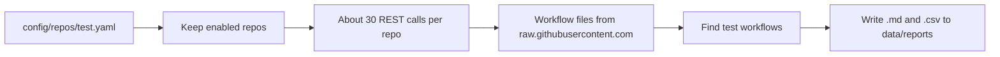

# Re-run check script

**In one sentence:** A command that looks at every repo in a member's list on GitHub and writes a report saying whether each repo is still a good place to collect failure data from.

**Status:** Working · **Owner:** shared (run by Member 3, Test) · **Plan tasks:** P1.3

## What it does

PipelineIQ learns from failed CI runs. Before the collector pulls data, the team needs to know if each repo has enough history and enough failures to be useful. GitHub only keeps 90 days of workflow runs, so a repo that is quiet or has short retention is a poor source.

The re-run check answers these questions for each repo in `config/repos/<member>.yaml`:

- How many runs happened in the last 90 days, and how many of them failed?
- How many of the newest runs were re-run? Re-runs are a sign of flaky tests.
- How far back does GitHub still keep runs? This is the real retention.
- Which workflow files look like they run tests?
- Does the licence in our config match the licence GitHub reports?

The script writes the answers to two files: a Markdown table you can read, and a CSV file you can open in a spreadsheet. Nothing is written to GitHub. The script only reads.

## How it works

1. The script reads the member's config file and skips repos marked `enabled: false`, unless you pass `--all`.
2. For each repo it asks GitHub's REST API (the web interface GitHub offers for programs to read data) a few questions. Each question is one "REST call". The repo's details come first, then the run counts, then the oldest run, then the list of workflow files.
3. It downloads each workflow file's text from `raw.githubusercontent.com`. These downloads are not REST calls, so they do not count against the hourly limit.
4. It checks each workflow file for test commands such as `npm test`, `jest`, `mocha` or `vitest`. Only the `test` member has this rule. For the other members, every workflow file counts as relevant.
5. It writes one row per repo to a Markdown file and a CSV file. A repo that fails gets an `ERROR` note and the other repos still run.



## How to run it

You need `uv` (the Python tool this project uses) and a GitHub token. The token is a password-like string that lets the script read GitHub. Keep it private.

Run these steps once from a fresh clone, in the repo folder.

1. Install the project. This also makes sure the installed `shared` package is up to date:

   ```bash
   make setup
   ```

   If the script later fails with an error about `shared` or `shared.github`, the installed copy is stale. Run this instead:

   ```bash
   uv sync --all-packages --reinstall-package pipelineiq-shared
   ```

2. Create your local settings file. It is git-ignored, so it stays on your machine:

   ```bash
   cp .env.example .env
   ```

   In PowerShell, use `Copy-Item .env.example .env`.

3. Open `.env` in an editor and set `GITHUB_TOKEN` to your GitHub token. Leave the other values as they are. The script does not read them.

4. Run the check:

   ```bash
   uv run --env-file .env python scripts/rerun_check.py --member test
   ```

   Running this command reads `.env` and passes its values to the script, so `GITHUB_TOKEN` is set.

Useful options:

| Option | What it does |
|---|---|
| `--member test` | Required. Which member's list to check. Only `test` has a detection rule. |
| `--all` | Also check repos marked `enabled: false`. Those rows show `no` in the Enabled column. |
| `--out-dir <folder>` | Write the reports to this folder instead of `data/reports`. A relative folder is relative to where you run the command. |
| `--config-dir <folder>` | Read the config from this folder instead of the repo's `config/`. The folder must contain `repos/<member>.yaml` and `workflow_detection.yaml`. |

### What you should see when it works

The script prints two lines that show where the files went. The paths are the real locations on your machine:

```
Report written: <repo>/data/reports/rerun_check-test-<YYYY-MM-DD>.md
CSV written:    <repo>/data/reports/rerun_check-test-<YYYY-MM-DD>.csv
```

The date is today's date in UTC, which can differ from your local date late in the day. Running again on the same day overwrites both files.

### Exit codes

| Exit code | Meaning |
|---|---|
| `0` | The reports were written. This is true even if some repos show `ERROR`. Read the Notes column. |
| `2` | Nothing was checked. Either `GITHUB_TOKEN` is not set, the config file is missing or invalid, the member name is unknown, or a command-line option is wrong. The message explains which. |
| `1` | The script crashed on something it did not expect (see Limitations). No report is written. |

## Inputs and outputs

| | What | Where / format |
|---|---|---|
| In | The member's repo list | `config/repos/test.yaml` (YAML) |
| In | Detection rule for `test` | `config/workflow_detection.yaml` |
| In | GitHub token | `GITHUB_TOKEN` in `.env` (read through `uv run --env-file .env`) |
| Out | Readable report | `data/reports/rerun_check-<member>-<YYYY-MM-DD>.md` (Markdown table, summary and legend) |
| Out | Spreadsheet report | `data/reports/rerun_check-<member>-<YYYY-MM-DD>.csv` (UTF-8, one row per repo, same columns) |

The whole `data/` folder is git-ignored. Reports are never committed.

## Reading the report

The Markdown file starts with a summary: how many repos were checked, how many were skipped as disabled, the window dates, the REST calls used, and the repos with errors or licence mismatches. The table has one row per repo. The legend at the bottom explains each column. The same columns appear in the CSV.

| Column | Meaning |
|---|---|
| Repo | The GitHub name, `owner/name`. |
| Enabled | `yes` or `no`, from the `enabled` flag in the config. Disabled repos only appear with `--all`. |
| Runs 90d | Workflow runs created in the last 90 days: the sum of 13 seven-day counts. `≥N` means at least N (GitHub stops counting at 2,500). |
| Failed 90d | Runs in that window that ended as `failure` (sum of 7-day counts, `≥N` = at least N). |
| Failure rate 90d | Failed 90d divided by Runs 90d. Empty when either number is `≥N` or the counts disagree. |
| Sample n | How many runs are in the sample for the next two columns. This is the newest 100 runs of the repo, or fewer if it has fewer. |
| Failure rate (sample) | The failure rate on the sample only. It favours recent runs. |
| Re-run share (sample) | The share of sample runs that were re-run at least once. A run counts as re-run when its `run_attempt` is above 1. A high value is a flaky-test signal. Sample only. |
| Oldest run | The creation date of the oldest run GitHub still lists. If the repo has more than 1,000 runs, the script cannot read that far back. The cell then says `older than <date>`. That date is only the 1,000th newest run. |
| Retention (days) | Today minus the Oldest run date. This is how much history can be collected. GitHub keeps at most 90 days. The cell shows `>N` when the 1,000-result limit applies. |
| Workflows | How many workflow files under `.github/workflows/` GitHub knows about for the repo. |
| Relevant workflows | The file names that the detection rule keeps for this member. Separated by `;`. For `test`, a file is relevant when one of its `run:` steps runs `npm test`, `jest`, `mocha`, `vitest` and similar commands. |
| Licence (config) | The `licence` value in the config file. |
| Licence (GitHub) | The licence id GitHub reports for the repo. `NOASSERTION` means GitHub could not tell. `none` means GitHub reports no licence. |
| Licence check | `match`: config and GitHub agree. `MISMATCH`: they disagree, so fix the config. `unknown`: GitHub gave no usable id, so check by hand. |
| API calls | REST calls spent on this repo, including retries and empty-window checks. About 30. |
| Raw calls | Workflow files fetched from `raw.githubusercontent.com`. These do not use the REST limit. |
| Notes | Errors and warnings for the repo. Multiple notes are separated by `;`. |

The Notes column can say:

- `ERROR: repo not found (404), or the token cannot see it`. Check the repo name and that the token can see it.
- `ERROR: GitHub error: ... (Actions may be disabled or the token lacks access)`. This is a 403. Actions may be turned off for the repo, or the token lacks access.
- `workflow file not fetched (404): ...`. A workflow was listed by GitHub but its file could not be downloaded.
- `configured workflow not found on GitHub: ...`. A path in the config's `workflows:` list does not exist.
- `some workflow files could not be parsed`. A workflow file is not valid YAML, so it was marked not relevant.

When a repo has an `ERROR`, the cells that come after the failing call are empty. Cells filled before the failure stay in the row. For example, the licence from GitHub is often still shown.

## Example

The test suite has a happy-path case with a made-up repo called `acme/widgets`. The fake GitHub holds 50 runs spread over 90 days, 25 of them failures, one of them a re-run, with the oldest on 22 July 2026, and two workflow files. Only `test.yml` contains a test command. The check on 19 October 2026 makes 30 REST calls (when every week has runs and failures) and 2 raw calls.

The row the script writes (the cells that matter here):

| Runs 90d | Failed 90d | Failure rate 90d | Sample n | Failure rate (sample) | Re-run share (sample) | Oldest run | Retention (days) | Workflows | Relevant workflows | Licence check | API calls | Raw calls |
|---|---|---|---|---|---|---|---|---|---|---|---|---|
| 50 | 25 | 50.0% | 50 | 50.0% | 2.0% | 2026-07-22 | 89 | 2 | `.github/workflows/test.yml` | match | 30 | 2 |

## Settings

| Setting | Where | Default | What it changes |
|---|---|---|---|
| `GITHUB_TOKEN` | `.env` | none (required) | The token the script uses to read GitHub. If it is missing, the script exits with code 2. Never paste it into chat, logs or commits. |
| `--member` | command line | none (required) | Which member's config to check. |
| `--all` | command line | off | Also checks repos marked `enabled: false`. |
| `--out-dir` | command line | `data/reports/` in the repo | Where the reports are written. |
| `--config-dir` | command line | the repo's `config/` | Where to read the config files. |
| `GITHUB_RATE_LIMIT_THRESHOLD` | `.env` | `200` | When fewer REST calls than this remain, the client waits until GitHub resets the limit. |
| `GITHUB_MIN_WINDOW_HOURS` | `.env` | `1` | Read by the GitHub client: the smallest window an empty-window check will split down to. |

The script does not read `MEMBER` from `.env`. It always takes the member from `--member`.

## REST budget

GitHub allows 5,000 REST calls per hour per token. GitHub returns a silent `0` for big filtered run queries (see Limitations), so the script no longer asks for one 90-day count. It sums 13 seven-day windows instead, through the hardened client in `shared/github`.

- A typical repo uses **30 REST calls**: 1 repo details, 1 newest-100 runs sample (also gives the unfiltered total), 13 run counts, 13 failed-run counts, 1 oldest run, 1 workflow list.
- Every window that comes back with 0 is checked again (2 retries and 2 half-windows), so it costs **5 calls instead of 1**. A quiet repo with, say, 6 empty run windows and 8 empty failure windows uses about 30 + 4 x 14 = **86 calls**. Worst case (every window empty) is 1 + 1 + 26 x 5 + 1 + 1 = **134 calls**.
- **More** if the repo has more than 100 workflow files, and for retries after a rate-limit or server error.
- Workflow files come from `raw.githubusercontent.com`. They do not use the REST quota.
- `config/repos/test.yaml` has **25 enabled repos**. A full run therefore uses about **750 calls** if every repo is busy (25 x 30), and at most about **3,350** if every window of every repo is empty. Busy repos with empty failure weeks sit in between. That is about 15% of one hour's quota in the normal case, so run the check once, not in a loop.

## Limitations and known issues

- **The sample is the newest 100 runs only.** The two sample columns (failure rate and re-run share) are rough. They lean towards recent runs. Only the 90-day columns use every run.
- **Only `failure` counts as a failure.** Runs that were cancelled or skipped are counted in Runs 90d but not in Failed 90d.
- **Detection only reads `run:` steps.** A workflow that runs tests through a `uses:` action, a reusable workflow, a script file, or a command such as `make test` is not marked relevant. Check those by hand.
- **Detection exists for `test` and `build`.** For `dependency` and `infra` every workflow file is kept.
- **Workflow files are downloaded at the default branch name, not at a commit.** If the default branch moves while the script runs, the files can change. The collector later uses commit ids, so results can differ from what it sees.
- **Only GitHub errors are caught per repo.** Any other crash, such as an unexpected response shape, stops the whole run with exit code 1 and writes no report. Re-run after the fix.
- **Long waits are possible.** If the token is nearly out of REST calls, the client sleeps until GitHub resets the limit. The console may look stuck. Warning lines are printed while it waits.
- **GitHub returns empty results for slow filtered queries.** Seen on a busy repo: a 90-day `created` range returned 0 runs while a one-week range returned 40, and `status=failure` returned 113 and then 0 an hour later. Because of this the script never uses a single 90-day filtered count. It sums 7-day windows, and any window that says 0 is asked again and split in halves before it is believed (a warning is logged if GitHub contradicts itself). If failed would still be larger than runs for a window, the run count is shown as `≥failed` and no rate is printed.
- **Counts stop at 2,500.** GitHub reports 2,500 for "2,500 or more" (`docs/DATA.md` section 1). A capped window makes the cell show `≥N` (a sum of lower bounds) and the failure rate stays empty, since a rate from capped numbers would be wrong. A week with 2,500 or more runs also means the repo is very busy.
- **The sample is the newest 100 runs, not the last 90 days.** The `(sample)` columns use the newest page of the unfiltered list, which on a busy repo covers only the last few days.
- **Runs over 1,000 are cut off.** When the list has more than 1,000 runs, the oldest run is read from the 1,000th newest run. The cell says `older than <date>` and the retention shows `>N`.
- **Renames are noticed only when the name changes.** A change of letter case alone is not reported.
- **Archived repos** show a note. No new runs appear for them.
- **Licence values should be SPDX ids.** The config's licence is compared with GitHub's SPDX id (a standard licence code such as `MIT`). Write the config value the same way, or the check shows `MISMATCH`.

`# DEFAULT:` choices made in this component:

- `scripts/rerun_check.py`, `DEFAULT_OUT_DIR`: reports go to `<repo>/data/reports`, which is git-ignored. Override with `--out-dir`.
- `scripts/rerun_check.py`, `COUNT_WINDOW_DAYS = 7` and `SAMPLE_SIZE = 100`: counts are summed over 7-day windows (small enough for GitHub to answer) and the sample is one page of the newest runs.
- `scripts/rerun_check.py`, `WINDOW_DAYS = 90`: the look-back is 90 days, GitHub's retention cap.
- `scripts/rerun_check.py`, `UNKNOWN_LICENCES`: the SPDX values `""`, `NOASSERTION`, `NONE` and `OTHER` mean GitHub could not tell, so the licence check says `unknown`.
- `pyproject.toml`, `[tool.pytest.ini_options] pythonpath`: `scripts/` is put on the test path so the tests can import `rerun_check`. `scripts/` is not a package.

The GitHub client and the workflow detection code have their own defaults (retry counts, backoff, timeouts, and "members without a rule keep every workflow"). They are listed in `shared/github/README.md` and `services/collector/README.md`.

## Related

- Plan task P1.3 in `docs/PLAN.md`. The task is not ticked there yet.
- `config/repos/test.yaml`: the repo list this script checks.
- `config/workflow_detection.yaml`: the test detection rule.
- `shared/github/README.md`: the GitHub client it uses for retries, rate limits and raw files.
- `services/collector/README.md`: the collector's repo config loader and workflow detection, which this script reuses.
- `docs/DATA.md` section 1: the 90-day retention, rate limit and 1,000-result limits this check is built around.

---

# Build screen

**In one sentence:** A command for the Build member that checks, with a real token, how many build, lint and type-check failures each repo in `config/repos/build.yaml` really has and how long a 90-day backfill of it would take.

**Status:** Written and tested on canned answers (respx); not yet run against GitHub · **Owner:** Member 2 (Build) · **Plan tasks:** B2

## What it does

The Build repo list was chosen from workflow files and git history only (no access to other people's CI runs at the time). Before the first `collector backfill --member build`, this script confirms each repo is worth collecting: enough build-type failures, and a pass 1 that finishes in hours, not days.

## How it works

1. Read `config/repos/build.yaml` (enabled repos; `--all` adds reserves; `--repo` picks some).
2. For each repo: read its details (licence, default branch) and its list of workflows.
3. Download each active workflow file from `raw.githubusercontent.com` (not counted against the REST limit) and keep the ones the Build detection rule keeps.
4. Read the newest 300 runs (unfiltered lists, which GitHub answers reliably). From them: the share of runs in build workflows, and the failed runs in build workflows.
5. Count all runs and all failed runs of the last 90 days in 13 seven-day windows, with the same hardened counting as the re-run check (`count_workflow_runs`). It never trusts one big filtered query, because GitHub sometimes answers those with a silent 0.
6. Open the jobs of up to 12 recent failed build-workflow runs and look at the name of each failed step. A step that builds, lints, format-checks or type-checks counts as a build-type failure (the same test the Build labeller uses when no log is available).
7. Estimate: build-workflow runs and failures in 90 days, build failures, pass 1 hours (`backfill --logs failed`, 1.6 REST calls per run as measured in the Test member's real backfill) and failed-log download hours (2.3 s per log in one lane). Suggest `keep` (50+ build failures, pass 1 under about 5 hours and failed-log downloads under 10 hours), `too quiet` or `expensive`. When GitHub stopped counting at 2,500 in a week the numbers are minimums; only the build workflows' runs are collected, so such a busy repo can still be cheap.
8. Write `data/reports/build_screen-<date>.md` and `.csv`, with totals for the repos marked keep.

## How to run it

```bash
uv run --env-file .env python scripts/build_screen.py           # enabled repos
uv run --env-file .env python scripts/build_screen.py --all     # with reserves
uv run --env-file .env python scripts/build_screen.py --repo vitejs/vite
```

About 30 to 45 REST calls per repo (about 1,500 for `--all`). It prints the two report paths.

## Limitations and known issues

- The build share comes from failed **step names**, not logs, and from a small sample. It is a rough guide. A repo that runs lint, types and tests in one step (for example `nx affected`) can show 0% although it has build failures.
- The build-workflow share comes from the newest 300 runs only; busy weeks can differ from quiet ones.
- The time estimates use averages measured on the Test member's repos; matrix-heavy repos cost more per run.
- Workflows are read at the default branch today; older runs may have used different files.

`# DEFAULT:` choices: `SAMPLE_PAGES = 3`, `SAMPLE_FAILED_RUNS = 12`, `MIN_BUILD_FAILURES = 50`, `MAX_PASS1_CALLS = 24_000`, `MAX_FAILED_LOG_HOURS = 10`, `CALLS_PER_RUN = 1.6`, `SECONDS_PER_LOG = 2.3`, `CALLS_PER_HOUR = 4_800`.

## Related

- `docs/experts/build.md` section 2: how the list was chosen and what to do with the report.
- `config/repos/build.yaml`, `config/workflow_detection.yaml` (member `build`).
