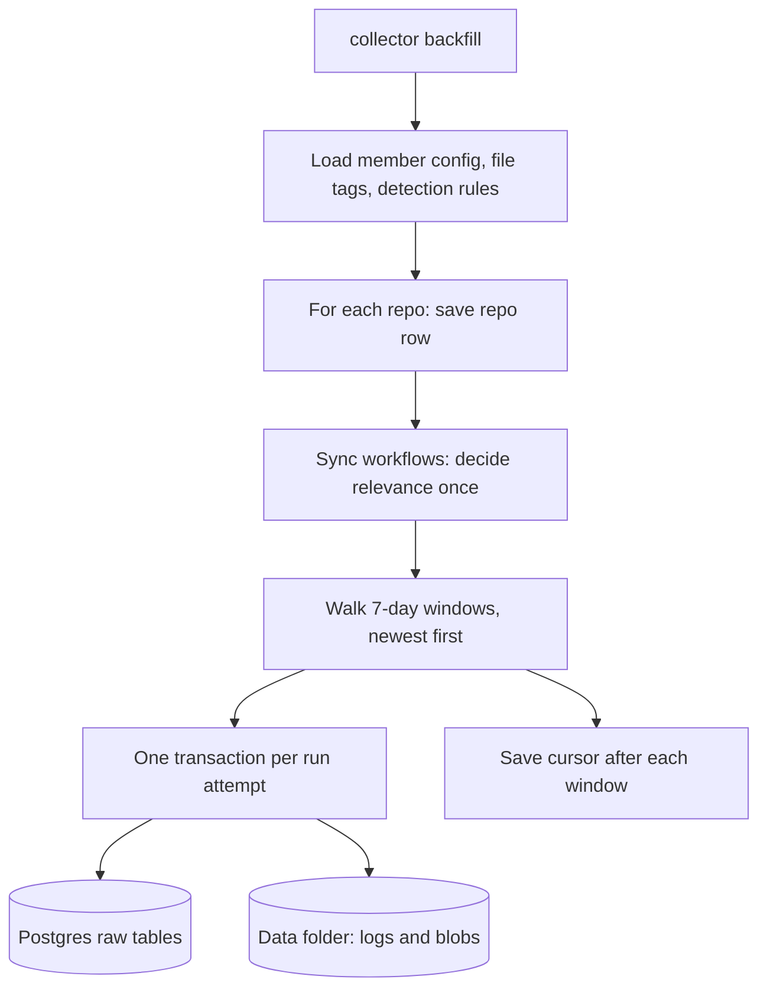
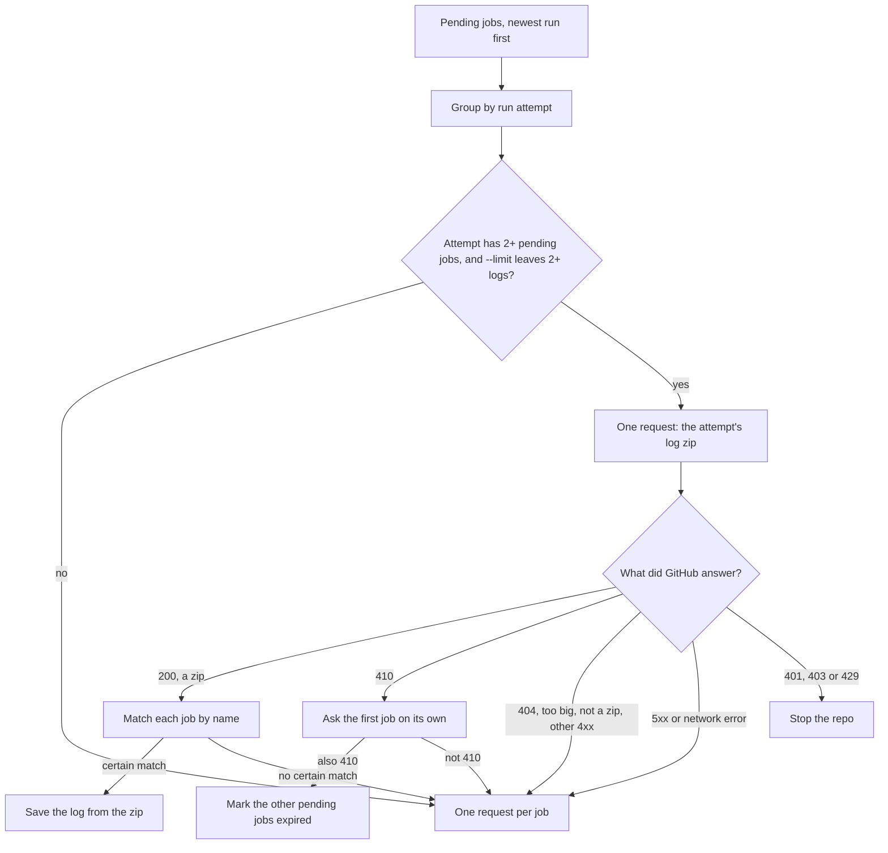
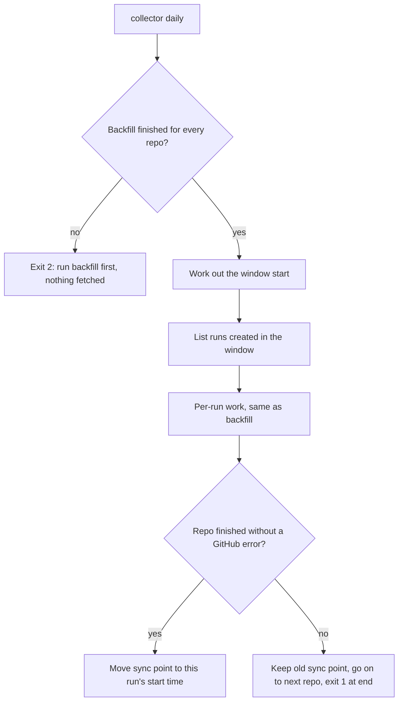
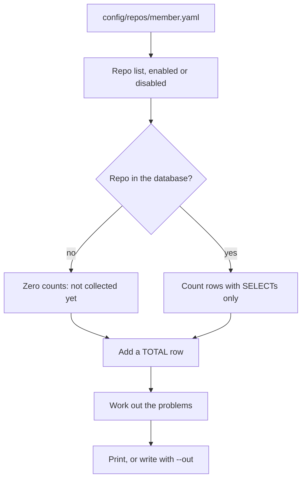
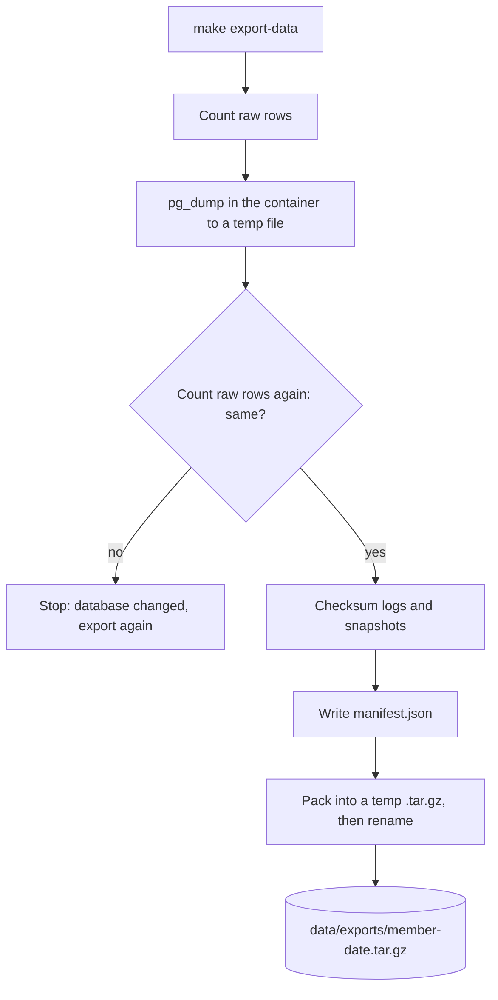
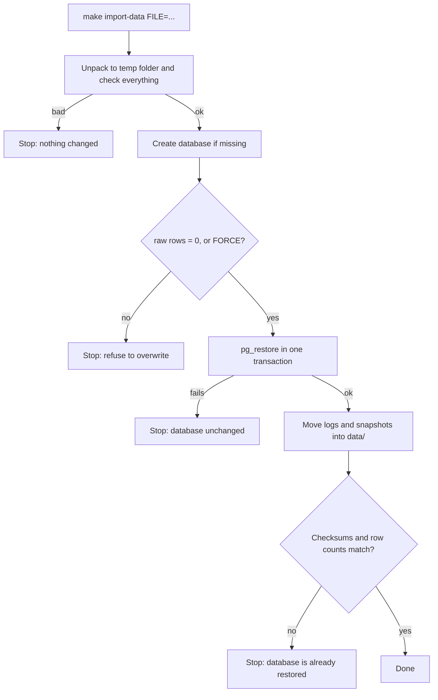

# Collector

**In one sentence:** The collector reads each team member's list of GitHub repositories and pulls the last 90 days of CI (continuous integration, automated build and test) runs, failure logs, commits and config files into the database, so the experts can learn from real failures.

**Status:** working (backfill with its two passes and `fill-logs`, log archive mode in `fill-logs`, skipped-run retry, daily, status, data-quality report, export and import) · **Owner:** shared · **Plan tasks:** P1.2 (repo config and workflow detection), P1.5 (backfill), P1.6 (daily and status), P1.7 (export and import), P1.8 (data-quality report). The two-pass log fill is decision D38, its `--passing` option is D40, skipped runs are D39, and the log archive mode of `fill-logs` is D41.

## What it does

PipelineIQ learns from real CI failures on real GitHub repositories. Each of the four team members (dependency, build, test, infra) picks a set of repositories that fit their topic. Those lists live in `config/repos/<member>.yaml`.

The collector is the part that reads those lists and collects the data. It has these jobs:

1. **Repo config loader (P1.2).** It opens a member's YAML file, checks every field, and turns it into clean Python objects. If the file has a mistake, it stops with a message that names the file, the repository and the field.
2. **Workflow detection (P1.2).** A GitHub repository can have many workflows (automated job files under `.github/workflows/`). Most are not relevant to a member. For example, the Test member only cares about workflows that run tests. Detection looks inside a workflow file and says whether it is relevant, and why.
3. **Backfill (P1.5).** The `backfill` command pulls the last 90 days of data for a member's repositories. It writes the data to Postgres tables and to files in the data folder. It is safe to run again: a second run adds nothing new. If it stops part way, the next run picks up where it left off. With `--logs failed` it skips the logs of passing jobs, which pass 2 collects later.
4. **Log fill, pass 2 (D38, D40, D41).** The `fill-logs` command fetches the logs that the backfill left out. It goes newest run first. It can also fetch only the passing-job logs of runs that had a failure (`--passing failed-runs`). By default it fetches all the logs of one run attempt with one zip download instead of one request per job (archive mode, D41). See "Two passes and parallel lanes" below.
5. **Skipped runs (D39).** When GitHub keeps answering one run with server errors (HTTP 5xx), the collector records that run in `raw.skipped_runs` and carries on with the repo. The next `backfill` or `daily` tries those runs again.
6. **Daily sync (P1.6).** The `daily` command keeps the data up to date after the backfill. It fetches the runs created since the last sync, and looks again at the last 14 days for new attempts of older runs.
7. **Status (P1.6).** The `status` command prints what is stored for each repo, the days with no runs, the backfill state, the logs still pending, the runs skipped, the last daily sync and the GitHub rate limit. It changes nothing.
8. **Export and import (P1.7).** `export` packs the whole database and the collected files into one `.tar.gz` archive, for sharing between members or as a weekly backup. `import` checks an archive and restores it into a database. Both work through the Postgres container, so no local Postgres tools are needed.
9. **Data-quality report (P1.8).** `report` prints a Markdown page for one member: per repo, how many runs, jobs and logs are stored, and a short list of problems to look at. It reads the database only, so it needs no GitHub token and makes no GitHub call. `--out FILE` saves the page to a file.

## How it works

### Repo config loader (P1.2)

1. Read the file as UTF-8 text. If it cannot be read, stop with "cannot read file".
2. Parse the YAML. YAML is a plain-text format for settings. The loader uses the safe parser, so a file cannot run code. If the YAML is broken, stop with "invalid YAML".
3. Check the top level. It must be a mapping (a list of `key: value` pairs). It must have a `member` field, and the value must be one of `dependency`, `build`, `test` or `infra`. It must match the file name: `config/repos/test.yaml` must say `member: test`.
4. Check the `repos` field. It must exist and be a list. Use `repos: []` for an empty list.
5. Check each repo entry, one at a time:
   - It must be a mapping.
   - `full_name` and `licence` are required text values. `full_name` must look like `owner/repo`.
   - `enabled` is optional and defaults to true. It must be a real YAML true or false. The text `'yes'` is rejected.
   - `workflows` is optional and defaults to an empty list. It must be a list of text values.
   - No two entries may name the same repository. The check ignores upper and lower case, because GitHub names do not care about case.
6. Keep any extra keys (for example `framework`, `flaky`, `note`) so they can be read later. They are not checked.

The loader stops at the first bad entry. It reports that one problem, so fixing one error may reveal the next.

### Workflow detection (P1.2)

Detection is driven by `config/workflow_detection.yaml`. That file holds, for each member, two lists of regular expressions. A regular expression (regex) is a pattern that matches text. `run_patterns` say which commands count. `exclude_patterns` say which commands do not count even if they match.

```mermaid
flowchart TD
    A[Workflow file text] --> B{Rule for this member?}
    B -- no --> K[Keep it: no rule for member]
    B -- yes --> C{Valid YAML mapping?}
    C -- no --> U[Not relevant: unparseable]
    C -- yes --> D[Collect every run: line, with its job]
    D --> E[Split each line on && & || ; and pipes]
    E --> F{Matches a run pattern and no exclude pattern?}
    F -- yes --> M[Relevant: matched]
    F -- no --> N[Not relevant: no match]
```

1. Find the member's rule in `config/workflow_detection.yaml`. If there is none, keep the workflow. This applies today to `dependency` and `infra`.
2. Parse the workflow file as YAML. If it is not valid, or its top level is not a mapping, mark it not relevant with reason "unparseable".
3. Walk every job and collect each line of every `run:` step, together with the job's key. A `run:` step is a shell command in a workflow. Steps that only use another action (`uses:`) are skipped. Blank lines are dropped.
4. Split each line into single commands. The splitting characters are `&&`, `&`, `||`, `;` and `|`. So `npm ci && npm test` becomes two commands, and each is judged on its own.
5. A command counts if at least one run pattern matches it and no exclude pattern matches it. "Matches" means the regex is found anywhere in the command.
6. If any command counts, the file is relevant, with reason "matched". The result lists each (job, command) pair that counted. If none counts, the reason is "no match".

Today the Test member's rules are:

- **Run patterns:** `npm`, `pnpm`, `yarn` or `bun` running `test` (including `npm run test:unit` and `pnpm -r test`); `turbo`, `nx` or `lerna` running a test target; and the runners `jest`, `mocha` or `vitest` themselves.
- **Exclude patterns:** installing or removing packages (`npm install`, `yarn add`, `npm ci` and similar), and `echo` or `printf` lines that only mention a runner.

The Build member's rules (see `docs/experts/build.md` section 2.2) keep a workflow when a job compiles, type-checks, lints, format-checks or bundles: `npm run build`, `pnpm -r typecheck`, `yarn lint:ci`, `npx tsc`, `eslint`, `vite build`, `prettier --check`, `turbo run build` and similar. They exclude installs, `echo` and `cd` lines, shell comments, quoted-string assignments, `docker build`, and folder paths such as `./packages/webpack`.

Detection itself does not fetch anything. The backfill fetches the workflow file and then calls detection.

### Backfill (P1.5)



A few words first. A **run** is one execution of a workflow. A run can be re-run, and each re-run is an **attempt** with its own number (1, 2, 3 and so on). A **job** is one unit of work inside a run. A **commit sha** is the unique ID of a git commit. A **transaction** is a group of database writes that either all succeed or all roll back.

1. **Load the config.** The command reads `config/repos/<member>.yaml`, `config/file_tags.yaml` and `config/workflow_detection.yaml`. A problem here stops the command with exit code 2 before any network call.
2. **Save the repo.** For each repo, the collector asks GitHub for the repo's ID and default branch, and saves a row in `raw.repos`. It also creates a `raw.sync_state` row if there is none.
3. **Sync workflows.** It lists the repo's workflow files and saves each one in `raw.workflows`. Relevance is decided once for each file path. The decision uses the file as it is at the head of the default branch (the newest commit on the main branch). The commit sha used is stored with the answer. Later backfills reuse the stored answer and do not look at the file again.
4. **Split the time range.** The range runs from 00:00 UTC, 90 days ago, to now. It is cut into 7-day windows. The newest window is walked first. For the default 90 days that makes 13 windows. If GitHub's 1,000-result limit is hit for one window, the GitHub client splits that window into smaller ones. If a window comes back empty, the client does not accept that at once: it asks again and then checks the two halves, because GitHub sometimes returns "0 runs" for a busy window without an error (see Limitations). Daily sync lists its window through the same client method, so it has the same protection.
5. **Walk each window.** The collector lists the runs in the window. A run of a workflow that is not relevant is skipped and nothing is stored for it. Every other run is processed in its own transaction (see the next section).
6. **Save the cursor.** After each window, the collector stores how many windows are done in `raw.sync_state.backfill_cursor`.
7. **Finish.** When all windows are done, it records `backfill_done_at` and clears the cursor.

#### What is stored for one run

For each attempt of a run, the collector stores:

| Table | What goes in |
|---|---|
| `raw.workflow_runs` | One row per run attempt: status, conclusion, branch, event, head sha, pull request numbers, time stamps, the hashed actor, and the run's JSON with some fields removed |
| `raw.jobs` | One row per job per attempt. Includes the mapped `job_key` (see below), the runner's operating system (guessed from labels) and the job's labels |
| `raw.steps` | One row per step of each job |
| `raw.commits` and `raw.commit_files` | The commit at the run's head sha: parent shas, hashed author, message, and each changed file with its patch. Stored once per sha |
| `raw.file_snapshots` | The text of the run's workflow file, and of each changed config file, at that sha |
| `raw.logs` | One row per job whose log the policy asks for. Says whether the log is `ok`, `expired` or `missing` |

The `job_key` is the job's key in the workflow YAML, for example `test`. The collector finds it by matching the GitHub job name, such as `test (20)` for a matrix job, against the YAML. If the match is unclear, `job_key` is left empty.

Each attempt has its own rows. Older attempts are read through the attempt metadata call, so each one gets its own row.

#### Log policy

- **Fetched:** failed jobs (conclusion `failure`, `timed_out` or `startup_failure`), and passing jobs (`success`) in relevant workflows.
- **Not fetched:** cancelled and skipped jobs, and jobs still running. They get no log row.
- **Runs of other workflows:** not stored at all.
- **Explicit list:** if a repo's `workflows` list in the config is not empty, it replaces detection. Only the listed files are relevant. Every other workflow file is marked not relevant.

#### Where the files land

Two kinds of file are written under the data folder (`DATA_DIR`, or `<checkout>/data` by default):

- **Logs:** `logs/{owner}/{repo}/{run_id}/{attempt}/{job_id}.log.gz`. A gzip file (a compressed file) holding the cleaned log text.
- **Blobs:** `snapshots/blobs/<first two characters>/<sha256>.gz`. These hold files stored by reference, mostly lockfiles (files that pin exact package versions, such as `package-lock.json`). The name is the hash of the file's original bytes, not a commit sha.

The database stores the path relative to the data folder (`storage_path`), so the folder can be moved. In `raw.logs`, `bytes` and `sha256` describe the `.gz` file on disk, not the text inside it.

#### Cleaning and personal data

- **Secrets are removed.** Log text, commit messages, diff patches, file snapshots and run titles go through the sanitiser (`shared/sanitise`). It removes tokens, keys, passwords and auth headers. The number of removals is stored as `redactions` on the log row.
- **Nul characters are removed.** A nul is a zero byte. Postgres text cannot hold one, so it is stripped from all stored text.
- **Logins are hashed.** The hash is SHA-256 of the team's salt plus the login (`IDENTITY_SALT`). The raw run JSON drops the fields `actor`, `triggering_actor`, `head_commit`, `repository` and `head_repository`.
- **Commit authors are hashed too.** The hash uses the GitHub login. If GitHub has no account for the author, the hash uses the commit's author email instead.
- **Patches over 1 MB are dropped.** The size is checked before cleaning. The file row keeps its other fields and gets `patch_truncated` set to true.
- **Lockfiles are stored by reference.** They are written to a blob file, and the snapshot row has `storage_path` and no inline text.
- **Co-authored-by lines are kept.** A commit message can contain `Co-authored-by:` lines with other people's names and emails. The sanitiser does not remove them. They are personal data in the database.

#### Missing and expired logs

| What GitHub says | What the collector stores |
|---|---|
| Log returned | Status `ok`, the `.gz` file is written |
| 410 (log expired) | Status `expired`, no file |
| 404 (not found) | Status `missing`, no file |
| 401 (a dead token) | The repo stops. Nothing is stored for that log. A re-run resumes |
| Other 4xx, for example 403 | Status `missing`, a warning is logged, and the repo carries on |
| 5xx or a network error | The repo stops. Nothing is stored for that log. A re-run resumes |

#### Two passes and parallel lanes (decision D38)

Logs of passing test jobs are by far the biggest part of a backfill: one run can have 20 jobs, and each log download takes a couple of seconds. GitHub deletes a day of history every day, so a single slow pass can lose data it has not reached yet. The collector therefore lets you collect in two passes. The end state is the same as one pass (D11); only the order changes.

1. **Pass 1: `collector backfill --member X --logs failed`.** Everything is collected as usual (runs, attempts, jobs, steps, commits, diffs, config snapshots) except the logs of passing jobs. Logs of failed jobs are fetched. A skipped passing log gets no row in `raw.logs`, not even a "missing" one, so pass 2 can find it. The summary line shows how many were deferred (`logs_deferred`).
2. **Pass 2: `collector fill-logs --member X [--repo R] [--limit N] [--passing all|failed-runs]`.** It looks for jobs that the log policy wants a log for and that have no `raw.logs` row, then fetches them newest run first (so if you stop early, you have the newest logs). Each log goes through the same code as the backfill: clean, gzip, write the file, save the row. An expired log (HTTP 410) or an unreadable one gets a status row, exactly as in the backfill. Each log is saved on its own, so you can stop with Ctrl+C at any time and run it again. A second run only sees what is still missing, so it fetches nothing once everything is done. `--limit N` stops after N logs in total across the repos of that run. `fill-logs` does not list runs, commits or files: it only asks GitHub for the logs. It fetches the logs of one run attempt as one zip where it can (archive mode, below).
3. **See progress:** `collector status` shows `logs pending: N` for each repo (jobs that need a log and have no row yet).

**Only the failed runs (`--passing failed-runs`, D40).** The default, `--passing all`, fetches every pending log, as described above. `--passing failed-runs` is narrower. Failed jobs (`failure`, `timed_out` or `startup_failure`) always get their log. A passing job gets its log only when its run has at least one failed, timed-out or startup-failed job, in any attempt. So if attempt 1 of a run failed and attempt 2 passed, attempt 2's passing logs are still fetched, because the run had a failure in attempt 1. Passing jobs in runs with no failure are left out. Those jobs stay without a `raw.logs` row, so `status` still counts them as `logs pending`. Running `fill-logs` without the flag later fetches the rest.

`daily` also supports `--logs all|failed` (default `all`, D46). `daily --logs failed` skips passing logs the same way, so they stay pending for `fill-logs`. Running `backfill --logs all` again after a `--logs failed` pass does **not** fill the gaps (runs already stored as complete are skipped); use `fill-logs`.

**Archive mode: one zip per run attempt (D41).** `fill-logs` now asks for the logs of a whole run attempt at once, unless you pass `--no-archive`. The reason is the quota. A token gets 5,000 requests an hour, and each job log costs one request. On the live database, 210,695 jobs were waiting for a log. Those jobs sit in only 7,002 run attempts, about 30 jobs each. One zip per attempt cuts pass 2 from about 210,000 requests to about 7,000.

A **run attempt** is one try of a run (a re-run is a new attempt). The zip is the log archive that GitHub builds for an attempt: one file per job.

How it works:

1. `fill-logs` reads the pending jobs, newest run first, as before. It groups them by run attempt, in the order they first appear.
2. An attempt with two or more pending jobs gets one request: the attempt's log archive. GitHub answers with a redirect to its storage. The token is not sent there (the client drops it on the redirect). The zip is read in memory, up to 150 MiB.
3. The zip holds one top-level file per job, named `{number}_{job name}.txt`. A folder per job (`{job name}/system.txt`) is ignored.
4. Each pending job is matched to one file, but only when the match is certain (the matching rule is below). A matched log is cleaned, gzipped and saved in the same way as a log downloaded on its own. The bytes are the same.
5. Every other pending job of that attempt gets its own request, exactly as before.
6. Each log is still saved in its own transaction. Ctrl+C is still safe, and a second run sees only what is still missing.

An attempt with only one pending job skips the archive. One request costs the same either way, and there is nothing to match.



**How a log is matched to a job.** The file name in the zip and the job name in the database are not the same text. GitHub removes some characters from file names. For example, the job `Build&Test: node-24, ubuntu-latest` is stored in the zip without its colon. So each name is reduced to a **key**: its letters and digits only, in lower case. The key of `Build&Test: node-24, ubuntu-latest` is `buildtestnode24ubuntulatest`. The zip file's `{number}_` prefix and `.txt` ending are removed first.

A job is matched only when both sides are unique:

1. Exactly one job of the attempt has that key. The check counts all jobs of the attempt that are stored, not only the pending ones. Two jobs whose names differ only in removed characters would otherwise look unique, and one of them could already be stored.
2. Exactly one top-level file in the zip has that key.

Anything else gets its own request: two jobs with one key, two files with one key, a job with no file, a name with no letter or digit at all, a file inside a folder, or an entry that cannot be read. A log can therefore never land on the wrong job. The cost of doubt is only an extra request.

**What each answer from GitHub does**

| Answer | What happens |
|---|---|
| 200, a zip | Matched jobs are saved from the zip. Every other pending job of the attempt gets its own request. If the zip is not a valid zip, the jobs fall back to their own requests |
| 410 | Not believed at once. The attempt's first pending job gets one normal request. If that answers 410 too (status `expired`), the logs of the whole attempt expired, and the other pending jobs get status `expired` with no more requests. With `--limit`, only as many as the limit allows (see Limitations). If the first job's own log is fine, the other jobs use their own requests. Cost: one extra request per expired attempt |
| 404, a zip over 150 MiB, any other 4xx (not 401, 403 or 429) | The jobs fall back to one request each. A too-large zip is checked while it is downloaded, so it is never held in memory in full |
| 5xx or a network error | The attempt's jobs fall back to one request each. A 5xx on one of those requests keeps the D39 rule (the log is left pending); a network error on one still stops the repo. The failure also counts toward a guard: after 5 archive downloads in a row fail this way, the repo stops with "GitHub looks unhealthy". A re-run resumes. Use `--no-archive` if the same attempts keep failing |
| 401, 403 or 429 | The repo stops (a dead token, a refusal, or a rate limit that never cleared), whatever the message. A re-run resumes |

**`--limit` and archives.** `--limit N` counts logs stored, as before. An archive stores at most what is left under the limit, in the same newest-first order. With only one log left, the archive is not used and one request is made. Note that the zip is downloaded whole even if only part of it is used.

**The summary line.** Each repo prints its counts. When archive mode did anything, the line gets three more counters:

```
owner/repo: logs ok 4, expired 0, missing 0; archives fetched 1 (3 logs), fell back to one request per job 0, archive failures 0
```

This is the shape the CLI test expects (`test_cli_uses_archives_by_default_and_reports_them`): four logs stored, three of them from one zip, and one job that needed its own request.

- `archives fetched N (M logs)`: zips that were opened, and how many logs came from them.
- `fell back to one request per job K`: attempts whose zip could not be used (404, too large, not a zip, other 4xx).
- `archive failures J`: archive downloads that failed with a 5xx or a network error. Their jobs then used their own requests.

The three counters are only printed when one of them is not zero. With `--no-archive` the line is the plain `logs ok, expired, missing` line. The 410 answer shows up in `expired`. Logs that failed with a 5xx on their own request are not printed; they stay `logs pending` in `status`.

**Verified and not verified.**

- *Verified on real data.* Two real runs were checked. First, vitejs/vite, run 40135357833, attempt 1, 10 jobs: the archive answered with a redirect to storage and a 120 KB zip. The entry `7_Build&Test node-24, ubuntu-latest.txt` was byte for byte the same as that job's own log download (156,426 bytes, including the UTF-8 byte order mark). The colon of that job name was missing from its file name, as the matching rule expects. Second, on 2026-10-26, Automattic/mongoose run 37232717702 (two attempts, one job each): the archive entry of attempt 1 and the entry of attempt 2 were each byte for byte the same as the per-job download of that attempt's job, and the two logs differ.
- *Not verified.* Re-run attempts with several jobs, expired archives (whether GitHub answers 410 or 404), reusable-workflow job names, whether the number in a file name is the job's position in the run, and whether skipped jobs have no file. Also how GitHub writes job names with non-ASCII letters into the zip file names. The key keeps Unicode letters, but I did not check the zip on such a job. If the names do not match, those jobs simply get their own request. I also did not check which other characters GitHub removes: only the colon was seen. The other behaviour (404, 410, 5xx, bad zip, the limit logic) is tested with a fake GitHub, not checked against live answers.

**Parallel lanes.** You can run several collector processes at the same time, one per repo, for the same member, against the same database and data folder:

```bash
uv run --env-file .env collector backfill --member test --repo owner/one --logs failed
uv run --env-file .env collector backfill --member test --repo owner/two --logs failed
```

What was checked for conflicts:

- `raw.sync_state`, the backfill cursor and the daily sync point are one row per repo, so lanes on different repos never touch the same row.
- Runs, jobs, logs and commits are keyed by GitHub's own ids (commits by repo and sha); logs are written under `logs/<owner>/<repo>/...`. Different repos never write the same row or file.
- The one shared path was `snapshots/blobs/<hash>.gz` (lockfiles are stored by content hash, so two repos can have the same file). Its temporary file name now includes the process id, so two lanes cannot overwrite each other's temp file. Both write identical bytes, so the result is the same.
- Each process has its own database connection and its own GitHub client. The rate-limit pause is per process.

What lanes **share**: the token's 5,000 requests per hour. Job-log downloads count against this limit too. This was measured on 2026-10-25. Pass 1 and pass 2 ran side by side, and every lane got HTTP 403 "API rate limit exceeded" on its job-log requests. The response had `x-ratelimit-remaining: 0` and `resource: core`. Each lane then waited for the hourly reset. So extra lanes do not speed up collection once the limit is the bottleneck. Each process counts only its own calls, so the lanes together can pass the limit before any one of them sees it. The client then waits for the reset and retries. `collector status` shows the remaining count as it was when `status` ran, so the number can be out of date. Do not run two lanes on the same repo at the same time: they would share one cursor. (Running `fill-logs` for a repo while its pass 1 is still running is safe but wasteful: both may fetch the same log, and the second write changes nothing.)

#### Errors and resuming

1. A network error, an auth error (401, 403) or a rate limit that never clears stops the current repo. The transaction for the run that was being saved is rolled back, so no job is stored without its run. A 5xx error does **not** stop the repo any more: see "Skipped runs" below.
2. The cursor stays at the last finished window. Other repos in the same command still run. The command exits with code 1 at the end.
3. Run the same command again. Finished windows are skipped. Runs that are already stored as complete are skipped too.

The cursor is a small JSON value holding `started_at`, `days`, `window_days` and `windows_done`. If the saved cursor was made with different `--days` or `--window-days` values, it is ignored with a warning, and the backfill starts over. Data already stored is skipped, so this costs API calls but does not duplicate rows.

#### Skipped runs (GitHub 5xx on one run)

For a few big runs GitHub answers the jobs listing with HTTP 502 on every retry (it times out). Before this, one such run stopped the whole repo and every re-run hit it again. Now:

1. When the jobs listing of a run fails with a 5xx after the normal retries, the client asks again with smaller pages (30 jobs per page, then 10), still with `filter=all`. The result is the same jobs as a normal listing, never duplicated, because each attempt starts again from page 1.
2. If it still fails (or the attempt metadata, a commit or a file of that run fails with a 5xx), the run is **skipped**: the run's transaction is rolled back (nothing half-collected), a row is written to `raw.skipped_runs` (repo, run id, latest attempt, reason, time), a warning with `repo`, `run_id` and `attempt` is logged, and the backfill goes on. The window cursor advances as usual, so the repo finishes.
3. The next `backfill` of that repo, and every `daily`, first retries the repo's skipped runs (it fetches the run again by id, then processes it). A run that works is removed from `raw.skipped_runs`. A run GitHub no longer has (404) is dropped from the list with a warning. A run that still fails is not tried a second time in the same command.
4. Network errors (`transport error`), auth errors (401/403) and rate limits that do not clear still stop the repo, so an internet outage never marks runs as skipped. A GitHub-wide streak of 5xx errors stops the repo too: after 5 runs in a row skipped (any success resets the count; the retry pass does not count) the command fails with "GitHub looks unhealthy: 5 runs in a row failed with server errors; re-run to resume". The skipped rows are kept and retried next time.
5. A log download that fails with a 5xx (in `backfill` or `fill-logs`) is not a skipped run: the log is left without a `raw.logs` row (pending), a warning is logged, and the command continues. `fill-logs` tries it again next time; its `--limit` counts only logs that were really fetched.
6. `collector status` shows `runs skipped (GitHub server errors): N` in each repo's detail block.

The table comes from migration `0003` (run `make migrate`).

#### Running twice changes nothing

- Every write is an upsert. An upsert inserts a row, or updates it if the key already exists. The keys are GitHub's own ids (for example run id and attempt, job id, commit sha).
- Gzip files are written with a fixed level, no file name and a zero time stamp, so the same input gives the same bytes. Files that already hold the same bytes are not rewritten.
- The `source` column of a run is set on the first insert only. A row owned by the GitHub App keeps its source when the collector writes it again.
- A run is treated as done once its latest attempt has status `completed`. Runs still in progress are read again next time.

#### Transactions and requests

- **One run is one transaction.** The collector holds the database transaction open while it makes the GitHub calls for that run. This is simple and safe, but a database connection stays open during those calls.
- **No per-run request cap.** The collector does not count requests per run. The shared GitHub client counts REST calls. When fewer than 200 calls remain in the token's hourly budget (`GITHUB_RATE_LIMIT_THRESHOLD`), it sleeps until the budget resets. A backfill can take hours.
- **Calls per run.** One jobs listing per run, one commit call per new sha (with more pages if the commit has many files), one log call per fetched log, and one raw file call per snapshot.

### Daily sync (P1.6)

The backfill fills the database once. The daily sync keeps it current. It does not start from 90 days ago again. It only looks at the time since the last sync, plus a 14-day look-back.

Each repo has a **sync point**: the time its last daily sync started. It is stored as `last_daily_sync_at` in `raw.sync_state`. The backfill sets it when the backfill finishes.



1. **Check every repo first.** Each repo needs a sync point, which only a finished backfill sets. If one repo does not have it, the command stops with exit code 2 and makes no GitHub call. The message says to run the backfill first.
2. **Work out the window start.** It is the earlier of two times: the last sync point, and 14 days before now. So the window is always at least 14 days long. Runs in that window are read again, which picks up new attempts of runs that were re-run. The 14 days is a default (see Limitations).
3. **Catch up after a gap.** If the last sync is more than 90 days old, the window cannot start before 90 days ago, because GitHub keeps runs for about 90 days. The repo's line then says WARNING, and a log warning is written. Runs in the lost part are not in the database.
4. **Process each run the way the backfill does.** The daily sync calls the backfill's own per-run code. A run whose latest attempt is stored and completed is skipped. Any other run is read again: older attempts, jobs, steps, and logs for jobs that have no log row yet. Logs already stored are not fetched again.
5. **Move the sync point.** Only when the whole repo finishes without a GitHub error does `last_daily_sync_at` move. It moves to the time this run started, cut to whole seconds. Runs created while the sync was running are then inside the next window. If a GitHub error stops the repo, the old sync point stays, so the next run covers the same time again. The other repos still run, and the command exits with code 1 at the end.

Running it twice in a row changes nothing. The second run processes no runs and makes no job, log, commit, or attempt calls. The test for this checks that.

**Example.** The daily tests use the recorded fake repo `acme/widgets`. The backfill ran on 19 October 2026 at 12:00 UTC. On 20 October at 12:00 UTC, a re-run of run 9001 (created on 12 October) has a second attempt. The daily command prints a line like this:

```
acme/widgets: window 2026-10-06 12:00..2026-10-20 12:00 UTC; runs seen 3, new or changed 1, already stored 1, ...
```

The window starts 14 days back. "Runs seen 3" includes a release workflow run, which is not relevant. That run is counted in "runs seen" but in neither of the other two counts. The sync point then moves to 20 October at 12:00 UTC.

### Status (P1.6)

`status` reads the database and prints a report. It makes no changes. It needs only `DATABASE_URL`. A GitHub token is optional. Without one, the rate limit line says it is unavailable.

The report has these parts:

- **Rate limit.** GitHub's core REST quota: the limit, how many calls remain, and when it resets. It comes from GitHub's `/rate_limit` endpoint, which does not use up quota. If there is no token, or the request fails, the line says "unavailable" and gives the reason.
- **A table, one row per repo** in the member's file. Disabled repos are marked "(disabled)". Columns: `runs` (distinct run ids), `attempts` (one per stored run attempt), `jobs`, `logs ok`, `expired`, `missing`, and `commits`.
- **Backfill state:** not started, in progress (for example "4 of 13 windows done"), or done with the time.
- **Last daily sync:** the sync point, or "never".
- **First and last day** with a stored run.
- **Days with zero runs.** These are days with no runs between the first and last stored day, within the last 90 days. They are shown as ranges. At most 8 ranges are listed, then "and N more". The report labels them "may just be quiet days". A gap is not proof of lost data, because a repo may simply have no CI runs on some days. A missed sync also looks like a gap.
- **Repos not in the database yet** show "not collected yet: run `collector backfill` first".

**Example.** The status test uses the recorded fake repo `acme/widgets` after a backfill. Its row reads `acme/widgets 3 4 8 5 1 1 3`: 3 runs, 4 attempts, 8 jobs, 5 logs ok, 1 expired, 1 missing, 3 commits. Runs were created on 1 August, 12 October and 15 October. The report then says:

```
  days with zero runs between first and last collected: 73 of 76 (may just be quiet days, not missing data):
    2026-08-02 to 2026-10-11 (71 days)
    2026-10-13 to 2026-10-14 (2 days)
```

### Data-quality report (P1.8)

The report answers one question: is the stored data good enough to learn from? It reads what is stored for each repo in the member's list and writes a Markdown page. Markdown is plain text with simple table marks, so the page also reads well in a terminal.

A few words first. A **job conclusion** is GitHub's verdict on one job, such as `success` or `failure`. A **redaction** is a secret that the sanitiser replaced in a stored log. An **expired** log is one that GitHub has deleted (HTTP 410).



1. **Read the repo list.** The command loads `config/repos/<member>.yaml`. It needs this file, but no GitHub token.
2. **Look up each repo.** A repo from the list that is not in the database yet gets zero counts and is marked "not collected yet".
3. **Count what is stored.** For each stored repo, the command runs read-only queries (SELECT only) over the runs, jobs, logs, skipped runs and redactions. The queries are in `store.py` (`repo_counts` and `repo_quality`).
4. **Add a TOTAL row.** It adds up all repos. The first and last run dates are the earliest and latest of all repos.
5. **Find the problems.** The rules are in the next part of this section.
6. **Print the page.** Without `--out`, it goes to the screen. With `--out FILE`, it is written to that file, and the folder is created if it is missing. The command then prints `wrote <path>`.

The page has a Problems section first, then three tables: Runs, Jobs and Logs. Every table has one row per repo from the list, and a TOTAL row.

**Runs table**

| Column | What it means |
|---|---|
| repo | `owner/name`. `(disabled)` means the repo has `enabled: false` in the list |
| runs | Distinct workflow runs stored |
| attempts | Stored run attempts. A run that was re-run has one row per attempt |
| re-run runs | Runs with more than one attempt |
| runs with failed job | Runs where a job of any attempt has a failed conclusion (`failure`, `timed_out` or `startup_failure`) |
| first run, last run | The UTC day of the oldest and the newest run. `-` if there are none |
| runs skipped | Runs given up after GitHub server errors (5xx). The next `backfill` or `daily` retries them |

**Jobs table**

| Column | What it means |
|---|---|
| jobs | Stored jobs, for all attempts |
| success, failure, timed_out, cancelled, skipped | Jobs with exactly that conclusion |
| other | Jobs whose conclusion has no column: `startup_failure`, `neutral`, `action_required`, and jobs with no conclusion yet |
| failed jobs | `failure` + `timed_out` + `startup_failure`. This is the same set the log policy fetches logs for |

**Logs table**

| Column | What it means |
|---|---|
| logs ok | Logs stored and readable |
| expired | Logs GitHub had deleted (410) |
| missing | Logs that could not be read, for example after a 404 or another 4xx |
| pending | Jobs that should have a log but have no log row yet. Run `collector fill-logs` |
| redactions | Secrets replaced across the stored logs |
| expired share | expired divided by all log rows stored for the repo, whatever their status. `-` if the repo has no logs |

**How the problems section decides.** Each rule looks at the repos in the list that are enabled. Disabled repos are never checked. A rule with no matches prints nothing. If no rule matches, the page says "No problems found."

- **Repos with zero runs.** Enabled repos with no stored runs. A repo not in the database yet is marked "(not collected yet)". `prettier/prettier` and `vuejs/core` show up here as "not collected yet" because they are postponed on purpose.
- **Repos with runs but no jobs.** Enabled repos with at least one run and no stored job at all. The jobs were never collected, so the run list alone is not useful.
- **Repos with jobs but no failed jobs.** Enabled repos with stored jobs and none that failed. A healthy repo can look like this, so this is a question to ask, not a verdict. A repo with runs but no jobs is listed only under the rule above.
- **Repos where more than 50% of the logs are expired.** The only rule with a threshold. A share of exactly 50% is not flagged.
- **Repos with logs still pending.** Any repo with at least one pending job. The fix is `collector fill-logs`. Logs that `fill-logs --passing failed-runs` (D40) leaves pending on purpose still show up here as problems, because the report cannot tell them from logs that were simply not fetched yet.
- **Repos with skipped runs.** Any repo with at least one row in `raw.skipped_runs`.

**Read-only.** The report issues SELECTs only and makes no GitHub request. A test checks that the database is the same before and after the report, and that the GitHub fake gets no request. It needs only `DATABASE_URL`, and it does not need `GITHUB_TOKEN` or `IDENTITY_SALT`.

**Exit codes**

| Code | Meaning |
|---|---|
| 0 | The page was printed, or written with `--out` |
| 1 | `--out` could not be written, for example because the path is a folder. The error says `cannot write <path>` |
| 2 | `DATABASE_URL` is missing, the config file is bad, or an option is wrong (for example `--member` is missing) |

**Example.** The report tests use the recorded fake repo `acme/widgets` after a backfill. The test adds two more repos to the list: `acme/never-collected` (not in the database) and `acme/reserve` (disabled). With the report time set to 27 October 2026, 09:30 UTC, the start of the output and the Problems and Logs sections read:

```
# PipelineIQ data-quality report: member=test

As of 2026-10-27 09:30 UTC. Read from the database only; nothing was fetched from GitHub.

## Problems

- Repos with zero runs (1): acme/never-collected (not collected yet)

Disabled repos are listed in the tables but not checked here.

## Logs

| repo                    | logs ok | expired | missing | pending | redactions | expired share |
| ----------------------- | ------: | ------: | ------: | ------: | ---------: | ------------: |
| acme/widgets            |       5 |       1 |       1 |       0 |          1 |           14% |
| acme/never-collected    |       0 |       0 |       0 |       0 |          0 |             - |
| acme/reserve (disabled) |       0 |       0 |       0 |       0 |          0 |             - |
| TOTAL                   |       5 |       1 |       1 |       0 |          1 |           14% |
```

The Runs and Jobs tables and the footnotes are left out of this excerpt. The fixture has 3 runs, 4 attempts and 8 jobs for `acme/widgets`. Its one expired log out of 7 stored logs gives 14%, which is below the 50% limit, so it is not a problem.

### Export and import (P1.7)

Members share data by sending each other a file, not by copying Docker volume folders. Postgres data folders do not move safely between machines. The export archive is also the weekly backup.

A few words first. A **dump** is a copy of the database in a format Postgres can read back. **pg_dump** and **pg_restore** are the Postgres tools that make and read dumps. A **checksum** is a fingerprint (a SHA-256 hash) of a file. If one byte changes, the checksum changes. A **manifest** is a small JSON file that lists what should be in the archive, with its checksums and row counts.

**The archive.** One `.tar.gz` file (a compressed tar archive) holds:

| Entry | What it is |
|---|---|
| `manifest.json` | Who made it, when, from which git commit, the database name, the dump's checksum and size, the row count of every `raw` table, and a checksum for every file |
| `db.dump` | The whole database in pg_dump's custom format. That means every schema, the `alembic_version` table (which migration the database is at) and the `vector` extension |
| `files/logs/...` | The gzipped job logs from `data/logs/` |
| `files/snapshots/...` | The lockfile blobs from `data/snapshots/` that `raw.file_snapshots` points at |

Nothing else under `data/` goes in. In particular `data/exports/` and any reports do not.

The archive itself has no timestamps: its entries, order and gzip header are fixed. So two exports of the same data should give the same bytes. The offline test checks this with a fake dump. Whether a real pg_dump always gives the same bytes was not checked.

**Where the database work runs.** The collector does not need a local Postgres client. It runs `docker compose exec -T postgres ...` and runs pg_dump, pg_restore and psql inside the `postgres` container. So **Docker must be running**. No password is passed. The commands rely on the container's local socket accepting connections without one, which was not checked here. The user and database name come from `DATABASE_URL`. The host and port in `DATABASE_URL` are ignored, because the commands always run in the compose container.

The exact commands, with the user and database filled in:

```bash
pg_dump -U <user> -d <db> -Fc --no-owner                      # dump goes to db.dump
pg_restore -U <user> -d <db> --no-owner --no-privileges --clean --if-exists \
           --single-transaction --exit-on-error               # dump comes from stdin
psql -U <user> -d <db> -X -v ON_ERROR_STOP=1 -A -t -c "<sql>" # counts and checks
```

**Export, step by step.**

1. Read the database name and user from `DATABASE_URL`, or from `--database`.
2. Count the rows of every table in the `raw` schema.
3. Run pg_dump into a temporary file inside the output folder. An empty dump is an error.
4. Count the `raw` rows again. If the count changed, stop. Someone wrote to the database during the dump, so the archive would not match itself. Stop the collector and export again.
5. Take a checksum of every file under `data/logs/` and `data/snapshots/`.
6. Write `manifest.json` (sorted, so equal data gives an equal manifest).
7. Pack the manifest, the dump and the files into a temporary `.tar.gz`, then rename it to its final name. The rename replaces an archive with the same name from the same day.



**Import, step by step.** The import checks everything before it changes anything. Steps 2 and 4 change the database. Step 5 changes `data/`.

1. **Unpack into a temporary folder** inside `data/`, and check the archive (see the safety rules below). Check the dump's checksum and every file's checksum against the manifest. If anything fails, stop. The database and `data/logs` are not touched.
2. **Create the database** if it does not exist yet.
3. **Refuse if the database is not empty.** If the `raw` schema has any rows, stop, unless `--force` (or `FORCE=1`) is given. Only `raw` is counted (see Limitations).
4. **Restore the dump.** pg_restore runs in one transaction. If it fails, the database is left as it was.
5. **Move the files** into `data/logs/` and `data/snapshots/`. A file already at the same path is replaced. If a symbolic link is in the way, the import stops.
6. **Verify.** Check every file's checksum in `data/` against the manifest. Count the `raw` rows again and compare them with the manifest.



If step 6 fails, the database stays restored and the files stay where they were moved. Run the import again with `FORCE=1`, because the database now has rows.

**Archive safety rules.** The import does not trust the archive's paths:

- Only `manifest.json`, `db.dump`, and files under `files/logs/` or `files/snapshots/` are allowed. Every file must be listed in the manifest, and every listed file must be in the archive. Extra or missing files stop the import.
- No absolute paths, no drive letters (`C:`), no backslashes, no `..`, no `.`, and no empty path parts.
- Only regular files and folders. Symbolic links, hard links, devices and named pipes are refused.
- No duplicate names.
- The import writes files itself, from the archive stream, into the temporary folder. It never uses a general "extract everything" call.

**Export and import options.** Some rows are for `make`, some for `uv run collector`.

| Option | Command | Meaning |
|---|---|---|
| `MEMBER=<name>` | `make export-data` | Required. One of `dependency`, `build`, `test`, `infra`. Makes the file name and goes in the manifest. It does not select data |
| `FILE=<path>` | `make import-data` | Required. The `.tar.gz` to import |
| `FORCE=1` | `make import-data` | Same as `--force`. Any other value is ignored |
| `--member` | `collector export` | Required, as above |
| `--database NAME` | `export`, `import` | Database name. Default: the one in `DATABASE_URL`. The user still comes from `DATABASE_URL` |
| `--data-dir PATH` | `export`, `import` | Folder with `logs/` and `snapshots/`. Default: `DATA_DIR`, else `<checkout>/data` |
| `--out-dir PATH` | `export` | Where the archive goes. Default: `<data-dir>/exports`, so `data/exports` |
| `--force` | `import` | Allow the import when `raw` already has rows. The restore then replaces every table in the dump |
| `FILE` | `collector import` | The archive path (positional argument) |

With `make`, the `MEMBER` and `FILE` values can come from `.env`. The Makefile loads `.env` first.

**Exit codes.** `export` and `import` return 0 on success. A failure (a `TransferError`, such as a checksum mismatch, a refused import or a failed container command) prints `export failed: ...` or `import failed: ...` on stderr and returns 1. A wrong option or a missing file argument returns 2, from the option parser.

**Example.** The offline tests (`test_export_import.py`) run an export with a fake Postgres. The file is named `test-2026-11-02.tar.gz`. The archive starts with `manifest.json` and `db.dump`, then `files/logs/...` and `files/snapshots/...`. The manifest says `"member": "test"`, `"date": "2026-11-02"` and the commit. The row counts are the `raw` tables only. The export command then prints `wrote <path> (<rows> rows in <tables> tables, <files> files)`. The import command prints `imported <file>: ... checksums and counts match` when everything passes.

The integration test (`test_export_import_db.py`) does the same thing with real Docker. It has run in `make check` against a throwaway database. It backfills the recorded repo `acme/widgets`, exports the database, imports the archive into a fresh database called `<main db>_import_test`, and checks that the row counts and file checksums match. It then checks that a second import is refused, and that `--force` works.

## How to run it

```bash
# from the repository root, with .env filled in (see .env.example)
uv run --env-file .env collector backfill --member test

# one repo only, and 30 days instead of 90
uv run --env-file .env collector backfill --member test --repo owner/name --days 30

# two passes: failed-job logs first, then the logs of passing jobs (newest first)
uv run --env-file .env collector backfill --member test --logs failed
uv run --env-file .env collector fill-logs --member test
# only the passing-job logs of runs that had a failure (any attempt)
uv run --env-file .env collector fill-logs --member test --passing failed-runs
# fill-logs options: --repo owner/name, --limit N (total for the run), --passing all|failed-runs, --no-archive, --data-dir PATH
# one request per job instead of one zip per run attempt (slower, uses far more quota)
uv run --env-file .env collector fill-logs --member test --no-archive

# after the backfill has finished: fetch what is new since the last sync
uv run --env-file .env collector daily --member test

# one repo only (this also runs a repo marked enabled: false), or write logs elsewhere
uv run --env-file .env collector daily --member test --repo owner/name --data-dir /path/to/data

# what is stored, days with no runs, backfill state, last daily sync, rate limit
uv run --env-file .env collector status --member test

# data-quality report for one member: printed on screen, or saved to a file (needs only DATABASE_URL)
uv run --env-file .env collector report --member test
uv run --env-file .env collector report --member test --out data/reports/quality_test.md

# bundle the database, logs and snapshots into data/exports/test-<date>.tar.gz
# (needs Docker running; the Makefile reads MEMBER from .env if you leave it out)
make export-data MEMBER=test

# check and restore an archive; refuses if raw.* already has rows
make import-data FILE=data/exports/test-2026-11-02.tar.gz
# replace the rows that are already there
make import-data FILE=data/exports/test-2026-11-02.tar.gz FORCE=1

# the same, without make, with other options
uv run --env-file .env collector export --member test --out-dir /path/to/out
uv run --env-file .env collector import /path/to/test-2026-11-02.tar.gz --database other_db --force

# the collector's tests (no database and no network needed)
uv run pytest services/collector
```

When `daily` works, it prints one line per repo: the repo name, the window, and the counts. When `status` works, it prints the report described above. When `export` works, it prints `wrote <path> (<rows> rows in <tables> tables, <files> files)`. When `import` works, it prints the row and file counts and says that checksums and counts match.

The Makefile passes `--force` only when `FORCE` is exactly `1`. The `collector` command takes `--force` directly. Export and import also use `DATABASE_URL` from `.env`. Make sure Docker Desktop is running first.

`daily` has the same `--member`, `--repo` and `--data-dir` options as backfill. It has no `--days` option, because the look-back is fixed by the sync point and the 90-day retention. `--repo` takes repos from the full list, so a repo marked `enabled: false` still runs when named. This is checked in `cli.py`: `run_daily` builds the list from `config.repos`, not `enabled_repos()`.

**Scheduling.** Nothing runs `daily` by itself. To run it every day, set up cron (Linux and macOS) or Task Scheduler (Windows). Step-by-step commands are in `docs/ONBOARDING.md`, section 8.

When the backfill works, it prints one line per repo. The line starts with the repo name and then lists the counters (runs seen, runs processed, logs ok, logs missing, logs expired, windows done). Progress lines for each window go to the log on the console.

The integration tests need Postgres. Start it with `make up`, then run:

```bash
uv run pytest services/collector -m integration
```

They read `DATABASE_URL` from `.env`. Use `127.0.0.1`, not `localhost`, on Windows. The tests create and drop a throwaway database called `<name>_collector_test` (for the default `pipelineiq` database, `pipelineiq_collector_test`), so the database user needs the right to create databases. If the database cannot be reached, the integration tests are skipped, not passed. **They run in `make check`** (which runs `uv run pytest`), against that throwaway database. Check the output says "passed", not "skipped".

The export and import integration test (`test_export_import_db.py`) also runs `docker compose exec` against the `postgres` service. It is skipped if that does not work. It creates and drops a database called `<main db>_import_test`. It was written for P1.7 when Docker was not available, and it has since run in `make check` against a throwaway database. To run it yourself: start Docker Desktop, run `make up`, export `DATABASE_URL` (see above), then run `uv run pytest services/collector -m integration`. A skipped test is not a passed test, so check the output says "passed" for the export and import test.

The full check that must pass before a task is done is `make check`.

### Command options

| Option | Meaning |
|---|---|
| `--member` | Required. One of `dependency`, `build`, `test`, `infra` |
| `--repo owner/name` | Only this repo. It must be in the member's list. The match is case-sensitive |
| `--days N` | How far back to go. Default 90 |
| `--logs all\|failed` | `backfill` and `daily`. `failed` skips logs of passing jobs for `fill-logs` to fetch later. Default `all` |
| `--limit N` | `fill-logs` only. Stop after N logs in total |
| `--passing all\|failed-runs` | `fill-logs` only. `failed-runs` fetches passing-job logs only in runs with a failed job (any attempt). Failed-job logs are always fetched. Default `all` (D40) |
| `--no-archive` | `fill-logs` only. One request per job log, with no zip per run attempt. Use it to get out of archive problems. Default: archive mode on (D41) |
| `--data-dir PATH` | Where logs and blobs go. Overrides `DATA_DIR` |
| `--window-days N` | Window size. Default 7. Hidden from `--help`, used by tests |
| `--out FILE` | `report` only. Write the report to FILE (its folder is created) instead of printing it. Default: print it |

### Exit codes

| Code | Meaning |
|---|---|
| 0 | Every repo finished |
| 1 | At least one repo hit a GitHub error. Re-run the command to resume |
| 2 | Config or environment problem: a missing variable, a bad config file, an unknown `--repo`, or a bad option. Nothing was fetched |

Exit code 2 is also used by argparse (the option parser) when `--member` is not one of the four names.

`daily` uses the same codes, with these meanings:

| Code | Meaning for `daily` |
|---|---|
| 0 | Every repo finished, and its sync point moved |
| 1 | At least one repo hit a GitHub error. Its sync point did not move. Run `daily` again later |
| 2 | Nothing fetched. `GITHUB_TOKEN`, `IDENTITY_SALT` or `DATABASE_URL` is missing, the config is bad, `--repo` is not in the list, or the backfill has not finished for one or more repos |

`status` returns 0 when it prints the report, and 2 when `DATABASE_URL` is missing or the config is bad. It does not return 1. A missing GitHub token is not an error: the rate limit line says "unavailable".

`report` has its own codes, listed in its section above: 0 when the page is printed or written, 1 when `--out` cannot be written, and 2 when `DATABASE_URL` is missing, the config is bad or an option is wrong.

## Inputs and outputs

|     | What | Where / format |
|---|---|---|
| In | One member's repo list | `config/repos/<member>.yaml` (YAML) |
| In | Which workflows count as relevant, per member | `config/workflow_detection.yaml` (YAML of regex lists) |
| In | Which changed files get a snapshot, and the patch size limit | `config/file_tags.yaml` (YAML) |
| In | GitHub data | REST API (runs, jobs, attempts, commits, workflows, logs) and `raw.githubusercontent.com` (file text at a sha) |
| In | Secrets and settings | Environment variables (see Settings) |
| Out | Validated repo list | `RepoConfig` object, with a list of `RepoEntry` objects |
| Out | Relevance decision for one workflow | `DetectionResult`: `relevant`, `reason` and `matches` |
| Out | Database rows | `raw.repos`, `raw.sync_state`, `raw.workflows`, `raw.workflow_runs`, `raw.jobs`, `raw.steps`, `raw.commits`, `raw.commit_files`, `raw.file_snapshots`, `raw.logs` (Postgres) |
| Out | Files | `logs/...log.gz` and `snapshots/blobs/...gz` under the data folder |
| Out | Errors | `ConfigError` (a kind of `ValueError`) for config problems, with the file path, repo and field in the message |
| In (export) | The whole database, and the logs and snapshots | Postgres, through `docker compose exec postgres` (pg_dump, psql); `data/logs/`, `data/snapshots/` |
| Out (export) | One archive | `data/exports/<member>-<date>.tar.gz`: `manifest.json`, `db.dump`, `files/...` |
| In (import) | One archive | The `.tar.gz` path given to `make import-data FILE=` or `collector import` |
| In (report) | The stored rows, and the member's repo list | Postgres (SELECT only), through `DATABASE_URL`; `config/repos/<member>.yaml` |
| Out (report) | One Markdown page | Standard output, or the file given with `--out` |
| Out (import) | Restored database and files | Postgres (pg_restore, through the container); `data/logs/`, `data/snapshots/` |

## Settings

| Setting | Where | Default | What it changes |
|---|---|---|---|
| `GITHUB_TOKEN` | Environment (`.env`) | Required | The GitHub token for API calls. Never printed or logged |
| `IDENTITY_SALT` | Environment (`.env`) | Required | The salt for hashing logins and author emails. Changing it changes every hash |
| `DATABASE_URL` | Environment (`.env`) | Required | The Postgres connection |
| `DATA_DIR` | Environment (`.env`) | `<checkout>/data` | Where logs and blobs are written. Exports go to `DATA_DIR/exports` and imports read and write here too. Empty means the default |
| `DATABASE_URL` (export and import) | Environment (`.env`) | Required for normal use | Only the user and database name are used by export and import. The host and port are ignored, because the commands run in the compose container. If it is empty, `POSTGRES_USER` and `POSTGRES_DB` are used when set, else `pipelineiq` and `pipelineiq` |
| `--database` (export and import) | Command line | The name in `DATABASE_URL` | Which database to dump or restore into |
| `--out-dir` (export) | Command line | `<data-dir>/exports` | Where the archive is written |
| `--force` (import) | Command line | Off | Lets the import replace a database that has rows in `raw` |
| `FORCE=1` (import) | `make import-data` | Off | The same as `--force` |
| `MEMBER` (export) | `.env` or `make export-data MEMBER=...` | Required | The member name in the archive file name and manifest. The collector CLI takes `--member` instead |
| `GITHUB_RATE_LIMIT_THRESHOLD` | Environment (read by the GitHub client) | 200 | When to sleep until the rate limit resets |
| `GITHUB_MIN_WINDOW_HOURS` | Environment (read by the GitHub client) | 1 | The smallest window the client splits down to |
| `SANITISE_PATTERNS_FILE` | Environment (read by the sanitiser) | `config/sanitise_patterns.yaml` | Which secret patterns to remove |
| `--member` | Command line | Required | Which member's repo list is read |
| `--repo` | Command line | All enabled repos | One repo only |
| `--days` | Command line | 90 | How far back to go |
| `--data-dir` | Command line | `DATA_DIR`, else `<checkout>/data` | Where files go. Wins over `DATA_DIR` |
| `enabled` | Each repo entry | `true` | Disabled repos are skipped by a plain run. `--repo` still runs them |
| `workflows` | Each repo entry | Empty list (auto-detect) | Explicit workflow paths. Replaces detection for this repo |
| `licence` | Each repo entry | Required | Stored in `raw.repos`. Not checked against GitHub here |
| `max_patch_bytes` | `config/file_tags.yaml`, `limits` | 1,048,576 (1 MB) | Patches larger than this are dropped |
| `lockfiles_inline` | `config/file_tags.yaml`, `limits` | `false` | Whether lockfiles are stored as text in the database |
| Run and exclude patterns | `config/workflow_detection.yaml`, per member | Test and Build members have rules; others have none | Which commands make a workflow relevant |

`.env.example` also lists `MEMBER`. The collector CLI does not read it: `collector` always takes the member from `--member`. `make export-data` does read it, when `MEMBER` is not given on the command line.

## Example

The backfill test uses a recorded fake repo, `acme/widgets`, with fixtures in `services/collector/tests/fixtures/github/`. The fake GitHub answers the same way the real API does. The test runs the backfill for the repo and checks the result:

- The repo has 4 runs in the window. One belongs to a release workflow that is not relevant, so it is skipped. The other 3 are processed.
- The 3 runs have 5 logs stored as `ok`, 1 stored as `missing` (the fake answers 403 for that job) and 1 stored as `expired` (410).
- The backfill walks 13 windows.

A second run of the same command then processes 0 runs and reports 3 runs already done. The database rows and the file checksums do not change.

The P1.2 detection example, from the detection tests. The Mongoose project has a workflow file, and its `test` job has these steps:

```yaml
jobs:
  test:
    steps:
      - run: npm install
      - name: Run tests
        run: npm test
```

Detection for the `test` member answers `relevant: true`, reason `matched`, with one match: job `test` and command `npm test`. The `npm install` line is not a match, because installing packages is excluded.

A repo entry in `config/repos/test.yaml` looks like this:

```yaml
- {full_name: Automattic/mongoose, licence: MIT, framework: mocha, flaky: 14}
```

It loads with `licence` set to `MIT`, `enabled` set to true, `workflows` set to an empty list, and `framework` and `flaky` kept as extras.

If the licence is missing, the loader reports something like this, which names the file, the repository and the field:

```
config/repos/test.yaml: repo 'a/b': field 'licence': <reason from the validator>
```

## Limitations and known issues

**Skipped runs**

- A skipped run is missing from the data until a later `backfill` or `daily` collects it. Check `collector status` for the count before you export or train. Each retry of a run GitHub still cannot serve costs three listing attempts with the normal retry waits (about 90 s), per command.
- Skipped runs are looked up by run id; a skipped run older than GitHub's retention (404) is dropped and its data is lost.

**GitHub returns empty results for slow queries**

- GitHub's run list sometimes answers a filtered query with `total_count: 0` and no runs, with no error. A silent empty window would mean a week of runs missing from the database, so backfill and daily list runs through `GitHubClient.iter_workflow_runs`, which retries an empty window twice and then cross-checks its halves before accepting it (details in `shared/github/README.md`). A real warning in the log (`GitHub returned no runs for a window but its halves have runs`) shows GitHub contradicted itself. After the first real backfill, check `collector status`: days with no runs in a repo that is normally busy are worth a second look.
- A genuinely quiet window costs 5 calls instead of 1. On a repo with many empty 7-day windows that adds up but stays far below the hourly limit.
- Runs are still listed per repo, not per workflow (`/actions/workflows/{id}/runs`). That would cut volume per query but multiplies calls by the number of relevant workflows, and the recorded test fixtures serve only the repo-wide list. The collector already skips non-relevant runs after listing, so this is left as a later optimisation. `iter_workflow_runs` accepts extra query parameters (such as `workflow_id`), so the change would be small.

**Not built yet**

- There is no command to re-decide a workflow's relevance. The stored answer is kept once it is set (see below).

**Export and import (P1.7)**

- **The database test needs Docker.** `test_export_import_db.py` was written when Docker was not available. It has run in `make check` against a throwaway database, and it is the only test that calls the real `pg_dump`, `pg_restore` and `psql`. If Docker is down, the test is skipped, not passed. The offline tests (`test_export_import.py`) use a fake Postgres and run without Docker.
- **Only `raw` is counted.** The row counts in the manifest, the "database changed during export" check and the "already holds rows" check all look only at tables in the `raw` schema. Platform tables are in the dump, but nothing counts them. Their restore relies on pg_restore's exit code.
- **An import is not refused when `raw` is empty, even if platform tables already have rows.** Without `--force`, the import still restores the dump, and `--clean` replaces every table in the dump. So platform data in the target can be overwritten without a warning.
- **`--clean` does not drop objects that are not in the dump.** Extra tables in the target are left alone. The restore fails, and rolls back, only if something left in the target depends on a table the dump replaces (for example a foreign key from a table that is not in the dump). I could not check this against a live Postgres.
- **A failure after the restore leaves the database restored.** If the file checksums or row counts do not match after the restore, the import stops with an error. The restored data stays, and the files may already be moved. Run the import again with `FORCE=1`.
- **The manifest catches accidents, not tampering.** Each checksum sits in the same archive as the file it checks. Someone who edits a file and its checksum in the manifest gets through. The archive is not signed and not encrypted.
- **The archive holds personal data.** Logins are hashed, but commit messages keep `Co-authored-by:` names and emails, and the log text is only sanitised for secrets. Treat the archive as sensitive before you share it or upload it to a cloud drive.
- **No size limit.** Neither export nor import caps the archive size. The temporary copy needs free disk space about equal to the uncompressed size: in `--out-dir` for export, and in `data/` for import.
- **Exports can fail while the collector runs.** If a `raw` row count changes during the dump, the export stops. Stop the collector first. Platform changes are not checked this way.
- **A same-day export replaces the earlier file.** The name is `<member>-<date>.tar.gz`, and the date is the UTC date. An export made twice on the same day overwrites the first.
- **The host and port in `DATABASE_URL` are ignored.** Only the user and database name are used, because the commands run in the `postgres` container of this compose file. A database on another host is not reached.
- **Missing `DATABASE_URL` falls back silently.** The user and database default to `pipelineiq`. A missing variable does not stop the command.
- **The import does not check the migration version.** The `alembic_version` table comes from the archive. The import does not compare it with the migrations in this checkout.
- **`git_commit` is the last commit, not the working tree.** Uncommitted changes are not recorded. The value is `unknown` outside a git checkout.
- **Trusted local socket.** pg_dump and pg_restore run without a password, relying on the container's local socket being trusted. This is how the official image is set up. It was not checked here.
- **Files are replaced.** An existing file at the same path in `data/` is overwritten by the import.
**Log archive (D41)**

- **A 410 on the archive follows `--limit`.** After the first job confirms the 410 with its own request, the code marks only as many of the other pending jobs `expired` as the limit still allows (`_expire_attempt`); the first job counts too. The rest stay pending for a later run. Without `--limit` every pending job is marked. D41 says the same.
- **A zip is held in memory while it is read.** Up to 150 MiB (`ARCHIVE_MAX_BYTES`), one archive at a time. The whole zip is downloaded even when the limit or the matching means only part of it is used.
- **The uniqueness check sees the jobs stored for the attempt.** The backfill stores every job of an attempt it processes, so the check normally sees all of them. The check is only as complete as `raw.jobs`. If an attempt had jobs that were never stored, a collision with them would not be seen. I did not find such a case in the data.
- **The archive streak is per command, and carries over between repos.** `fill-logs` counts failed archive downloads in a row (5xx or network error). Any other archive answer resets it. When the streak reaches 5, that repo stops, and the other repos in the same command still run, but the count is not reset: the first failed archive in the next repo stops it at once, until one archive works. Exit code 1 at the end.
- **Archives are for `fill-logs` only.** `backfill` and `daily` still make one request per job log. They are not affected by `--no-archive`, because they never use archives.
- **Quota.** One archive download is one REST call against the 5,000 an hour limit, whatever its size. The rate-limit headers of the answer count too (see `shared/github/README.md`). A too-large answer (over 150 MiB) is refused before its headers are recorded, so that answer does not update the client's view of the quota.
- **Nothing was measured on the live archive for 404, 410, 5xx or a bad zip.** Those outcomes are tested with a fake GitHub.

**Rate-limit errors on logs**

- A log that fails with a 401 (a dead token), a 429, or a limit-related 403 that never cleared after all retries, stops the repo. A re-run resumes. Only other 4xx answers (for example a plain 403) are stored as `missing`.
- **Job-log downloads use the same 5,000 requests per hour as everything else.** This was measured on 2026-10-25 with two passes running side by side. Every lane was held at the hourly reset. Extra lanes do not help once that limit is the bottleneck, and `collector status` can show a remaining count that is already out of date.
- **`--passing failed-runs` leaves passing logs for later.** Those jobs stay pending until `fill-logs` runs without the flag. `status` counts them as `logs pending` in the meantime.

**Behaviour to know about**

- **Relevance is decided once per workflow path.** It uses the file at the default branch head when first seen. A later change to that workflow is not picked up by the backfill.
- **A workflow file that cannot be read is stored as not relevant.** Its `detected_at_sha` stays empty, so the next backfill checks it again.
- **Explicit `workflows` replace detection.** Every workflow file not in the list is marked not relevant. Its runs are not stored.
- **Runs of a workflow not in the listing are skipped.** For example, a deleted workflow's runs.
- **Only changed config files are snapshotted.** The run's own workflow file is always snapshotted. Other config files are snapshotted only if the commit changed them. The collector does not take a full copy of the repo's config at each sha.
- **Snapshot names are not commit shas.** Blob names are the hash of the file's bytes, so the same file at two commits is stored once.
- **Missing commits are skipped.** A commit that no longer exists (for example after a force-push) gets no commit row and no diff. The run row is still saved. The run's workflow file is still snapshotted, if GitHub can serve it at that sha.
- **Log rows are written once.** A job that already has a log row is never fetched again, even if its row says `missing`.
- **No log row for cancelled, skipped or running jobs.** Those jobs have a job row and steps only.
- **In-progress runs are read again.** A run counts as done only when its latest attempt is `completed`.
- **Attempts with no metadata are skipped.** If the metadata of an older attempt returns 404, that attempt is skipped. Its jobs are not stored.
- **Logs are stored as text after cleaning.** The original bytes are not kept.
- **`--repo` is case-sensitive.** The config check ignores case, but the `--repo` match does not.
- **No repos enabled means nothing happens.** The command exits 0 with no output.
- **Non-GitHub errors are not turned into exit code 1.** A database error or a bug stops the command with a Python traceback. Only GitHub errors are counted as "a repo failed".
- **Long transactions.** One run holds one database transaction during its GitHub calls.
- **Personal data stays in commit messages.** Co-authored-by lines are not removed. See Cleaning and personal data.
- **Dates round down.** The start is 00:00 UTC on the day 90 days ago, so the range can be a little longer than 90 days.
- **Integration tests skip when Postgres is down.** The backfill integration tests (`test_backfill_db.py`) run in `make check` against the throwaway `pipelineiq_collector_test` database. If the database is unreachable they are skipped, so check the output says "passed".

**Daily and status**

- **The daily and status integration tests skip without Postgres.** The four tests in `tests/test_daily_db.py` check the SQL that `daily` and `status` use against real tables. They run in `make check` against the throwaway `pipelineiq_collector_test` database, like the backfill tests, and skip (not pass) if the database is unreachable. The offline tests (`test_status_sql_offline.py`, `test_sql_store_offline.py`) check the same SQL text without a database. The other daily and status tests use an in-memory store and recorded GitHub responses. They need no database: `uv run pytest services/collector`.
- **Nothing schedules `daily`.** Set up cron or Task Scheduler yourself (see `docs/ONBOARDING.md`, section 8). If the computer is off, the next run catches up, but only within the 90-day retention. Longer gaps lose runs, and the output warns about it.
- **Re-runs of old runs can be missed.** The window always starts at least 14 days back. A re-run of a run created more than 14 days before the window start is not seen, unless the sync point is older than that.
- **The "data lost" message is hard-coded to 90 days.** `_daily_line` in `cli.py` writes "older than 90 days" as text. The check itself uses the backfiller's `days`, which is 90 because `daily` has no `--days` option. If that default changes, the message will be wrong.
- **"Runs seen" includes runs of workflows that are not relevant.** Those runs are not counted as processed or already stored, and the line does not show how many were skipped.
- **A database error or bug stops the command with a Python traceback.** Only GitHub errors are turned into exit code 1. The same is true of backfill.
- **A gap in `status` is not proof of a problem.** It cannot tell a quiet day from a missed sync. It also looks only at the last 90 days of stored runs.
- **`status` does not check `IDENTITY_SALT`.** It does not need it.

**Data-quality report (P1.8)**

- **Only repos in the member's list are shown.** A repo that is in the database but was removed from the list does not appear.
- **The numbers describe what is stored, not what GitHub has now.** A repo with skipped runs or pending logs looks smaller than it is. The Problems section names these cases, but the report cannot tell a partial repo from a small one.
- **The problem rules are constants, not settings.** The 50% expired limit and the other rules are set in `report.py`, not in `config/`. Changing one needs a code change. CONVENTIONS asks for thresholds in `config/`, so this is a known gap.
- **"Repos with runs but no failed jobs" is a question, not a verdict.** A healthy repo with only passing CI is flagged, and so is a repo whose failed jobs were never stored.
- **Pending logs are left out of the expired share.** A pending job has no log row, so it is not counted in ok, expired or missing.
- **`--out` overwrites the file without asking.**
- **The SQL tests need Postgres.** `test_report_db.py` is an integration test. It skips, not passes, when the database is down. `test_report_sql_offline.py` only checks the SQL text. The in-memory tests (`test_report.py`) need no database.

**Every `# DEFAULT:` in this component**

Line numbers are as of this writing and may drift. Search for the marker text if a number is off.

In `services/collector/src/collector`:

- `repo_config.py`, line 15: `DEFAULT_CONFIG_DIR` is found from the location of the source file, four folders up to the repository root, then `config/`. A packaged install would point to the wrong place, so callers should pass `config_dir` explicitly outside a checkout.
- `workflow_detection.py`, line 98: members with no detection rule (`dependency`, `build`, `infra`) keep every workflow until their owner adds a rule. Keeping a workflow is safer than dropping data that may matter.
- `daily.py`, line 20: `RESCAN_DAYS = 14`. The daily window always starts at least this far back, so re-runs of recent runs are picked up. Taken from the design note in `docs/DATA.md` 3.3 (re-runs of older runs appear later).
- `status.py`, line 20: `GAP_DAYS_WINDOW = 90`. Gaps are looked for in the last 90 days, the length of GitHub's run retention.
- `status.py`, line 22: `MAX_GAP_RANGES = 8`. At most 8 gap ranges are printed per repo, then "and N more".
- `backfill.py`, line 57: 7-day windows (`DEFAULT_WINDOW_DAYS`). The client halves any window that hits the 1,000-result cap. The 90-day default is `DEFAULT_DAYS`.
- `backfill.py`, line 60: `MAX_CONSECUTIVE_SKIPS = 5`. After 5 runs in a row are skipped for 5xx errors, the command stops the repo with "GitHub looks unhealthy", because GitHub itself is probably down. A success resets the count. The skipped rows are kept, so a re-run resumes (D39).
- `backfill.py`, line 80: personal data and bulky objects are dropped from the stored run JSON (`actor`, `triggering_actor`, `head_commit`, `repository`, `head_repository`). Logins and emails must only appear hashed, and the repository blobs repeat on every run.
- `backfill.py`, line 115: the runner OS is guessed from the first job label naming Ubuntu or Linux, Windows, or macOS.
- `backfill.py`, line 239: the licence recorded is the one in the member's config file. `scripts/rerun_check.py` (P1.3) flags a mismatch with GitHub's `spdx_id`.
- `backfill.py`, line 315: a workflow file that cannot be read is treated as not relevant and checked again on the next backfill (`detected_at_sha` stays empty).
- `backfill.py`, line 634: `fill-logs` reads the whole pending list even when `--limit` is set. Logs that fail with a 5xx stay pending, and if they used up the limit they would block the rest.
- `backfill.py`, line 840: a non-retryable 4xx (for example 403) on a log is recorded as `missing`, so one unreadable log does not stop the repo. Rate-limit failures and a 401 (a dead token) are not treated this way; they stop the repo.
- `backfill.py`, line 909: a commit that no longer exists (force-push) is skipped, not fatal.
- `backfill.py`, line 919: if GitHub has no account for a commit's author, the commit's author email is hashed instead.
- `backfill.py`, line 64: `ARCHIVE_MIN_JOBS = 2`. An attempt with one pending job uses its own request, because one request costs the same and there is nothing to match (D41).
- `backfill.py`, line 68: `ARCHIVE_MAX_BYTES`, 150 MiB. A log archive over this is not read into memory. The size is checked while the body streams in, and against `Content-Length` when GitHub sends it. The attempt's jobs then use their own requests (D41).
- `backfill.py`, line 71: `MAX_CONSECUTIVE_ARCHIVE_FAILURES = 5`. After 5 archive downloads in a row fail with a 5xx or a network error, the repo stops with "GitHub looks unhealthy", so retries do not burn the quota. A re-run resumes (D41). Until then, the failed attempt's jobs use their own requests.
- `backfill.py`, line 652: an archive is used only when the limit leaves at least 2 logs. With fewer, the rest of a downloaded zip would be thrown away, and one request is cheaper.
- `cli.py`, line 38: logs and snapshots live in `<checkout>/data` unless `DATA_DIR` or `--data-dir` says otherwise.
- `cli.py`, line 207: `--limit` on `fill-logs` is a total over all repos of that run, not a limit per repo. Logs that failed with a 5xx do not count (see the `backfill.py` line 634 note above).
- `export_import.py`, line 46: only `logs/` and `snapshots/` under `data/` travel with an export. Reports and exports do not.
- `export_import.py`, line 48: names are limited to plain Postgres identifiers (letters, digits, underscores, at most 63), so they are safe in SQL and command arguments.
- `export_import.py`, line 161: pg_restore runs with `--clean --if-exists --single-transaction`. This works into an empty database and over a migrated one, and a failure leaves the database unchanged.
- `file_tags.py`, line 18: tags whose files are worth a content snapshot are the ones that are not `test`, `source`, `docs` or `other`. That means configuration and manifests (and lockfiles). Test files, plain source and docs are already visible in the commit diff.
- `log_archive.py`, line 21: `match_key` keeps only the letters and digits of a job name, lower-cased, so the characters GitHub removes from file names (`:` `/` `\` `*` `?` `"` `<` `>` `|`, control characters, spaces) cannot make the two sides differ. A name with no letter or digit has no key and is never matched (D41).
- `policy.py`, line 9: "failed" means `failure`, `timed_out` or `startup_failure`. Cancelled and skipped jobs are not failures, and their logs carry no useful signal.
- `policy.py`, line 14: gzip level 6, which is the zlib default. The level is fixed so the bytes are stable.
- `report.py`, line 16: a repo is flagged in the Problems section when MORE than half (`EXPIRED_SHARE_LIMIT = 0.5`, line 18) of its stored logs are expired. Exactly 50% is not flagged.
- `report.py`, line 19: the job conclusions with their own column are `success`, `failure`, `timed_out`, `cancelled` and `skipped` (`JOB_COLUMNS`, line 21). Every other value, such as `startup_failure`, `neutral` or no conclusion yet, is summed into "other".
- `report.py`, line 23: "failed jobs" use the collector's own failed set (`policy.FAILED_CONCLUSIONS`: `failure`, `timed_out`, `startup_failure`), so the report agrees with which logs the log policy fetches.
- `report.py`, line 25: "runs with failed job" counts a run when a job of ANY of its attempts failed. This is the same rule as `fill-logs --passing failed-runs` (D40).
- `report.py`, line 120: disabled repos (reserves, not collected on purpose) never count as problems. They are still listed in the tables, marked "(disabled)".
- `report.py`, line 138: "no failed jobs" is judged only for repos that have jobs. A repo with runs and no jobs appears once, under "Repos with runs but no jobs". A repo with jobs and no failures gives no failure labels.
- `report.py`, line 152: pending logs and skipped runs count as problems for every enabled repo, even when they were left on purpose (`fill-logs --passing failed-runs`, D40), because the report cannot tell the two apart.
- `cli.py`, line 357 (`run_report`): `--out` creates missing parent folders and overwrites an existing file.
- `report.py`, line 196: the report uses three narrower tables (Runs, Jobs, Logs), each with a TOTAL row, instead of one wide table. The Problems section comes first.
- `report.py`, line 212: the report has extra columns beyond the minimum the plan asked for: re-run runs, runs with failed job, runs skipped, jobs by conclusion and the expired share.

One more is written as `(DEFAULT: ...)` inside a step comment, not as the `# DEFAULT:` marker:

- `export_import.py`, line 531 (the import's step 4, "files"): a file already at the same path in `data/` is replaced by the import.

Not marked with a `# DEFAULT:` comment, but chosen by the implementer and worth knowing:

- Archive mode (D41), `backfill.py` `_fill_attempt_archive` and `_expire_attempt`: a 404, a zip over the size limit, a file that is not a zip, or any other 4xx on the archive sends the attempt's jobs to their own requests. A 410 is checked with one normal request for the attempt's first job; only if that also answers 410 are the other pending jobs marked `expired` (with `--limit`, only as many as the limit allows). A 5xx or network error sends them to their own requests too, and counts toward the stop-after-5 guard.
- Archive mode, `_fill_attempt_archive`: a 401, 403 or 429 on the archive stops the repo. This is decided by the status code, not by the message text. So a plain 403 refusal also stops the repo here, while on a single log a plain 403 is stored as `missing`.
- Archive mode: an unreadable file in the zip only affects its own job, which then gets its own request (`_read_entry`). Any error while opening the zip or reading a file is caught, because the bytes are untrusted, and falls back to one request per job.
- `--no-archive` (`cli.py`, `fill-logs`) turns archive mode off for the run. It does not change `backfill` or `daily`.

- The `bytes` and `sha256` of a log row describe the `.gz` file on disk, not the text.
- `storage_path` is relative to the data folder.
- A snapshot covers the run's workflow file plus each changed config-tagged file that was not removed in that commit.
- NUL characters are stripped from all stored text.
- Detection is stored once per workflow path, keyed by the commit it was decided at.
- `file_tags.py` falls back to 1 MB for `max_patch_bytes` and to `false` for `lockfiles_inline` if `config/file_tags.yaml` leaves them out.
- `daily.py`: the sync point is cut to whole seconds (`started` is rounded down). The window then overlaps the previous one by a fraction of a second, which is harmless because every write is an upsert.
- `daily.py`: the data-lost check uses the backfiller's `days` (90 by default), not a separate constant. `daily` has no `--days` option, so in practice it is always 90.
- `cli.py`, `run_status`: with no `GITHUB_TOKEN`, `status` does not call `/rate_limit` at all. It only prints "unavailable". With a token, a failed request is also shown as "unavailable", with the error name and no details.
- `export_import.py`, `_DEFAULT_USER` and `_DEFAULT_DB` (lines 51–52): the user and database fall back to `pipelineiq` when `DATABASE_URL` is not set. Not marked in the code.
- `cli.py`, `run_export`: the archive goes to `<data-dir>/exports` (so `data/exports`) unless `--out-dir` is given. The help text says so, but there is no `# DEFAULT:` comment in the code.
- `export_import.py`, `export_data`: the archive name uses the UTC date, and an archive with the same name is replaced. Not marked in the code.
- `Makefile`, `export-data`: `MEMBER` comes from `.env` or the command line, and the target stops if it is empty. This choice is marked there.

`config/workflow_detection.yaml` has no `# DEFAULT:` comments.

In the tests:

- `tests/conftest.py`, line 39: the tests use their own throwaway database (`<name>_collector_test`), not the `_test` database that `shared/tests` uses, so the two suites never drop each other's database. The database user needs the CREATEDB right.
- `tests/test_export_import_db.py`, line 49: the import target is `<main db>_import_test`, dropped before and after the test.

## Related

- Plan: `docs/PLAN.md`, tasks P1.2 (repo config and detection), P1.5 (backfill), P1.6 (daily and status), P1.7 (export and import), P1.8 (data-quality report).
- Data-quality report: `services/collector/src/collector/report.py` (rules, tables, rendering), `repo_quality` and `repo_counts` in `store.py` (the SQL), and the `report` command in `cli.py` (`run_report`). Tests: `test_report.py` (fixture numbers, problem rules, CLI, in-memory store), `test_report_db.py` (integration, Postgres), `test_report_sql_offline.py` (SQL text).
- Export and import code: `services/collector/src/collector/export_import.py` (archive, checks, pg commands) and the `export` and `import` commands in `cli.py`. Makefile targets `export-data` and `import-data`. Design: `docs/DATA.md` section 9.
- Export and import tests: `services/collector/tests/test_export_import.py` (offline, fake Postgres) and `test_export_import_db.py` (integration, Docker, runs in `make check`).
- Design: `docs/DATA.md` section 2 (repo lists and auto-detection), section 3 (the collector), section 5 (file tags).
- The GitHub client that the backfill uses: `shared/github/README.md`.
- The sanitiser that cleans logs and text: `shared/sanitise/README.md`.
- The database tables: `shared/db/models.py` (the `raw` schema).
- Config files: `config/repos/*.yaml`, `config/workflow_detection.yaml`, `config/file_tags.yaml`.
- Tests: `services/collector/tests/test_repo_config.py`, `test_workflow_detection.py`, `test_cli.py`, `test_cli_backfill.py`, `test_backfill.py` (in-memory store and recorded GitHub), `test_backfill_db.py` (integration, Postgres), `test_sql_store_offline.py`, `test_units.py`. Daily and status: `test_daily.py` (in-memory), `test_status.py` (report, gaps, rate limit, CLI), `test_status_sql_offline.py` (SQL text), `test_daily_db.py` (integration, Postgres, runs in `make check`). Archive mode (D41): `test_log_archive.py` (matching rule), `test_fill_logs_archive.py` (archive outcomes, CLI counters and `--no-archive`).
- Scheduling the daily run: `docs/ONBOARDING.md`, section 8.
- Status table for the collector: `docs/COMPONENTS.md`.
