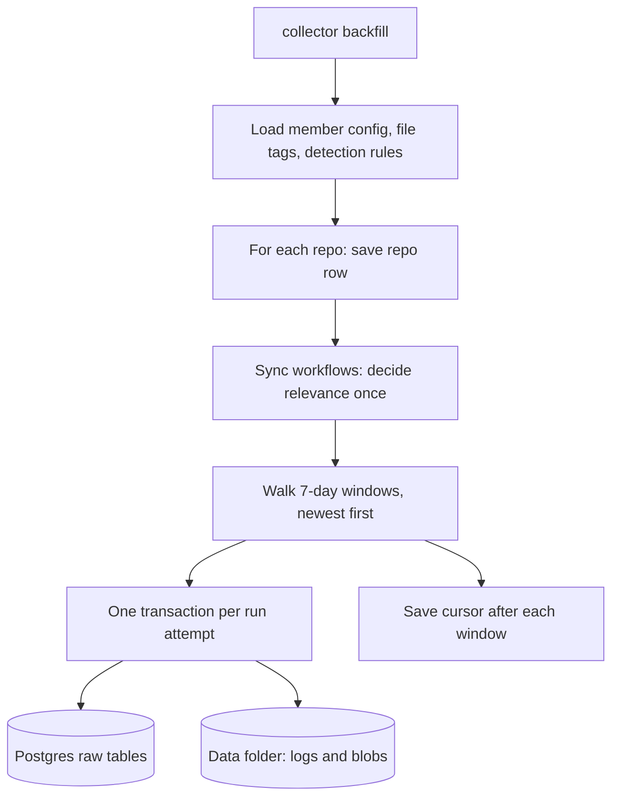
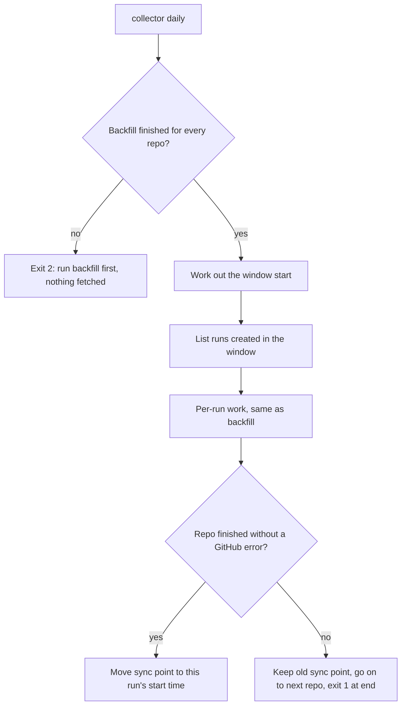

# Collector

**In one sentence:** The collector reads each team member's list of GitHub repositories and pulls the last 90 days of CI (continuous integration, automated build and test) runs, failure logs, commits and config files into the database, so the experts can learn from real failures.

**Status:** partial (backfill, daily and status work; export and import not built) · **Owner:** shared · **Plan tasks:** P1.2 (repo config and workflow detection), P1.5 (backfill), P1.6 (daily and status). Export and import come in P1.7.

## What it does

PipelineIQ learns from real CI failures on real GitHub repositories. Each of the four team members (dependency, build, test, infra) picks a set of repositories that fit their topic. Those lists live in `config/repos/<member>.yaml`.

The collector is the part that reads those lists and collects the data. It has five jobs:

1. **Repo config loader (P1.2).** It opens a member's YAML file, checks every field, and turns it into clean Python objects. If the file has a mistake, it stops with a message that names the file, the repository and the field.
2. **Workflow detection (P1.2).** A GitHub repository can have many workflows (automated job files under `.github/workflows/`). Most are not relevant to a member. For example, the Test member only cares about workflows that run tests. Detection looks inside a workflow file and says whether it is relevant, and why.
3. **Backfill (P1.5).** The `backfill` command pulls the last 90 days of data for a member's repositories. It writes the data to Postgres tables and to files in the data folder. It is safe to run again: a second run adds nothing new. If it stops part way, the next run picks up where it left off.
4. **Daily sync (P1.6).** The `daily` command keeps the data up to date after the backfill. It fetches the runs created since the last sync, and looks again at the last 14 days for new attempts of older runs.
5. **Status (P1.6).** The `status` command prints what is stored for each repo, the days with no runs, the backfill state, the last daily sync and the GitHub rate limit. It changes nothing.

Export and import come in P1.7.

## How it works

### Repo config loader (P1.2)

1. Read the file as UTF-8 text. If it cannot be read, stop with "cannot read file".
2. Parse the YAML. YAML is a plain-text format for settings. The loader uses the safe parser, so a file cannot run code. If the YAML is broken, stop with "invalid YAML".
3. Check the top level. It must be a mapping (a list of `key: value` pairs). It must have a `member` field, and the value must be one of `dependency`, `build`, `test` or `infra`. It must match the file name: `config/repos/test.yaml` must say `member: test`.
4. Check the `repos` field. It must exist and be a list. Use `repos: []` for an empty list.
5. Check each repo entry, one at a time:
   - It must be a mapping.
   - `full_name` and `licence` are required text values. `full_name` must look like `owner/repo`.
   - `enabled` is optional and defaults to true. It must be a real YAML true or false. The text `'yes'` is rejected.
   - `workflows` is optional and defaults to an empty list. It must be a list of text values.
   - No two entries may name the same repository. The check ignores upper and lower case, because GitHub names do not care about case.
6. Keep any extra keys (for example `framework`, `flaky`, `note`) so they can be read later. They are not checked.

The loader stops at the first bad entry. It reports that one problem, so fixing one error may reveal the next.

### Workflow detection (P1.2)

Detection is driven by `config/workflow_detection.yaml`. That file holds, for each member, two lists of regular expressions. A regular expression (regex) is a pattern that matches text. `run_patterns` say which commands count. `exclude_patterns` say which commands do not count even if they match.

```mermaid
flowchart TD
    A[Workflow file text] --> B{Rule for this member?}
    B -- no --> K[Keep it: no rule for member]
    B -- yes --> C{Valid YAML mapping?}
    C -- no --> U[Not relevant: unparseable]
    C -- yes --> D[Collect every run: line, with its job]
    D --> E[Split each line on && & || ; and pipes]
    E --> F{Matches a run pattern and no exclude pattern?}
    F -- yes --> M[Relevant: matched]
    F -- no --> N[Not relevant: no match]
```

1. Find the member's rule in `config/workflow_detection.yaml`. If there is none, keep the workflow. This applies today to `dependency`, `build` and `infra`.
2. Parse the workflow file as YAML. If it is not valid, or its top level is not a mapping, mark it not relevant with reason "unparseable".
3. Walk every job and collect each line of every `run:` step, together with the job's key. A `run:` step is a shell command in a workflow. Steps that only use another action (`uses:`) are skipped. Blank lines are dropped.
4. Split each line into single commands. The splitting characters are `&&`, `&`, `||`, `;` and `|`. So `npm ci && npm test` becomes two commands, and each is judged on its own.
5. A command counts if at least one run pattern matches it and no exclude pattern matches it. "Matches" means the regex is found anywhere in the command.
6. If any command counts, the file is relevant, with reason "matched". The result lists each (job, command) pair that counted. If none counts, the reason is "no match".

Today the Test member's rules are:

- **Run patterns:** `npm`, `pnpm`, `yarn` or `bun` running `test` (including `npm run test:unit` and `pnpm -r test`); `turbo`, `nx` or `lerna` running a test target; and the runners `jest`, `mocha` or `vitest` themselves.
- **Exclude patterns:** installing or removing packages (`npm install`, `yarn add`, `npm ci` and similar), and `echo` or `printf` lines that only mention a runner.

Detection itself does not fetch anything. The backfill fetches the workflow file and then calls detection.

### Backfill (P1.5)



A few words first. A **run** is one execution of a workflow. A run can be re-run, and each re-run is an **attempt** with its own number (1, 2, 3 and so on). A **job** is one unit of work inside a run. A **commit sha** is the unique ID of a git commit. A **transaction** is a group of database writes that either all succeed or all roll back.

1. **Load the config.** The command reads `config/repos/<member>.yaml`, `config/file_tags.yaml` and `config/workflow_detection.yaml`. A problem here stops the command with exit code 2 before any network call.
2. **Save the repo.** For each repo, the collector asks GitHub for the repo's ID and default branch, and saves a row in `raw.repos`. It also creates a `raw.sync_state` row if there is none.
3. **Sync workflows.** It lists the repo's workflow files and saves each one in `raw.workflows`. Relevance is decided once for each file path. The decision uses the file as it is at the head of the default branch (the newest commit on the main branch). The commit sha used is stored with the answer. Later backfills reuse the stored answer and do not look at the file again.
4. **Split the time range.** The range runs from 00:00 UTC, 90 days ago, to now. It is cut into 7-day windows. The newest window is walked first. For the default 90 days that makes 13 windows. If GitHub's 1,000-result limit is hit for one window, the GitHub client splits that window into smaller ones.
5. **Walk each window.** The collector lists the runs in the window. A run of a workflow that is not relevant is skipped and nothing is stored for it. Every other run is processed in its own transaction (see the next section).
6. **Save the cursor.** After each window, the collector stores how many windows are done in `raw.sync_state.backfill_cursor`.
7. **Finish.** When all windows are done, it records `backfill_done_at` and clears the cursor.

#### What is stored for one run

For each attempt of a run, the collector stores:

| Table | What goes in |
|---|---|
| `raw.workflow_runs` | One row per run attempt: status, conclusion, branch, event, head sha, pull request numbers, time stamps, the hashed actor, and the run's JSON with some fields removed |
| `raw.jobs` | One row per job per attempt. Includes the mapped `job_key` (see below), the runner's operating system (guessed from labels) and the job's labels |
| `raw.steps` | One row per step of each job |
| `raw.commits` and `raw.commit_files` | The commit at the run's head sha: parent shas, hashed author, message, and each changed file with its patch. Stored once per sha |
| `raw.file_snapshots` | The text of the run's workflow file, and of each changed config file, at that sha |
| `raw.logs` | One row per job whose log the policy asks for. Says whether the log is `ok`, `expired` or `missing` |

The `job_key` is the job's key in the workflow YAML, for example `test`. The collector finds it by matching the GitHub job name, such as `test (20)` for a matrix job, against the YAML. If the match is unclear, `job_key` is left empty.

Each attempt has its own rows. Older attempts are read through the attempt metadata call, so each one gets its own row.

#### Log policy

- **Fetched:** failed jobs (conclusion `failure`, `timed_out` or `startup_failure`), and passing jobs (`success`) in relevant workflows.
- **Not fetched:** cancelled and skipped jobs, and jobs still running. They get no log row.
- **Runs of other workflows:** not stored at all.
- **Explicit list:** if a repo's `workflows` list in the config is not empty, it replaces detection. Only the listed files are relevant. Every other workflow file is marked not relevant.

#### Where the files land

Two kinds of file are written under the data folder (`DATA_DIR`, or `<checkout>/data` by default):

- **Logs:** `logs/{owner}/{repo}/{run_id}/{attempt}/{job_id}.log.gz`. A gzip file (a compressed file) holding the cleaned log text.
- **Blobs:** `snapshots/blobs/<first two characters>/<sha256>.gz`. These hold files stored by reference, mostly lockfiles (files that pin exact package versions, such as `package-lock.json`). The name is the hash of the file's original bytes, not a commit sha.

The database stores the path relative to the data folder (`storage_path`), so the folder can be moved. In `raw.logs`, `bytes` and `sha256` describe the `.gz` file on disk, not the text inside it.

#### Cleaning and personal data

- **Secrets are removed.** Log text, commit messages, diff patches, file snapshots and run titles go through the sanitiser (`shared/sanitise`). It removes tokens, keys, passwords and auth headers. The number of removals is stored as `redactions` on the log row.
- **Nul characters are removed.** A nul is a zero byte. Postgres text cannot hold one, so it is stripped from all stored text.
- **Logins are hashed.** The hash is SHA-256 of the team's salt plus the login (`IDENTITY_SALT`). The raw run JSON drops the fields `actor`, `triggering_actor`, `head_commit`, `repository` and `head_repository`.
- **Commit authors are hashed too.** The hash uses the GitHub login. If GitHub has no account for the author, the hash uses the commit's author email instead.
- **Patches over 1 MB are dropped.** The size is checked before cleaning. The file row keeps its other fields and gets `patch_truncated` set to true.
- **Lockfiles are stored by reference.** They are written to a blob file, and the snapshot row has `storage_path` and no inline text.
- **Co-authored-by lines are kept.** A commit message can contain `Co-authored-by:` lines with other people's names and emails. The sanitiser does not remove them. They are personal data in the database.

#### Missing and expired logs

| What GitHub says | What the collector stores |
|---|---|
| Log returned | Status `ok`, the `.gz` file is written |
| 410 (log expired) | Status `expired`, no file |
| 404 (not found) | Status `missing`, no file |
| Other 4xx, for example 403 | Status `missing`, a warning is logged, and the repo carries on |
| 5xx or a network error | The repo stops. Nothing is stored for that log. A re-run resumes |

#### Errors and resuming

1. A 5xx error or a network error stops the current repo. The transaction for the run that was being saved is rolled back, so no job is stored without its run.
2. The cursor stays at the last finished window. Other repos in the same command still run. The command exits with code 1 at the end.
3. Run the same command again. Finished windows are skipped. Runs that are already stored as complete are skipped too.

The cursor is a small JSON value holding `started_at`, `days`, `window_days` and `windows_done`. If the saved cursor was made with different `--days` or `--window-days` values, it is ignored with a warning, and the backfill starts over. Data already stored is skipped, so this costs API calls but does not duplicate rows.

#### Running twice changes nothing

- Every write is an upsert. An upsert inserts a row, or updates it if the key already exists. The keys are GitHub's own ids (for example run id and attempt, job id, commit sha).
- Gzip files are written with a fixed level, no file name and a zero time stamp, so the same input gives the same bytes. Files that already hold the same bytes are not rewritten.
- The `source` column of a run is set on the first insert only. A row owned by the GitHub App keeps its source when the collector writes it again.
- A run is treated as done once its latest attempt has status `completed`. Runs still in progress are read again next time.

#### Transactions and requests

- **One run is one transaction.** The collector holds the database transaction open while it makes the GitHub calls for that run. This is simple and safe, but a database connection stays open during those calls.
- **No per-run request cap.** The collector does not count requests per run. The shared GitHub client counts REST calls. When fewer than 200 calls remain in the token's hourly budget (`GITHUB_RATE_LIMIT_THRESHOLD`), it sleeps until the budget resets. A backfill can take hours.
- **Calls per run.** One jobs listing per run, one commit call per new sha (with more pages if the commit has many files), one log call per fetched log, and one raw file call per snapshot.

### Daily sync (P1.6)

The backfill fills the database once. The daily sync keeps it current. It does not start from 90 days ago again. It only looks at the time since the last sync, plus a 14-day look-back.

Each repo has a **sync point**: the time its last daily sync started. It is stored as `last_daily_sync_at` in `raw.sync_state`. The backfill sets it when the backfill finishes.



1. **Check every repo first.** Each repo needs a sync point, which only a finished backfill sets. If one repo does not have it, the command stops with exit code 2 and makes no GitHub call. The message says to run the backfill first.
2. **Work out the window start.** It is the earlier of two times: the last sync point, and 14 days before now. So the window is always at least 14 days long. Runs in that window are read again, which picks up new attempts of runs that were re-run. The 14 days is a default (see Limitations).
3. **Catch up after a gap.** If the last sync is more than 90 days old, the window cannot start before 90 days ago, because GitHub keeps runs for about 90 days. The repo's line then says WARNING, and a log warning is written. Runs in the lost part are not in the database.
4. **Process each run the way the backfill does.** The daily sync calls the backfill's own per-run code. A run whose latest attempt is stored and completed is skipped. Any other run is read again: older attempts, jobs, steps, and logs for jobs that have no log row yet. Logs already stored are not fetched again.
5. **Move the sync point.** Only when the whole repo finishes without a GitHub error does `last_daily_sync_at` move. It moves to the time this run started, cut to whole seconds. Runs created while the sync was running are then inside the next window. If a GitHub error stops the repo, the old sync point stays, so the next run covers the same time again. The other repos still run, and the command exits with code 1 at the end.

Running it twice in a row changes nothing. The second run processes no runs and makes no job, log, commit, or attempt calls. The test for this checks that.

**Example.** The daily tests use the recorded fake repo `acme/widgets`. The backfill ran on 19 October 2026 at 12:00 UTC. On 20 October at 12:00 UTC, a re-run of run 9001 (created on 12 October) has a second attempt. The daily command prints a line like this:

```
acme/widgets: window 2026-10-06 12:00..2026-10-20 12:00 UTC; runs seen 3, new or changed 1, already stored 1, ...
```

The window starts 14 days back. "Runs seen 3" includes a release workflow run, which is not relevant. That run is counted in "runs seen" but in neither of the other two counts. The sync point then moves to 20 October at 12:00 UTC.

### Status (P1.6)

`status` reads the database and prints a report. It makes no changes. It needs only `DATABASE_URL`. A GitHub token is optional. Without one, the rate limit line says it is unavailable.

The report has these parts:

- **Rate limit.** GitHub's core REST quota: the limit, how many calls remain, and when it resets. It comes from GitHub's `/rate_limit` endpoint, which does not use up quota. If there is no token, or the request fails, the line says "unavailable" and gives the reason.
- **A table, one row per repo** in the member's file. Disabled repos are marked "(disabled)". Columns: `runs` (distinct run ids), `attempts` (one per stored run attempt), `jobs`, `logs ok`, `expired`, `missing`, and `commits`.
- **Backfill state:** not started, in progress (for example "4 of 13 windows done"), or done with the time.
- **Last daily sync:** the sync point, or "never".
- **First and last day** with a stored run.
- **Days with zero runs.** These are days with no runs between the first and last stored day, within the last 90 days. They are shown as ranges. At most 8 ranges are listed, then "and N more". The report labels them "may just be quiet days". A gap is not proof of lost data, because a repo may simply have no CI runs on some days. A missed sync also looks like a gap.
- **Repos not in the database yet** show "not collected yet: run `collector backfill` first".

**Example.** The status test uses the recorded fake repo `acme/widgets` after a backfill. Its row reads `acme/widgets 3 4 8 5 1 1 3`: 3 runs, 4 attempts, 8 jobs, 5 logs ok, 1 expired, 1 missing, 3 commits. Runs were created on 1 August, 12 October and 15 October. The report then says:

```
  days with zero runs between first and last collected: 73 of 76 (may just be quiet days, not missing data):
    2026-08-02 to 2026-10-11 (71 days)
    2026-10-13 to 2026-10-14 (2 days)
```

## How to run it

```bash
# from the repository root, with .env filled in (see .env.example)
uv run --env-file .env collector backfill --member test

# one repo only, and 30 days instead of 90
uv run --env-file .env collector backfill --member test --repo owner/name --days 30

# after the backfill has finished: fetch what is new since the last sync
uv run --env-file .env collector daily --member test

# one repo only (this also runs a repo marked enabled: false), or write logs elsewhere
uv run --env-file .env collector daily --member test --repo owner/name --data-dir /path/to/data

# what is stored, days with no runs, backfill state, last daily sync, rate limit
uv run --env-file .env collector status --member test

# the collector's tests (no database and no network needed)
uv run pytest services/collector
```

When `daily` works, it prints one line per repo: the repo name, the window, and the counts. When `status` works, it prints the report described above.

`daily` has the same `--member`, `--repo` and `--data-dir` options as backfill. It has no `--days` option, because the look-back is fixed by the sync point and the 90-day retention. `--repo` takes repos from the full list, so a repo marked `enabled: false` still runs when named. This is checked in `cli.py`: `run_daily` builds the list from `config.repos`, not `enabled_repos()`.

**Scheduling.** Nothing runs `daily` by itself. To run it every day, set up cron (Linux and macOS) or Task Scheduler (Windows). Step-by-step commands are in `docs/ONBOARDING.md`, section 8.

When the backfill works, it prints one line per repo. The line starts with the repo name and then lists the counters (runs seen, runs processed, logs ok, logs missing, logs expired, windows done). Progress lines for each window go to the log on the console.

The integration tests need Postgres. Start it with `make up`, then run:

```bash
uv run pytest services/collector -m integration
```

They read `DATABASE_URL` from `.env`. Use `127.0.0.1`, not `localhost`, on Windows. The tests create and drop a throwaway database called `<name>_collector_test`, so the database user needs the right to create databases. If the database cannot be reached, the integration tests are skipped, not passed. **These integration tests had not been run when P1.5 was written, because Docker was not available.**

The full check that must pass before a task is done is `make check`.

### Command options

| Option | Meaning |
|---|---|
| `--member` | Required. One of `dependency`, `build`, `test`, `infra` |
| `--repo owner/name` | Only this repo. It must be in the member's list. The match is case-sensitive |
| `--days N` | How far back to go. Default 90 |
| `--data-dir PATH` | Where logs and blobs go. Overrides `DATA_DIR` |
| `--window-days N` | Window size. Default 7. Hidden from `--help`, used by tests |

### Exit codes

| Code | Meaning |
|---|---|
| 0 | Every repo finished |
| 1 | At least one repo hit a GitHub error. Re-run the command to resume |
| 2 | Config or environment problem: a missing variable, a bad config file, an unknown `--repo`, or a bad option. Nothing was fetched |

Exit code 2 is also used by argparse (the option parser) when `--member` is not one of the four names.

`daily` uses the same codes, with these meanings:

| Code | Meaning for `daily` |
|---|---|
| 0 | Every repo finished, and its sync point moved |
| 1 | At least one repo hit a GitHub error. Its sync point did not move. Run `daily` again later |
| 2 | Nothing fetched. `GITHUB_TOKEN`, `IDENTITY_SALT` or `DATABASE_URL` is missing, the config is bad, `--repo` is not in the list, or the backfill has not finished for one or more repos |

`status` returns 0 when it prints the report, and 2 when `DATABASE_URL` is missing or the config is bad. It does not return 1. A missing GitHub token is not an error: the rate limit line says "unavailable".

## Inputs and outputs

|     | What | Where / format |
|---|---|---|
| In | One member's repo list | `config/repos/<member>.yaml` (YAML) |
| In | Which workflows count as relevant, per member | `config/workflow_detection.yaml` (YAML of regex lists) |
| In | Which changed files get a snapshot, and the patch size limit | `config/file_tags.yaml` (YAML) |
| In | GitHub data | REST API (runs, jobs, attempts, commits, workflows, logs) and `raw.githubusercontent.com` (file text at a sha) |
| In | Secrets and settings | Environment variables (see Settings) |
| Out | Validated repo list | `RepoConfig` object, with a list of `RepoEntry` objects |
| Out | Relevance decision for one workflow | `DetectionResult`: `relevant`, `reason` and `matches` |
| Out | Database rows | `raw.repos`, `raw.sync_state`, `raw.workflows`, `raw.workflow_runs`, `raw.jobs`, `raw.steps`, `raw.commits`, `raw.commit_files`, `raw.file_snapshots`, `raw.logs` (Postgres) |
| Out | Files | `logs/...log.gz` and `snapshots/blobs/...gz` under the data folder |
| Out | Errors | `ConfigError` (a kind of `ValueError`) for config problems, with the file path, repo and field in the message |

## Settings

| Setting | Where | Default | What it changes |
|---|---|---|---|
| `GITHUB_TOKEN` | Environment (`.env`) | Required | The GitHub token for API calls. Never printed or logged |
| `IDENTITY_SALT` | Environment (`.env`) | Required | The salt for hashing logins and author emails. Changing it changes every hash |
| `DATABASE_URL` | Environment (`.env`) | Required | The Postgres connection |
| `DATA_DIR` | Environment (`.env`) | `<checkout>/data` | Where logs and blobs are written. Empty means the default |
| `GITHUB_RATE_LIMIT_THRESHOLD` | Environment (read by the GitHub client) | 200 | When to sleep until the rate limit resets |
| `GITHUB_MIN_WINDOW_HOURS` | Environment (read by the GitHub client) | 1 | The smallest window the client splits down to |
| `SANITISE_PATTERNS_FILE` | Environment (read by the sanitiser) | `config/sanitise_patterns.yaml` | Which secret patterns to remove |
| `--member` | Command line | Required | Which member's repo list is read |
| `--repo` | Command line | All enabled repos | One repo only |
| `--days` | Command line | 90 | How far back to go |
| `--data-dir` | Command line | `DATA_DIR`, else `<checkout>/data` | Where files go. Wins over `DATA_DIR` |
| `enabled` | Each repo entry | `true` | Disabled repos are skipped by a plain run. `--repo` still runs them |
| `workflows` | Each repo entry | Empty list (auto-detect) | Explicit workflow paths. Replaces detection for this repo |
| `licence` | Each repo entry | Required | Stored in `raw.repos`. Not checked against GitHub here |
| `max_patch_bytes` | `config/file_tags.yaml`, `limits` | 1,048,576 (1 MB) | Patches larger than this are dropped |
| `lockfiles_inline` | `config/file_tags.yaml`, `limits` | `false` | Whether lockfiles are stored as text in the database |
| Run and exclude patterns | `config/workflow_detection.yaml`, per member | Test member has rules; others have none | Which commands make a workflow relevant |

`.env.example` also lists `MEMBER`. The collector does not read it. The member always comes from `--member`.

## Example

The backfill test uses a recorded fake repo, `acme/widgets`, with fixtures in `services/collector/tests/fixtures/github/`. The fake GitHub answers the same way the real API does. The test runs the backfill for the repo and checks the result:

- The repo has 4 runs in the window. One belongs to a release workflow that is not relevant, so it is skipped. The other 3 are processed.
- The 3 runs have 5 logs stored as `ok`, 1 stored as `missing` (the fake answers 403 for that job) and 1 stored as `expired` (410).
- The backfill walks 13 windows.

A second run of the same command then processes 0 runs and reports 3 runs already done. The database rows and the file checksums do not change.

The P1.2 detection example, from the detection tests. The Mongoose project has a workflow file, and its `test` job has these steps:

```yaml
jobs:
  test:
    steps:
      - run: npm install
      - name: Run tests
        run: npm test
```

Detection for the `test` member answers `relevant: true`, reason `matched`, with one match: job `test` and command `npm test`. The `npm install` line is not a match, because installing packages is excluded.

A repo entry in `config/repos/test.yaml` looks like this:

```yaml
- {full_name: Automattic/mongoose, licence: MIT, framework: mocha, flaky: 14}
```

It loads with `licence` set to `MIT`, `enabled` set to true, `workflows` set to an empty list, and `framework` and `flaky` kept as extras.

If the licence is missing, the loader reports something like this, which names the file, the repository and the field:

```
config/repos/test.yaml: repo 'a/b': field 'licence': <reason from the validator>
```

## Limitations and known issues

**Not built yet**

- Export and import (`make export-data`, `make import-data`) come in P1.7.
- There is no command to re-decide a workflow's relevance. The stored answer is kept once it is set (see below).

**Rate-limit errors on logs**

- A log that fails with a 429, or a limit-related 403 that never cleared after all retries, stops the repo like a 5xx. A re-run resumes. Only other 4xx answers (for example a plain 403) are stored as `missing`.

**Behaviour to know about**

- **Relevance is decided once per workflow path.** It uses the file at the default branch head when first seen. A later change to that workflow is not picked up by the backfill.
- **A workflow file that cannot be read is stored as not relevant.** Its `detected_at_sha` stays empty, so the next backfill checks it again.
- **Explicit `workflows` replace detection.** Every workflow file not in the list is marked not relevant. Its runs are not stored.
- **Runs of a workflow not in the listing are skipped.** For example, a deleted workflow's runs.
- **Only changed config files are snapshotted.** The run's own workflow file is always snapshotted. Other config files are snapshotted only if the commit changed them. The collector does not take a full copy of the repo's config at each sha.
- **Snapshot names are not commit shas.** Blob names are the hash of the file's bytes, so the same file at two commits is stored once.
- **Missing commits are skipped.** A commit that no longer exists (for example after a force-push) gets no commit row and no diff. The run row is still saved. The run's workflow file is still snapshotted, if GitHub can serve it at that sha.
- **Log rows are written once.** A job that already has a log row is never fetched again, even if its row says `missing`.
- **No log row for cancelled, skipped or running jobs.** Those jobs have a job row and steps only.
- **In-progress runs are read again.** A run counts as done only when its latest attempt is `completed`.
- **Attempts with no metadata are skipped.** If the metadata of an older attempt returns 404, that attempt is skipped. Its jobs are not stored.
- **Logs are stored as text after cleaning.** The original bytes are not kept.
- **`--repo` is case-sensitive.** The config check ignores case, but the `--repo` match does not.
- **No repos enabled means nothing happens.** The command exits 0 with no output.
- **Non-GitHub errors are not turned into exit code 1.** A database error or a bug stops the command with a Python traceback. Only GitHub errors are counted as "a repo failed".
- **Long transactions.** One run holds one database transaction during its GitHub calls.
- **Personal data stays in commit messages.** Co-authored-by lines are not removed. See Cleaning and personal data.
- **Dates round down.** The start is 00:00 UTC on the day 90 days ago, so the range can be a little longer than 90 days.
- **Integration tests not run yet.** They were written for P1.5, but had not been executed when this was written, because Docker was not available.

**Daily and status**

- **The integration tests for daily and status have not been run.** The four tests in `tests/test_daily_db.py` need Postgres, and Docker was not available when they were written. They check the SQL that `daily` and `status` use against real tables. Until they run, the SQL is checked only by the offline tests (`test_status_sql_offline.py`, `test_sql_store_offline.py`). The other daily and status tests use an in-memory store and recorded GitHub responses. They need no database: `uv run pytest services/collector`.
- **Nothing schedules `daily`.** Set up cron or Task Scheduler yourself (see `docs/ONBOARDING.md`, section 8). If the computer is off, the next run catches up, but only within the 90-day retention. Longer gaps lose runs, and the output warns about it.
- **Re-runs of old runs can be missed.** The window always starts at least 14 days back. A re-run of a run created more than 14 days before the window start is not seen, unless the sync point is older than that.
- **The "data lost" message is hard-coded to 90 days.** `_daily_line` in `cli.py` writes "older than 90 days" as text. The check itself uses the backfiller's `days`, which is 90 because `daily` has no `--days` option. If that default changes, the message will be wrong.
- **"Runs seen" includes runs of workflows that are not relevant.** Those runs are not counted as processed or already stored, and the line does not show how many were skipped.
- **A database error or bug stops the command with a Python traceback.** Only GitHub errors are turned into exit code 1. The same is true of backfill.
- **A gap in `status` is not proof of a problem.** It cannot tell a quiet day from a missed sync. It also looks only at the last 90 days of stored runs.
- **`status` does not check `IDENTITY_SALT`.** It does not need it.

**Every `# DEFAULT:` in this component**

In `services/collector/src`:

- `repo_config.py`, line 15: `DEFAULT_CONFIG_DIR` is found from the location of the source file, four folders up to the repository root, then `config/`. A packaged install would point to the wrong place, so callers should pass `config_dir` explicitly outside a checkout.
- `workflow_detection.py`, line 98: members with no detection rule (`dependency`, `build`, `infra`) keep every workflow until their owner adds a rule. Keeping a workflow is safer than dropping data that may matter.
- `daily.py`, line 20: `RESCAN_DAYS = 14`. The daily window always starts at least this far back, so re-runs of recent runs are picked up. Taken from the design note in `docs/DATA.md` 3.3 (the code cites it; the design section was not re-checked here).
- `status.py`, line 20: `GAP_DAYS_WINDOW = 90`. Gaps are looked for in the last 90 days, the length of GitHub's run retention.
- `status.py`, line 22: `MAX_GAP_RANGES = 8`. At most 8 gap ranges are printed per repo, then "and N more".
- `backfill.py`, line 43: 7-day windows (`DEFAULT_WINDOW_DAYS`). The client halves any window that hits the 1,000-result cap. The 90-day default is `DEFAULT_DAYS`.
- `backfill.py`, line 47: personal data and bulky objects are dropped from the stored run JSON (`actor`, `triggering_actor`, `head_commit`, `repository`, `head_repository`). Logins and emails must only appear hashed, and the repository blobs repeat on every run.
- `backfill.py`, line 82: the runner OS is guessed from the first job label naming Ubuntu or Linux, Windows, or macOS.
- `backfill.py`, line 158: the licence recorded is the one in the member's config file. `scripts/rerun_check.py` (P1.3) flags a mismatch with GitHub's `spdx_id`.
- `backfill.py`, line 254: a workflow file that cannot be read is treated as not relevant and checked again on the next backfill (`detected_at_sha` stays empty).
- `backfill.py`, line 424: a non-retryable 4xx (for example 403) on a log is recorded as `missing`, so one unreadable log does not stop the repo. Rate-limit failures are not treated this way; they stop the repo.
- `backfill.py`, line 474: a commit that no longer exists (force-push) is skipped, not fatal.
- `backfill.py`, line 484: if GitHub has no account for a commit's author, the commit's author email is hashed instead.
- `cli.py`, line 26: logs and snapshots live in `<checkout>/data` unless `DATA_DIR` or `--data-dir` says otherwise.
- `file_tags.py`, line 18: tags whose files are worth a content snapshot are the ones that are not `test`, `source`, `docs` or `other`. That means configuration and manifests (and lockfiles). Test files, plain source and docs are already visible in the commit diff.
- `policy.py`, line 8: "failed" means `failure`, `timed_out` or `startup_failure`. Cancelled and skipped jobs are not failures, and their logs carry no useful signal.
- `policy.py`, line 13: gzip level 6, which is the zlib default. The level is fixed so the bytes are stable.

Not marked with a `# DEFAULT:` comment, but chosen by the implementer and worth knowing:

- The `bytes` and `sha256` of a log row describe the `.gz` file on disk, not the text.
- `storage_path` is relative to the data folder.
- A snapshot covers the run's workflow file plus each changed config-tagged file that was not removed in that commit.
- NUL characters are stripped from all stored text.
- Detection is stored once per workflow path, keyed by the commit it was decided at.
- `file_tags.py` falls back to 1 MB for `max_patch_bytes` and to `false` for `lockfiles_inline` if `config/file_tags.yaml` leaves them out.
- `daily.py`: the sync point is cut to whole seconds (`started` is rounded down). The window then overlaps the previous one by a fraction of a second, which is harmless because every write is an upsert.
- `daily.py`: the data-lost check uses the backfiller's `days` (90 by default), not a separate constant. `daily` has no `--days` option, so in practice it is always 90.
- `cli.py`, `run_status`: with no `GITHUB_TOKEN`, `status` does not call `/rate_limit` at all. It only prints "unavailable". With a token, a failed request is also shown as "unavailable", with the error name and no details.

`config/workflow_detection.yaml` has no `# DEFAULT:` comments.

`services/collector/tests/conftest.py`, line 39: the tests use their own throwaway database (`<name>_collector_test`), not the `_test` database that `shared/tests` uses, so the two suites never drop each other's database. The database user needs the CREATEDB right.

## Related

- Plan: `docs/PLAN.md`, tasks P1.2 (repo config and detection), P1.5 (backfill), P1.6 (daily and status), P1.7 (export).
- Design: `docs/DATA.md` section 2 (repo lists and auto-detection), section 3 (the collector), section 5 (file tags).
- The GitHub client that the backfill uses: `shared/github/README.md`.
- The sanitiser that cleans logs and text: `shared/sanitise/README.md`.
- The database tables: `shared/db/models.py` (the `raw` schema).
- Config files: `config/repos/*.yaml`, `config/workflow_detection.yaml`, `config/file_tags.yaml`.
- Tests: `services/collector/tests/test_repo_config.py`, `test_workflow_detection.py`, `test_cli.py`, `test_cli_backfill.py`, `test_backfill.py` (in-memory store and recorded GitHub), `test_backfill_db.py` (integration, Postgres), `test_sql_store_offline.py`, `test_units.py`. Daily and status: `test_daily.py` (in-memory), `test_status.py` (report, gaps, rate limit, CLI), `test_status_sql_offline.py` (SQL text), `test_daily_db.py` (integration, Postgres, not yet run).
- Scheduling the daily run: `docs/ONBOARDING.md`, section 8.
- Status table for the collector: `docs/COMPONENTS.md`.
