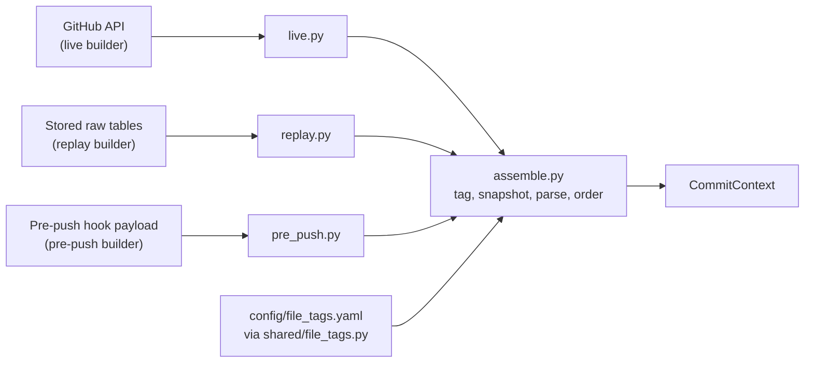

# Features service

**In one sentence:** Turns one commit into a `CommitContext`, the single description of what the commit changed and what its CI setup looks like, and tags each changed file so the rest of the system knows what the change touched.

**Status:** Working (file tagger, P2.2; CommitContext builders, P2.3). The SQL replay test has never been run. It needs a reachable Postgres database and is skipped without one · **Owner:** shared · **Plan tasks:** P2.2 and P2.3 done

## What it does

When a CI run fails, the experts need to know what the commit changed. A commit can touch a test file, a lockfile, a Dockerfile and a README at the same time. The service gathers that picture from three places, depending on when the question is asked:

- **Live:** a commit already on GitHub, read through the GitHub API.
- **Replay:** a CI run the collector already stored. The context is rebuilt from the database, so GitHub is never called.
- **Pre-push:** a commit that is not pushed yet. The git hook sends its diff.

Each of the three builders gathers its inputs in its own way. Then all three hand the inputs to one shared function, `assemble_context`. That is why their output has the same shape. For the same commit, the live and replay builders return the same context, except for the fields that are meant to differ (event, cut-off time and random id).

The result is a `CommitContext` (a contract type in `shared/contracts`). It holds the changed files with their tags and patches, the head content of config files (snapshots), the parsed CI jobs, a hash of the author, the history cut-off time and a `truncated` flag. `truncated` means that some patch was left out because it was too big.

The file tagger (P2.2) is the first part of this folder. It gives each file its tags, such as `test` or `lockfile`, and drops patches that are too big to store. The shared code is described below.

## How it works

The three builders share one set of steps (in `assemble.py`). The builders only differ in how they gather their inputs.



### Shared steps (`assemble.py`)

1. **Sort the files by path.** Every builder returns the same order, whatever the source gave.
2. **Tag each file** with the file tagger (see below). This also applies the patch size limit.
3. **Build snapshots.** A snapshot is the head content of a config file. A file gets one only when it has a tag other than `test`, `source`, `docs` or `other`. Removed files, lockfiles and files with no content get none.
4. **Parse workflow files.** The builder supplies some workflow files. The commit's own changed workflow files are always added, from their head content. Each path is parsed once. A file that cannot be read is logged and skipped.
5. **Set `truncated`.** It is true when the tagger dropped a patch, or when the source already dropped one.
6. **Return the context.** Each context gets a new random `context_id`.

### Live builder (`live.py`)

1. **Read the commit** from GitHub and follow the pages of its file list. For a pull request that has a base SHA, it reads the compare view instead, which shows the pull request's whole diff.
2. **Find the base.** This is the base SHA if one was given, otherwise the commit's first parent. A first commit has no base.
3. **Find the author.** Use the GitHub login. If there is none, use the commit author's email. Either value is hashed. If neither exists, the builder raises an error.
4. **Read the time.** `committed_at` is the committer date, converted to UTC.
5. **Read the files.** Each patch is cleaned of secrets. The head content is fetched only for config files. Removed files and lockfiles are never fetched. Each path is fetched once.
6. **Read the workflows.** Use the paths the caller gave. Otherwise list every `.yml` and `.yaml` file in `.github/workflows` at this commit.

### Replay builder (`replay.py`)

1. **Find the run** by repo, run id and attempt. If it is not stored, the builder raises `ReplayDataError`.
2. **Find the commit** and check what it needs: a commit time, an author hash and the run's branch. If one is missing, the builder raises `ReplayDataError`.
3. **Read the stored file rows** of the commit. Content comes from the stored snapshot at the head SHA, and only for config files.
4. **Pick the workflows.** By default, these are the workflow files of this commit's runs that were created before the cut-off, plus this run's own file.
5. **Set the base and PR.** The base is the first stored parent. The PR number is the run's first PR number.
6. **Set the cut-off.** It is the run's `created_at`.

The replay builder never imports the GitHub client, and its test checks that no HTTP call is made.

### Pre-push builder (`pre_push.py`)

1. **Check the payload.** `PrePushPayload` checks the repo name (`owner/name`), the 40-character SHAs and the branch. It rejects unknown fields.
2. **Clean the text.** Patches and file content are cleaned of secrets. Removed files get no content.
3. **Take the author hash from the caller.** The payload has no author field on purpose. The API (P2.6) knows the user from the API key and passes the user hash as `author_hash`.
4. **Set the event and PR.** The event is `pre_push` and the PR number is empty.
5. **Hand over to the shared steps.** Workflows come only from the payload. The pre-push builder does no discovery.

### History cut-off

The cut-off is the time the context describes. It is stored in the context. Only the replay builder uses it to choose rows.

| Builder | `history_cutoff` |
|---|---|
| Replay | The run's `created_at`. Only runs of the commit created strictly before this time are read. A run created at the same instant is not read. |
| Live | The `history_cutoff` argument, or now if none is given. The caller should pass the push time. |
| Pre-push | The `history_cutoff` argument, or now if none is given. |

### Which workflow files are parsed

| | Default workflows | Changed workflows |
|---|---|---|
| Live | Every `.yml` and `.yaml` file in `.github/workflows` at the commit | Always parsed, from head content |
| Replay | The workflow files of this commit's earlier runs, plus this run's | Always parsed, from head content |
| Pre-push | Only the workflows the hook sent | Always parsed, from head content |

This is why live and replay can list different jobs. A workflow that exists at the commit but has not run yet is visible live and hidden in replay. In the tests, the later run's workflow is hidden from the earlier replay.

### Equal contexts

Two contexts are equal when all their fields match, except `context_id`, `event` and `history_cutoff`. Live and replay give equal contexts when both are given the same `workflow_paths`. Pre-push gives an equal context to live when given the same files and workflows.

### The file tagger (P2.2)

1. **Load the config.** The YAML file holds the size limits and one list of patterns per tag. A pattern is a glob, a path pattern such as `**/*.test.*`. Each glob is turned into a regular expression (a text-matching rule) once, when the config loads.
2. **Check each tag on its own.** A path can match several tags. For example, `docs/a.test.ts` gets both `test` and `docs`.
3. **Apply the two special rules.**
   - `source` (plain JavaScript and TypeScript) is not given to a file that is already `test`.
   - `test_config` is added to a `vite.config.*` file only when its content has a `test:` block. If no content is passed in, the tag is not added.
4. **Fall back to `other`.** If no tag matched, the file gets `other`.
5. **Apply the size rules to the patch.**
   - A lockfile patch is dropped. The batch is not marked truncated.
   - Any other patch over the limit is dropped, and the batch is marked truncated.
   - Anything else is kept. The size is counted in bytes, not characters, so an accented letter counts as more than one byte.
6. **Return the result.** The caller gets one list of files, each with its tags and its patch or no patch, and one `truncated` flag for the whole batch.

## How to run

```bash
make setup                          # install the workspace once (if not done yet)
make check                          # ruff, mypy and pytest for the whole repo
uv run pytest services/features     # run only this package's tests
```

When it works, pytest ends with a summary line and no failures. The SQL replay test is marked `integration`. It is skipped unless the database in `DATABASE_URL` is reachable. To run it, start the database with `make up` and set `DATABASE_URL` as described in `docs/CONVENTIONS.md`. It creates a separate database called `<name>_features_test`, applies the migrations to it, loads the test scenario and drops the database at the end.

There is no command-line entry point. The builders are library functions that other code imports.

## Inputs and outputs

| | What | Where / format |
|---|---|---|
| In (live) | Commit SHA, repo, event, branch, optional PR number, base SHA, cut-off, workflow paths, tagger, hash function, cleaning function | Arguments to `build_live_context`. GitHub is read through `shared/github` |
| In (replay) | Repo, run id, attempt, optional workflow paths, tagger | Arguments to `build_replay_context`, plus a `RawHistory` object. `SqlHistory` reads Postgres. `InMemoryHistory` is for tests |
| In (pre-push) | The local diff: files, patches, config content, workflows, SHAs, branch, commit time | A `PrePushPayload` (pydantic model, defined in `pre_push.py`), plus the caller's `author_hash` |
| In (tags) | Tag patterns and size limits | `config/file_tags.yaml` |
| Out | The context | `CommitContext` from `shared/contracts`. Changed files with tags, snapshots, workflow jobs, author hash, cut-off, `truncated` |
| Out (tagger) | Each file with its tags and patch | List of `ChangedFile` in `TaggedFiles.files`, plus `truncated` |

## Settings

| Setting | Where | Default | What it changes |
|---|---|---|---|
| `max_patch_bytes` | `config/file_tags.yaml`, under `limits` | 1,048,576 bytes (1 MB) | Patches larger than this are dropped and the batch is marked `truncated` |
| `lockfiles_inline` | `config/file_tags.yaml`, under `limits` | `false` | When `false`, lockfile patches are always dropped. When `true`, they are kept, subject to the size limit. Lockfiles still get no snapshot either way |
| Tag patterns | `config/file_tags.yaml`, under `tags` | The list in `docs/DATA.md` section 5 | Which files get which tags |
| Config path | `load_tagger(path)` | `config/file_tags.yaml` in the repo | Which YAML file is read. Each path is loaded once and cached |
| `history_cutoff` | Argument to the live and pre-push builders | Now | The time the context describes. Replay always uses the run's `created_at` |
| `workflow_paths` | Argument to the live and replay builders | None (default discovery, see above) | Which workflow files are parsed. Changed workflows are parsed anyway |
| `base_sha`, `pr_number` | Argument to the live builder | The commit's first parent; no PR | The diff base and the PR number |
| `tagger` | Argument to every builder | `config/file_tags.yaml` | The tag rules and limits used |
| `hash_fn` (live) and `author_hash` (pre-push) | Arguments | GitHub login or author email, hashed (live); the caller passes the hash (pre-push) | The author hash on the context |
| `scrub` | Argument to every builder | Secret cleaner from `shared/sanitise` | How patches, content and `run:` commands are cleaned |
| `IDENTITY_SALT` | Environment variable (`.env`), read by `hash_identity` in `shared/sanitise` | None (required). A live build fails without it, because it hashes the author. Replay and pre-push do not hash, so they do not need it. Tests set a fake value | The salt for the author hash. Never log it |

## Example

The test scenario in `tests/ctx_scenario.py` is one commit that changes seven files:

- `package.json`, with the patch and head content.
- `src/index.ts` and `test/index.test.ts`, which are source and test files.
- `package-lock.json`, a lockfile with a large patch.
- `vite.config.ts`, which has a `test:` block.
- `old.js`, which was removed.
- `.github/workflows/ci.yml`, a changed workflow with a Node matrix of 18 and 20.

A second workflow, `release.yml`, exists at the commit. Its run was created one hour after the cut-off. Each builder returns:

- **Changed files:** all seven, with their tags. `vite.config.ts` gets `test_config` and `bundler_config`.
- **Snapshots:** `package.json`, `vite.config.ts` and `ci.yml`. Not the source, the test file, the lockfile or the removed file.
- **Lockfile:** its patch is `None`, and the batch is not `truncated`.
- **Workflow jobs:** the live builder finds `test` and `publish`, because it lists the folder. The replay builder finds only `test`, because the later run is not visible at its cut-off. The `test` job has Node versions `18` and `20`.

When both builders are given the same `workflow_paths`, the two contexts are equal apart from `context_id`, `event` and `history_cutoff`.

## Limitations and known issues

- **Live cannot see run history.** By default it lists every workflow file at the commit. Some of them may never have run on that commit.
- **Replay only sees what the collector stored.** A config file or workflow file that the collector did not store is missing from a replay. A snapshot stored by reference (no inline content) is treated as missing. The collector stores lockfiles by reference, so this does not change any lockfile result.
- **`truncated` covers only the 1 MB limit.** GitHub leaves out very large or binary patches, and neither the live nor the replay builder marks those as truncated. The collector does the same.
- **Live pull requests without a base SHA** are diffed as a single commit, not as the whole pull request.
- **Pre-push content for non-config files is not ignored by the builder.** The `PrePushFile` comment says the hook sends content only for config files and that other content is ignored. The builder keeps any content it gets. Only the tag rules decide whether a file becomes a snapshot.
- **Tags come from the path.** The only exception is `vite.config.*`, which also reads its content, and only to look for `test:`.
- **The `test:` check is a plain text match.** A `test:` inside a comment or a string also counts. A longer word such as `contest:` does not.
- **Matching is case-sensitive.** `README.MD` does not get `docs`.
- **Paths use forward slashes.** A leading `/` is removed.
- **The glob support is small.** Only `*`, `?` and `**` work. Braces such as `{js,ts}` and character classes such as `[abc]` do not. Use one list entry per pattern instead.
- **Renamed files are tagged by their new path only.**
- **Config changes need a restart.** The config is cached in the running process.
- **A broken config stops loading.** The error names the file.
- **The default config path is found from the file location.** It works from a repo checkout. A packaged install may not find the file. Pass the path in that case.
- **The SQL replay test has never been run.** It is the only check of the Postgres queries in `SqlHistory`. Its results are not known yet.
- **Choices in the code with no `# DEFAULT:` marker.** These are behaviours that were not marked in the code. They are listed here so the team can review them:
  - Live and pre-push use the current time as the cut-off when none is given.
  - The live builder uses the commit's first parent as the base when none is given.
  - A 404 on `.github/workflows` means there are no workflows. Other errors are raised.
  - A pull request without a base SHA is diffed as a single commit.
  - Replay takes the first stored parent as the base, and the run's first PR number.
  - Replay treats an empty workflow file as missing.
  - A GitHub file status that is unknown or missing becomes `modified` (`normalise_status`).
  - Duplicate workflow paths are parsed once. The first one in the list wins.
  - `scrub_text` removes NUL characters, because Postgres cannot store them.

Every `# DEFAULT:` choice made in this component:

1. `shared/file_tags.py`: the default config path comes from the location of the file (the repo root, then `config/file_tags.yaml`). Callers can pass another path.
2. `shared/file_tags.py`: a bare `test:` key anywhere in a vite config (not part of a longer word) counts as a test block.
3. `services/features/src/features/file_tagger.py`: a lockfile patch is dropped and kept by reference. It is not marked as truncated.
4. `services/collector/src/collector/file_tags.py`: the tags whose files get a content snapshot are the ones that are not `test`, `source`, `docs` or `other`. This set was moved from the collector unchanged. The collector's own README describes the same rule.
5. `services/features/src/features/assemble.py`: the set of tags that get no snapshot mirrors the collector's set (`test`, `source`, `docs`, `other`). Services must not import each other, so the set is repeated.
6. `services/features/src/features/assemble.py`: GitHub's extra file statuses fold into the four the contract has. `copied` becomes `added`. `changed` and `unchanged` become `modified`.
7. `services/features/src/features/assemble.py`: lockfiles get no snapshot. By-reference storage is the collector's job.
8. `services/features/src/features/assemble.py`: snapshots hold head content only. The `base_content` field is always empty, because the patch already shows the change.
9. `services/features/src/features/assemble.py`: an unreadable workflow file is skipped with a log warning, not treated as an error. The patch still shows the file.
10. `services/features/src/features/live.py`: with no GitHub login, the commit author's email is hashed instead, the same as the collector.
11. `services/features/src/features/replay.py`: a commit with no stored author hash uses the run's actor hash.
12. `services/features/src/features/workflow_parser.py`: with no `setup-node` step, matrix keys named `node`, `node-version` or `node_version` still count as Node versions.
13. `services/features/src/features/workflow_parser.py`: `read-all` and `write-all` permissions become one entry under the key `*`.
14. `services/features/src/features/workflow_parser.py`: each non-blank line of a multi-line `run:` block is one command, with spaces trimmed.

## Related

- `docs/PLAN.md`: P2.2 (file tagger) and P2.3 (this part). P2.6 is the pre-push API that calls `build_pre_push_context`.
- `docs/DATA.md` section 5: the tag table and size limits.
- `docs/ARCHITECTURE.md` section 3: the flow these builders implement.
- `config/file_tags.yaml`: the patterns and limits.
- `shared/file_tags.py`: the tag rules, shared with the collector.
- `shared/contracts`: `CommitContext`, `ChangedFile`, `FileSnapshot`, `WorkflowJob`, `FileTag`.
- `shared/github/README.md`: the GitHub client the live builder uses.
- `shared/sanitise/README.md`: the secret cleaner and the author hash.
- `services/collector/README.md`: writes the raw tables that the replay builder reads.
- `shared/db/README.md`: the raw tables and their columns.
