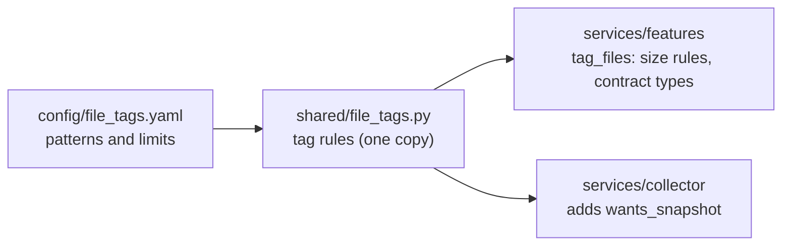

# Features service

**In one sentence:** Gives every changed file in a commit one or more plain tags (such as `test`, `lockfile` or `workflow`) and decides which file patches are too big to store, so the rest of the system knows what a change touched.

**Status:** Working (file tagger) · **Owner:** shared · **Plan tasks:** P2.2 done. P2.3 (CommitContext builders) will add to this folder later.

## What it does

When a CI run fails, the system needs to know what the commit changed. One commit can touch a test file, a lockfile, a Dockerfile and a README at the same time. The file tagger looks at the path of each changed file and attaches labels called tags. The tag rules come from `config/file_tags.yaml`. Each team member owns the rows for their own area.

The tagger also protects storage. A patch is the text of a change: the lines added and removed. A patch over 1 MB is dropped, and the whole result is marked `truncated`, so a reader knows something was left out. A lockfile patch is never stored inline. It is kept by reference only, so it is dropped without the `truncated` mark. A lockfile is a file that pins exact package versions, such as `package-lock.json`.

The tag rules live in `shared/file_tags.py`. The collector uses the same code, so the collector and the features service always agree on what a file is. The features service adds the size rules and returns the shared contract types. Its code is in `services/features/src/features/file_tagger.py`.

## How it works

1. **Load the config.** The YAML file holds the size limits and one list of patterns per tag. A pattern is a glob, a path pattern such as `**/*.test.*`. The code turns each glob into a regular expression (a text-matching rule) once, when the config loads.
2. **Check each tag on its own.** A path can match several tags. For example, `docs/a.test.ts` gets both `test` and `docs`.
3. **Apply the two special rules.**
   - `source` (plain JavaScript and TypeScript) is not given to a file that is already `test`.
   - `test_config` is added to a `vite.config.*` file only when its content has a `test:` block. If no content is passed in, the tag is not added.
4. **Fall back to `other`.** If no tag matched, the file gets `other`.
5. **Apply the size rules to the patch.**
   - A lockfile patch is dropped. The batch is not marked truncated.
   - Any other patch over the limit is dropped, and the batch is marked truncated.
   - Anything else is kept. The size is counted in bytes, not characters, so an accented letter counts as more than one byte.
6. **Return the result.** The caller gets one list of files (each with its tags and its patch or no patch) and one `truncated` flag for the whole batch.



## How to run

```bash
make setup                        # install the workspace once (if not done yet)
make check                        # ruff, mypy and pytest for the whole repo
uv run pytest services/features   # run only this package's tests
```

When it works, pytest ends with a summary line and no failures. The tests are table-driven: one row per tag, plus cases for files with several tags, the `vite.config` rule, and the size rules.

There is no command-line entry point yet. The tagger is a library that other code imports.

## Inputs and outputs

| | What | Where / format |
|---|---|---|
| In | Changed files: path, status (`added`, `modified`, `removed` or `renamed`), line counts, optional patch, optional previous path, optional head content (used only for `vite.config`) | Python objects (`RawFile`), built by the caller |
| In | Tag patterns and size limits | `config/file_tags.yaml` |
| Out | Each file with its tags and its patch (or no patch) | List of `ChangedFile` in `TaggedFiles.files`. Tags are the `FileTag` values in `shared/contracts` |
| Out | Whether any patch was dropped for size | `truncated` flag on `TaggedFiles` |

## Settings

| Setting | Where | Default | What it changes |
|---|---|---|---|
| `max_patch_bytes` | `config/file_tags.yaml`, under `limits` | 1,048,576 bytes (1 MB) | Patches larger than this are dropped and the batch is marked `truncated` |
| `lockfiles_inline` | `config/file_tags.yaml`, under `limits` | `false` | When `false`, lockfile patches are always dropped. When `true`, they are kept like any other patch, subject to the size limit |
| Tag patterns | `config/file_tags.yaml`, under `tags` | The list in `docs/DATA.md` section 5 | Which files get which tags |
| Config path | The `path` argument of `load_tagger` | `config/file_tags.yaml` in the repo | Which YAML file is read. Each path is loaded once and cached |

## Example

Two changed files go in:

- `vite.config.ts`, with the patch `p` and the head content `export default { test: {} }`.
- `package-lock.json`, with the patch `@@ small @@`.

The tagger returns:

- `vite.config.ts` with the tags `bundler_config`, `test_config` and `source`. The patch is kept, because the content has a `test:` block.
- `package-lock.json` with the tag `lockfile`. The patch is `None` (stored by reference), and the batch is not `truncated`.

## Limitations and known issues

- **Tags come from the path.** The only exception is `vite.config.*`, which also reads its content, and only to look for `test:`.
- **The `test:` check is a plain text match.** A `test:` inside a comment or a string also counts. A longer word such as `contest:` does not.
- **Matching is case-sensitive.** `README.MD` does not get `docs`, and `dockerfile` (lower case) does not match `Dockerfile*`.
- **Paths use forward slashes.** A leading `/` is removed. Backslashes are not converted.
- **The glob support is small.** Only `*`, `?` and `**` work. Braces such as `{js,ts}` and character classes such as `[abc]` do not. Use one list entry per pattern instead.
- **Renamed files are tagged by their new path only.** The old path is not looked at.
- **Config changes need a restart.** The config is cached in the running process.
- **A broken config stops loading.** The error names the file.
- **The default config path is found from the file location.** It works from a repo checkout. A packaged install (a wheel, not an editable install) may not find the file. Pass the path in that case. I did not test a packaged install.
- **Fallbacks not yet marked `# DEFAULT:`.** If `config/file_tags.yaml` leaves out `limits`, the code uses 1 MB for `max_patch_bytes` and `false` for `lockfiles_inline` (`shared/file_tags.py`, the `FileTagger` class and `load`). These are default values and should be marked in the code.

Every `# DEFAULT:` choice made in this component:

1. `shared/file_tags.py`: the default config path comes from the location of the file (the repo root, then `config/file_tags.yaml`). Callers can pass another path.
2. `shared/file_tags.py`: a bare `test:` key anywhere in a vite config (not part of a longer word) counts as a test block.
3. `services/features/src/features/file_tagger.py`: a lockfile patch is dropped and kept by reference. It is not marked as truncated.
4. `services/collector/src/collector/file_tags.py`: the tags whose files get a content snapshot are the ones that are not `test`, `source`, `docs` or `other`. This set was moved from the collector unchanged. The collector's own README describes the same rule.

## Related

- `docs/PLAN.md`: P2.2 (this component) and P2.3 (CommitContext builders, next).
- `docs/DATA.md` section 5: the tag table and size limits this code follows.
- `config/file_tags.yaml`: the patterns and limits.
- `shared/file_tags.py`: the one tagger, shared with the collector.
- `shared/contracts`: `FileTag` and `ChangedFile`, the types the output uses.
- `services/collector/README.md`: how the collector uses the tagger to choose snapshots.
- `docs/ARCHITECTURE.md`: where the features service fits.
