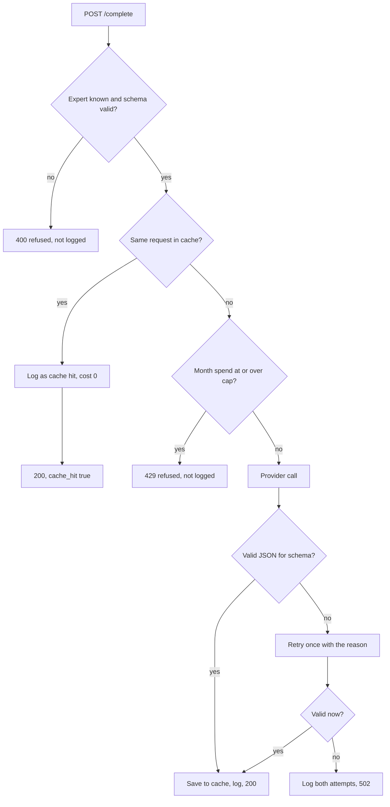

# LLM gateway

**In one sentence:** the one door to the language model. The four experts send a request here, and the gateway returns a checked JSON answer, while enforcing a monthly budget per expert and logging the cost of every call.

**Status:** working, mock provider only; runs as a Compose service (P4.12) · **Owner:** shared · **Plan tasks:** P2.4, P4.12

## What it does

The experts need a language model to write parts of their diagnoses. A model can cost money and can return text that is not the shape we asked for. The gateway handles both problems in one place, so no expert talks to a model provider directly.

For each request, the gateway returns a JSON answer that matches the JSON Schema the caller sent. (A JSON Schema is a description of the shape a JSON document must have: which fields exist, their types and which ones are required.) If the model's answer does not match, the gateway asks once more. If it still does not match, the caller gets an error instead of bad data.

The gateway also keeps each expert within a monthly spending limit, remembers identical answers so repeated questions cost nothing, and writes every paid call to the `platform.llm_calls` table in Postgres. Only the mock provider exists so far. The mock never leaves the machine and returns placeholder answers. A real provider is waiting on the team's choice (open item O5 in `docs/DECISIONS.md`).

## How it works

1. An expert sends `POST /complete` with its name, a prompt version, the chat messages and the JSON Schema it wants back.
2. The gateway checks the request. An unknown expert or a broken schema is refused with 400. Nothing is logged for these.
3. It builds a cache key from the model name, the prompt version, the messages and the schema. If the same request was answered recently, it returns the saved answer. This is a cache hit. It costs nothing, so it is allowed even when the expert is over its cap.
4. If there is no cache hit, it adds up the expert's spend since the start of the UTC month. If the spend has reached the cap, it refuses with 429. The provider is not called.
5. It calls the provider (only the mock today) and checks the answer as JSON that matches the schema.
6. If the answer is not valid, it sends the conversation back to the provider once more, with the bad answer and the reason. The second answer must be valid, or the gateway gives up with 502.
7. A valid answer is saved in the cache for 7 days and logged. A 502 is logged too, because the tokens were still used and cost money.
8. The gateway returns the answer with the model name, the token counts and the cost in US dollars.



## How to run it

As a container (profiles `experts` and `e2e`): `docker compose --profile experts up -d --build llm-gateway` serves it on `127.0.0.1:8200` with the mock provider, the `platform.llm_calls` log in the Compose Postgres, the Compose Redis as cache and `config/` mounted read-only. `LLM_PROVIDER` and `LLM_API_KEY` come from `.env` (provider default `mock`, key empty). The Test worker is pointed at it by default. By hand, from the repository root:

```bash
# start Postgres and Redis (optional for a first try, see Settings)
make up

# start the gateway on the internal port 8200
uv run uvicorn llm_gateway.api:app --host 127.0.0.1 --port 8200

# in a second terminal: check it is alive
curl http://127.0.0.1:8200/health
```

When it works, uvicorn prints `Uvicorn running on http://127.0.0.1:8200`, and the health check returns:

```json
{"status": "ok", "provider": "mock"}
```

To run the tests, use `make check`. The tests use the mock provider and in-memory stores, so they need no network and no database. The one SQL test is marked `integration`. It needs `make up` and is skipped when Postgres is not reachable.

## Inputs and outputs

| | What | Where / format |
|---|---|---|
| In | `POST /complete` body: `expert` (name, such as `test`), `prompt_version` (text, part of the cache key), `messages` (a list of `{role, content}` text pairs), `json_schema` (a JSON Schema object) | HTTP JSON body on port 8200 |
| Out | 200: `output` (the validated JSON), `model`, `prompt_version`, `cache_hit`, `input_tokens`, `output_tokens`, `cost_usd` | HTTP JSON body |
| Out | Errors: 400 `unknown_expert` (with the list of known experts) or `invalid_json_schema`; 429 `monthly_cap_exceeded` (with `expert`, `spent_usd`, `cap_usd`); 502 `invalid_model_output` (with the `reason`). A body that does not match the request model gets FastAPI's standard 422 | HTTP JSON body |
| Out | `GET /health`: `status` and the active `provider` | HTTP JSON body |
| Out | One row per paid or cached call in `platform.llm_calls`: expert, model, prompt version, token counts, cost, cache hit, latency, time | Postgres table (or in memory, see Settings) |
| Out | Log lines: one `llm call` line per call (no prompt or answer text), one warning when a cap is reached | Standard Python `logging` |

## Settings

Environment variables (`.env`, with placeholders in `.env.example`):

| Setting | Where | Default | What it changes |
|---|---|---|---|
| `LLM_PROVIDER` | env | `mock` | Which provider answers. Only `mock` exists. Any other value fails on the first `/complete` call |
| `LLM_API_KEY` | env | empty | The key for a future real provider. No code reads it yet, and it is never logged |
| `LLM_CONFIG_FILE` | env | `config/llm.yaml` in the checkout | Path of the YAML config. Set it when the gateway runs outside a source checkout |
| `REDIS_URL` | env | unset: in memory | When set, the answer cache is shared through Redis |
| `DATABASE_URL` | env | unset: in memory | When set, calls and spend are stored in `platform.llm_calls` |
| `LLM_GATEWAY_PORT` | `.env.example` | `8200` | Documents the port. No code reads it; the port comes from the uvicorn command |
| `LLM_GATEWAY_URL` | `.env.example` | `http://127.0.0.1:8200` | Where experts send requests. No code reads it yet |

Settings in `config/llm.yaml` (all values are placeholders until the provider is chosen):

| Setting | Where | Default | What it changes |
|---|---|---|---|
| `default_model` | `config/llm.yaml` | `mock-1` | The model used for every call |
| `models` (`input_per_1k_usd`, `output_per_1k_usd`) | `config/llm.yaml` | `0.001` and `0.002` US dollars per 1,000 tokens | The price used to work out each call's cost |
| `monthly_cap_usd` | `config/llm.yaml` | `25.0` for each of `dependency`, `build`, `test`, `infra` | The monthly spending limit per expert. The keys are also the list of known experts |
| `cache_ttl_seconds` | `config/llm.yaml` | `604800` (7 days) | How long a saved answer is reused. Must be above zero |

A token is the unit a model charges by: a short piece of a word, roughly four characters.

## Example

A request from the tests. The expert is `test`, the schema asks for a text field `verdict` and a whole number `score`, and both are required:

```json
{
  "expert": "test",
  "prompt_version": "v1",
  "messages": [{"role": "user", "content": "hello"}],
  "json_schema": {
    "type": "object",
    "properties": {"verdict": {"type": "string"}, "score": {"type": "integer"}},
    "required": ["verdict", "score"]
  }
}
```

The mock provider builds the smallest valid answer for that schema, so the response is:

```json
{
  "output": {"score": 0, "verdict": "mock"},
  "model": "mock-1",
  "prompt_version": "v1",
  "cache_hit": false,
  "input_tokens": 1,
  "output_tokens": 7,
  "cost_usd": 0.000015
}
```

Sending the same request again returns the saved answer with `cache_hit: true` and `cost_usd: 0`. A second log row is written with cost zero.

If the `test` expert's spend had already reached its cap, the same request with a new `prompt_version` would get HTTP 429 with `"error": "monthly_cap_exceeded"`, and the provider would not be called.

## Limitations and known issues

**Provider and answers**
- Only the mock provider exists. Choosing and paying for a real provider is open (O5 in `docs/DECISIONS.md`). `LLM_API_KEY` is reserved for it.
- The mock answers are placeholders built from the schema: the first allowed value, `"mock"` for text, `0` for numbers, `false` for booleans. They are not meaningful.
- `docs/ARCHITECTURE.md` says the mock returns answers "from fixtures". The code builds them from the schema instead, with no fixture files. The team should decide which one is wanted.
- The mock estimates tokens at four characters each. Real providers will report their own counts.
- The gateway sends no output-length limit. A call's cost is known only after the call.

**Spending and cache**
- The cap check and the log write are not one atomic step. Two requests that arrive together can both pass the check, so the spend can go over the cap. With several uvicorn workers, or several processes, each one can overshoot.
- The call that crosses the cap is allowed. Once spend is at or over the cap, later calls are refused.
- Cache hits are free and are allowed even over the cap. `# DEFAULT:` in `service.py`.
- The expert name is not part of the cache key, so two experts that send the same request share one saved answer. The second expert gets the answer for free, and its log row shows cost zero. `# DEFAULT:` in `service.py`.
- Only whitespace at the start and end of a message is ignored when matching. Other differences count as a new request.
- Failed (502) answers are not cached.
- The tests check that a saved answer is reused, but not that it expires after its time to live. The Redis test only checks the round trip.
- Without `REDIS_URL` the cache is per process and is lost on restart. Without `DATABASE_URL` the call log and the spend are also per process. A restart resets the spend to zero. `# DEFAULT:` in `api.py`.

**Configuration and startup**
- `config/llm.yaml` is read once per process. Editing it needs a restart.
- The code does not check that `default_model` is listed under `models`. A mismatch shows up as an error on the first paid call.
- `/health` reports the value of `LLM_PROVIDER` without checking it. A bad provider name passes `/health` and fails on the first `/complete`, as a server error.
- The default config path is worked out from where the source file sits. That breaks outside a source checkout, so set `LLM_CONFIG_FILE` there. `# DEFAULT:` in `config.py`.
- `LLM_PROVIDER` defaults to `mock` when it is unset or blank. `# DEFAULT:` in `config.py`.
- `LLM_GATEWAY_PORT` and `LLM_GATEWAY_URL` are documented but not read by any code yet.
- There is no Dockerfile or docker-compose service for the gateway.

**Errors and security**
- The code does not catch errors from Redis or Postgres. If either is down, `/complete` fails with a server error.
- There is no authentication. The gateway is meant to be reachable only inside the stack. Anything that can reach port 8200 can spend the budget.
- Refused requests (400, 429) are not logged to `platform.llm_calls`, because no paid call was made.
- The test `test_api_key_is_never_logged` passes trivially for now, because no code reads `LLM_API_KEY`. It needs a real check once a provider reads the key.

**Not yet run**
- The SQL test (`tests/test_gateway_sql.py`, marked `integration`) has never been run in this environment. It needs `make up` and a reachable `DATABASE_URL`.

**Every `# DEFAULT:` choice in this component**
- `config.py`: the default config path is `config/llm.yaml` in the checkout.
- `config.py`: `LLM_PROVIDER` falls back to `mock`.
- `providers.py`: tokens are estimated at four characters each.
- `api.py`: with no `DATABASE_URL`, the log is in memory and a warning is logged.
- `service.py`: the expert is not part of the cache key.
- `service.py`: cache hits are served even over the cap.
- `config/llm.yaml` (header comment, covering every value in the file): `default_model: mock-1`; prices `0.001` and `0.002` US dollars per 1,000 input and output tokens; caps `25.0` for `dependency`, `build`, `test` and `infra`; `cache_ttl_seconds: 604800`.
- `.env.example` (gateway-related, outside this folder): `LLM_GATEWAY_PORT=8200`, `LLM_GATEWAY_URL=http://127.0.0.1:8200`, and the `DATABASE_URL` and `REDIS_PORT` lines that point at the Docker Compose defaults.

## Related

- `docs/PLAN.md`, task P2.4 (the task this guide covers).
- `docs/ARCHITECTURE.md`, section 4, "LLM gateway".
- `docs/DATA.md`, the `llm_calls` table.
- `docs/DECISIONS.md`, item O5 (choice of provider).
- `shared/db/README.md`, the database layer that defines the `llm_calls` table and the database URL.
- `config/llm.yaml`, the gateway's settings.
- `.env.example`, the environment variables.
- Experts (`experts/`): the callers. None call the gateway yet.
