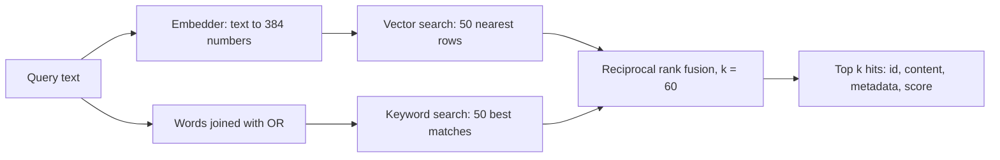

# Embeddings and hybrid search

**In one sentence:** Cleans CI logs, turns text into lists of numbers that capture meaning, and stores documents in a per-expert Postgres table where they can be searched by keywords and by meaning at once. The four experts use it to find past failures that look like the current one.

**Status:** Working (P2.5); the two SQL tests have not run yet · **Owner:** shared · **Plan tasks:** P2.5

## What it does

Experts need to find past failures that look like the current one. A keyword search misses matches that use different words. A meaning-based search (a vector search) finds matches with different words, but it can miss exact error codes. This component runs both and merges the results.

It does three jobs.

First, it cleans logs. It replaces timestamps, commit hashes, ids and file paths with fixed placeholders, such as `<TS>` and `<PATH>`. Two runs of the same failure then look the same.

Second, it turns text into an embedding. An embedding is a list of 384 numbers. Texts with similar meaning get lists that point in similar directions. The real model is `granite-embedding-small-english-r2` from IBM. It runs locally.

Third, it stores documents and searches them. Each expert gets its own table in Postgres. The table uses pgvector, a Postgres extension that adds a vector column type and fast nearest-neighbour search.

What comes out: a cleaned log string, rows in an expert table, or a ranked list of hits. Each hit has a document id, its content, its metadata (a small JSON object) and a score.

## How it works

The component has three parts: the log cleaner, the embedders, and the `Collection` (the table plus its search).

1. **Pick an embedder.** `get_embedder()` reads `EMBEDDING_PROVIDER`. `granite` gives a `GraniteEmbedder`. `fake` gives a `FakeEmbedder`. Any other value, including a typo, also gives the granite one.
2. **Know the two embedders.** Both follow the same shape, called a Protocol in Python: any object with a `dim` number and an `embed` method works.
   - `GraniteEmbedder` is lazy. Creating it loads nothing. The first call to `embed` imports `sentence-transformers` and loads the model. If that package is missing, it raises an error that shows the install command. Each vector is scaled to length 1, so a cosine similarity is just a dot product.
   - `FakeEmbedder` is for tests only. It counts words, hashes each word into one of 384 slots, and scales the result. Texts that share words end up close. It needs no model and no network, but it does not understand meaning.
3. **Clean the log** with `normalise_log` (table below). This runs before embedding, so the noise does not reach the model.
4. **Create a collection:** `Collection(engine, embedder, schema, name)`. The schema must be one of `dependency`, `build`, `testing` or `infra`. The name must start with a lowercase letter and use only lowercase letters, digits and underscores, up to 48 characters. Anything else raises an error before any SQL runs.
5. **Call `ensure()`.** It creates the table and two indexes if they do not exist. An index is a lookup structure that makes search fast. Then it checks that the table's vector size matches the embedder. If not, it raises `DimensionMismatchError`.
6. **Call `add(doc_id, content, metadata)`.** It embeds the content and inserts the row. If the `doc_id` already exists, the row is updated.
7. **Call `search(query, k)`.** It runs two searches, each keeping its best 50 candidates:
   - a vector search that ranks rows by cosine distance to the query's embedding (smaller is closer);
   - a keyword search over the English full-text index, using an OR of the query's words.
8. **Merge the two lists** with reciprocal rank fusion (RRF, k = 60). A row gets `1 / (60 + rank)` from each list it appears in, and the scores are added. A row near the top of both lists wins. The top `k` rows are returned.



### The table

Each collection is one table, `<schema>.<name>`:

| Column | What it holds |
|---|---|
| `id` | A number that goes up with each new row |
| `doc_id` | A unique text name for the document. Used for updates |
| `content` | The text itself |
| `metadata` | A JSON object of extra facts, such as the source run |
| `embedding` | The 384 numbers, stored as `vector(384)` |
| `tsv` | A keyword index of `content`, built automatically with English rules (word endings and common words are handled) |

Two indexes are created with the table. `<name>_tsv_idx` is a GIN index (a lookup table from word to rows) for keyword search. `<name>_vec_idx` is an HNSW index (a graph of near neighbours) with cosine distance for vector search.

### Log cleaning rules

The rules run in the order listed. ANSI codes go first because they hide inside other text.

| In the log | Becomes | Example (from the tests) |
|---|---|---|
| Terminal colour codes (ANSI escape codes) | removed | `ESC[31mError ESC[0m: boom` becomes `Error: boom` |
| Date and time, such as `2026-10-21T10:11:12.345Z` (T or a space) | `<TS>` | `2026-10-21T10:11:12.345Z npm ERR!` becomes `<TS> npm ERR!` |
| Clock time, such as `10:11:12` | `<TS>` | `at 10:11:12 done` becomes `at <TS> done` |
| UUID, such as `123e4567-e89b-12d3-a456-426614174000` | `<ID>` | `id 123e4567-...` becomes `id <ID>` |
| Hex number with `0x` | `<HEX>` | `ptr 0xdeadBEEF` becomes `ptr <HEX>` |
| Hex-looking string of 7 to 64 characters with at least one digit (commit hashes) | `<HEX>` | `commit 3f9a1c2b7d4e done` becomes `commit <HEX> done` |
| Windows path | `<PATH>` | `open C:\Users\me\app\a.js failed` becomes `open <PATH> failed` |
| Absolute Unix path with at least one folder | `<PATH>` | `open /home/runner/work/app/src/a.js failed` becomes `open <PATH> failed` |
| Relative path starting `./` or `../` | `<PATH>` | `see ./src/lib/x.ts now` becomes `see <PATH> now` |
| Runs of spaces or tabs; blank lines | one space; blank lines dropped | |

Words with no digit, such as `deadline` or `decade`, are left alone. Two runs of the same failure with different timestamps, paths and commit hashes produce the same cleaned text.

## How to run it

```bash
# Default setup: light, no torch, no model. The fake embedder is enough for tests.
make setup

# Optional: install the real granite model (adds sentence-transformers and torch)
uv sync --all-packages --extra embeddings

# Run this component's tests
uv run pytest shared/tests/test_embeddings.py
```

What you should see when it works: all tests in `test_embeddings.py` pass. The two SQL tests are marked `integration`. They are skipped when no database is reachable. To run them, start the database with `make up` and export `DATABASE_URL` and `REDIS_URL` as described in the project README. Those two tests have never been run.

The first real call to the granite embedder downloads the model files into a cache. This needs network access once. The tests never load the model.

## Inputs and outputs

| | What | Where / format |
|---|---|---|
| In | A raw log (for cleaning) | A Python string |
| In | A document to store: `doc_id`, text, metadata | Strings and a dict, passed to `add` |
| In | A search: query text and `k` | A string and an integer, passed to `search` |
| In | Settings | Environment variables (see below) |
| Out | Cleaned log | A Python string, one line per log line |
| Out | Stored document | A row in `<schema>.<name>` in Postgres |
| Out | Search results | A list of `SearchHit` objects: `doc_id`, `content`, `metadata`, `score` |

The `score` is the fused RRF score, not a cosine similarity. Its largest possible value is about 0.033 (2 / 61), reached by a row that ranks first in both lists. Do not compare it with a percentage.

## Settings

| Setting | Where | Default | What it changes |
|---|---|---|---|
| `EMBEDDING_PROVIDER` | `.env` or environment | `granite` | `fake` uses the offline fake embedder (no model, no download). Any other value uses granite. The value is trimmed and case-insensitive |
| `EMBEDDING_MODEL` | `.env` or environment | `ibm-granite/granite-embedding-small-english-r2` | The model that `GraniteEmbedder` loads. The vector size is fixed at 384 in code, so a model with another size fails at embed time |
| `EMBEDDING_CACHE_DIR` | `.env` or environment | not set (sentence-transformers' own cache folder) | Where the model files are stored |

These values are fixed in code and are not settings: 50 candidates per search, k = 60 for RRF, and the collection name rule (48 characters).

## Example

The integration test `test_collection_hybrid_search_sql` stores four short failure messages, each with metadata `{"id": <doc_id>}`:

- `peer`: "npm ERR! ERESOLVE unable to resolve dependency tree peer dependency conflict"
- `oom`: "JavaScript heap out of memory during webpack build"
- `flaky`: "mocha test timeout of 2000ms exceeded in integration suite"
- `docker`: "docker pull failed rate limit exceeded for image"

Then it searches for `ERESOLVE peer dependency conflict` with `k=2`. The expected result is two hits, and the first one has `doc_id` `peer` and metadata `{"id": "peer"}`. The keyword side matches `ERESOLVE`, `peer`, `dependency` and `conflict`. The vector side also ranks `peer` first.

The ranking part of this example is also checked without a database, in `test_top_k_on_fixture_set_with_fake_embedder`. The SQL version has never run.

## Limitations and known issues

- **Two SQL tests have never run.** `test_collection_hybrid_search_sql` and `test_collection_dimension_mismatch_sql` are integration tests. They are expected to run for the first time in CI.
- **The real granite model is never loaded in tests.** Tests use the fake embedder. The granite tests only check that creating the object loads nothing, and that a missing package gives a clear error.
- **Vector size is fixed.** `GraniteEmbedder` always reports 384. A different model needs a code change. A table's vector size is set when it is created. Changing it means dropping and rebuilding the table.
- **Tables are created at runtime.** `ensure()` runs `CREATE TABLE IF NOT EXISTS`. Tables are not created by an Alembic migration. Whether this fits the team's rule that database changes go through Alembic is an open question.
- **Call `ensure()` first.** `add` and `search` need the table to exist. Reading the code, a call before `ensure()` fails with a database error rather than a clear message. This was not run.
- **A typo in `EMBEDDING_PROVIDER` is silent.** Any value other than `fake` uses granite. A typo gives the real model without a warning.
- **The granite extra is needed for real embeddings.** Without it, the error appears on the first `embed` call, not at startup. Tests and offline runs should set `EMBEDDING_PROVIDER=fake`.
- **Keyword search uses an OR of the query's words.** Every word of 2 or more ASCII letters or digits is joined with OR, so a row matches if it has any one word. Common words in logs (such as `error` or `npm`) therefore match many rows, and the ranking has to do the work. Postgres English rules then drop stop words and stem the rest. Non-ASCII words are dropped. The code says only that this form is safe to pass to `to_tsquery`. It does not say why OR was chosen over AND. This choice is not marked `# DEFAULT:`.
- **Only the top 50 of each search are merged.** A row that is outside the top 50 in both searches cannot appear in the results. On large tables this limits recall.
- **Empty query.** The keyword side is skipped. The vector side still runs and returns the nearest rows.
- **The log cleaner is heuristic.** It was tested on short hand-written lines, not on real failure logs. It also has side effects:
  - A plain number with 7 or more digits (for example `12345678`) matches the hex rule and becomes `<HEX>`.
  - Placeholders contain `<` and `>`, which are not path characters. A hash inside a path can cut the path short. For example, `C:\Users\<HEX>\x.js` would leave `<HEX>\x.js` after the path placeholder. This is from reading the rules, not from a test.
- **The fake embedder is not semantic.** It only sees shared words. It is for tests, not for real results.

### Every `# DEFAULT:` in this component

- `shared/embeddings/embedder.py:13` and `:14`: the model name `ibm-granite/granite-embedding-small-english-r2`, from the architecture doc, overridable with `EMBEDDING_MODEL`.
- `shared/embeddings/embedder.py:66`: the fake embedder uses hashed word counts instead of random vectors. The marker sits inside the class docstring, not in a `#` comment, so it is easy to miss.
- `shared/embeddings/collection.py:18`: collection names are lowercase letters, digits and underscores, starting with a letter, up to 48 characters.
- `shared/embeddings/collection.py:21`: each search fetches 50 candidates before fusion.
- `shared/embeddings/collection.py:97`: HNSW index with cosine distance, with no training step.
- `shared/embeddings/rrf.py:7`: k = 60, from the original RRF paper.
- `.env.example:65`: granite small at 384 dimensions, and `EMBEDDING_PROVIDER=fake` as the offline option.
- `pyproject.toml:111`: `sentence_transformers` is an optional extra, so mypy ignores it when it is missing.
- `pyproject.toml:87`: the shared test folder (including `test_embeddings.py`) is not held to strict annotations on test functions.

### Choices made without a `# DEFAULT:` marker

These were made but are not marked in the code. `CONVENTIONS.md` asks for a marker on every invented default.

- The keyword query is an OR of words (`_or_query` in `collection.py`).
- The English text-search rules (stemming and stop words) are used for the keyword index and query.
- Words must be 2 or more characters, ASCII only (`_WORD` in `collection.py`).
- `add` is an upsert keyed on `doc_id`.
- Vectors are scaled to length 1 (`normalize_embeddings=True` in `embedder.py`).
- `get_embedder()` defaults to `granite` in code. The default is only written in `.env.example`.
- Ties are broken by row `id` in SQL and by first appearance in RRF.
- All of the log cleaning rules in `normalise.py` (the 7-character hex threshold, the path rules, and the rule order). That file has no `# DEFAULT:` markers at all.

## Related

- `docs/PLAN.md` task P2.5 (the plan lists this task as not yet ticked).
- `docs/ARCHITECTURE.md`: the embedding model row.
- `shared/db/README.md`: the database schemas that the expert collections live in.
- `experts/`: the four expert services are the planned users of `Collection`.
- `.env.example`: the three embedding settings.
