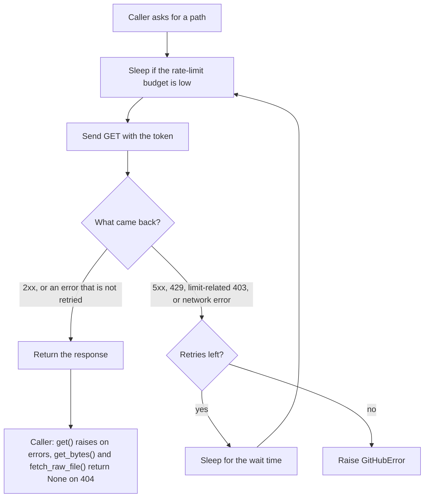

# GitHub client (shared/github)

**In one sentence:** A Python class that asks GitHub for data (runs, jobs, logs, files) and handles the waiting, retrying and splitting that GitHub's limits require, so the collector does not have to.

**Status:** working · **Owner:** shared · **Plan tasks:** P1.1

## What it does

GitHub limits how often a token may ask for data. Each token gets a budget of requests per hour. A busy request can also trigger a "secondary" limit, which is a short pause that GitHub asks for when requests come too fast. GitHub also caps how many results one search can return. The run list stops at 1,000 results, however many exist.

This client takes care of those limits. The collector and the scripts ask for data in plain terms, such as "give me all runs of this repo between these dates". The client sends the requests, waits when it must, tries again when a server error happens, and splits a date range in two when the answer is too big.

The client talks to two GitHub addresses. The REST API (`api.github.com`) returns JSON and job logs. The raw file server (`raw.githubusercontent.com`) returns the contents of a file at one commit. The client does not change anything on GitHub. It only reads.

## How it works

Every request goes through the same path. A "request" here means one HTTP GET.

1. The caller asks for a path, such as `/repos/acme/widgets/actions/runs`.
2. Before sending, the client checks the last rate-limit headers it saw. If fewer calls remain than the threshold (200 by default), it sleeps until the budget resets, plus one second.
3. It sends the GET request with the token in the `Authorization` header. The token is never put in the URL.
4. It reads the answer and decides what to do:
   - A 2xx answer, or any other error that is not on this list, is handed back. The caller then gets an error if the status is bad.
   - A 5xx server error waits and tries again. The wait doubles each time.
   - A 429 (too many requests) or a 403 (forbidden) that mentions a limit waits and tries again. If GitHub sent a `Retry-After` header, the client waits that many seconds. Otherwise it waits at least 60 seconds.
   - A network error (for example, a dropped connection) waits and tries again.
5. After the set number of retries, the client gives up and raises `GitHubError`.
6. The client keeps two counters. `api_calls` counts every REST attempt. `raw_calls` counts every raw file attempt. Retries count too.



Splitting date windows works on top of this. It is described in its own step list below.

### Splitting a date window

The run list returns at most 1,000 results for one query. To get every run in a long period, the client splits the period.

1. It asks for the runs in the whole window (for example, one month). The query uses GitHub's `created` filter.
2. If the answer says there are 1,000 or more runs, the window is too big. The client cuts it in half.
3. The left half keeps the first half of the time. The right half starts one second after the cut, so no run is counted twice.
4. Each half is handled the same way. Halving stops when a window is one hour or less.
5. If a window is at the minimum size and still has 1,000 or more runs, the client logs a warning that the results were truncated. It keeps the runs it can see. It does not raise an error.

### Raw file fetcher

`fetch_raw_file` asks `raw.githubusercontent.com` for one file at one commit. It uses the same retry path, but it does not read or count the REST rate-limit headers. If the file does not exist (404), it returns `None` and does not raise.

### Job logs

`get_bytes` fetches a body such as a job log. GitHub answers the log request with a redirect to a storage address. The client follows the redirect. The token is not sent to the storage address, because `httpx` (the HTTP library used here) drops the `Authorization` header when a redirect goes to a different host.

If the log has expired, GitHub answers 410. `get_bytes` does not treat 410 as "missing". It raises `GitHubError` with `status_code` 410. The caller must catch that error.

## How to run it

The client is a library. Nothing runs by itself. Use it from Python code in this repo. Put the token in `.env` (see `.env.example`), then run:

```bash
# quick check: prints this token's rate-limit numbers (uses one call)
uv run --env-file .env python -c "from shared.github import GitHubClient; print(GitHubClient().get_rate_limit()['rate'])"
```

When it works, you see a dictionary with `limit`, `used`, `remaining` and `reset`. A token with a normal budget shows `limit` 5000.

Use `with GitHubClient() as client:` in real code. The `with` block closes the connection when it ends.

Run the tests with no network. They use recorded responses through `respx` (a library that fakes HTTP calls):

```bash
uv run pytest shared/tests/test_github_client.py
make check   # runs ruff, mypy and all tests
```

## Inputs and outputs

| | What | Where / format |
|---|---|---|
| In | Access token | `GITHUB_TOKEN` in `.env`, or the `token` argument |
| In | Tuning values | `GITHUB_RATE_LIMIT_THRESHOLD` and `GITHUB_MIN_WINDOW_HOURS` in `.env`, or a `GitHubConfig` object |
| In | Requests | Paths such as `/repos/<owner>/<repo>/actions/runs`, or a repo name, a commit SHA and a file path |
| Out | JSON answers | Python dictionaries and lists (`get_json`, `paginate`, `iter_workflow_runs`) |
| Out | Raw bytes | Job logs and file contents, as `bytes` (`get_bytes`, `fetch_raw_file`) |
| Out | Errors | `GitHubError` (with `status_code`), or its subclass `GitHubNotFoundError` for 404 |
| Out | Counters | `client.api_calls` and `client.raw_calls` |
| Out | Log lines | Standard `logging` warnings for retries, sleeps and truncation. The token is not in them |

## Settings

| Setting | Where | Default | What it changes |
|---|---|---|---|
| `GITHUB_TOKEN` | `.env` (environment) | Empty, so no `Authorization` header is sent | The token used for every request. Empty means unauthenticated, which has a much lower limit and is not warned about |
| `GITHUB_RATE_LIMIT_THRESHOLD` | `.env` (environment), read by `GitHubConfig.from_env()` | 200 | The client sleeps before a call when fewer calls than this remain |
| `GITHUB_MIN_WINDOW_HOURS` | `.env` (environment), read by `GitHubConfig.from_env()` | 1 | The smallest date window the client splits down to. Zero, empty or a negative value uses the default |
| `max_retries` | `GitHubConfig` in code | 5 | Retries after the first attempt for 5xx, 429, limit-related 403 and network errors |
| `backoff_base` / `backoff_cap` | `GitHubConfig` in code | 1 s, doubling, capped at 60 s | The wait between 5xx and network retries |
| `secondary_backoff` | `GitHubConfig` in code | 60 s | The minimum wait for a 429, or a limit-related 403 with no `Retry-After` |
| `timeout` | `GitHubConfig` in code | 30 s | How long one request may take |
| `base_url` / `raw_url` | `GitHubConfig` in code | `https://api.github.com` and `https://raw.githubusercontent.com` | Where requests go. Tests point these elsewhere |

Passing your own `GitHubConfig` object replaces the environment values for the threshold and window. The environment is only read when no config is passed.

## Example

From `test_retry_after_is_honoured` in `shared/tests/test_github_client.py`.

- **Input:** the client asks for `/a`. GitHub answers three times in a row. First a 429 with `Retry-After: 17`. Then a 403 with `Retry-After: 5`. Then a 200 with `{"ok": true}`.
- **Output:** the caller gets `{"ok": true}`. The client waited 17 seconds, then 5 seconds. It made 3 calls, so `api_calls` is 3. The test replaces the real sleep with a fake one that records the waits. In real use, the process really waits.

## Limitations and known issues

**Behaviour to know about**

- **Waits are not capped for `Retry-After`.** If GitHub sends a large `Retry-After`, the client sleeps that long.
- **`Retry-After` is ignored for 5xx errors.** Those always use the backoff.
- **The 60-second cap is never reached with default settings.** With 5 retries the 5xx waits are 1, 2, 4, 8 and 16 seconds. The 60-second cap only matters if the retry count is raised.
- **410 (expired log) has no special handling.** It raises a plain `GitHubError` with `status_code` 410. No test covers this. Callers must catch it.
- **Truncated windows lose runs.** A window at the minimum size that still has 1,000 or more runs is cut short. Only a warning in the log shows this.
- **`api_calls` counts everything.** That includes retries and the `/rate_limit` call. The `get_rate_limit` docstring says that call does not use quota, but the counter still goes up.
- **Raw fetches do not check the rate-limit budget.** They have no quota sleep and no 60-second floor for 429. Their 429 waits are 1, 2, 4 and so on.
- **The rate-limit sleep only happens before a call.** The last call of a run never waits.
- **Invalid environment numbers stop the client.** A non-number in `GITHUB_RATE_LIMIT_THRESHOLD` raises `ValueError` when the client is created.
- **An empty token is silent.** The client sends no `Authorization` header and does not warn.
- **Everything is synchronous.** One request at a time. The collector is a sequential command-line tool.
- **Other numbers are code constants.** `max_retries`, backoff, timeout and the URLs live in `GitHubConfig` in code, not in `config/` or `.env`. This goes against the convention "config over constants". Only the threshold and window come from the environment.

**Every `# DEFAULT:` in this component** (all in `shared/github/client.py`)

1. `GitHubConfig.rate_limit_threshold`: 200, the threshold named in `docs/DATA.md` section 3.3.
2. `GitHubConfig.max_retries`, `backoff_base`, `backoff_cap`: 5 retries, 1 s doubling to a 60 s cap, bounded in time and with no jitter (no random spread), so the behaviour is repeatable.
3. `GitHubConfig.secondary_backoff`: a limit-related 403 or a 429 with no `Retry-After` waits at least 60 s, which is GitHub's advice.
4. `GitHubConfig.min_window`: stop halving date windows at one hour. Below that the client accepts truncation and warns.
5. `GitHubConfig.timeout`: 30 s per request.
6. `GitHubClient.__init__`: a synchronous `httpx.Client` that follows redirects. The collector is a sequential command-line tool, and `httpx` drops the token on cross-host redirects.

The environment defaults are also marked in `.env.example`: the threshold (200) and the minimum window (1 hour).

## Related

- Plan task P1.1 in `docs/PLAN.md` (this component). The later collector and re-run check tasks (P1.3, P1.5, P1.6) are meant to build on this client.
- `docs/DATA.md` section 3.3: the threshold and the window rules.
- `shared/tests/test_github_client.py`: the tests, with recorded responses in `shared/tests/fixtures/github/`.
- `.env.example`: the environment variables this client reads.
- `docs/CONVENTIONS.md`: the rules for tests (no network) and secrets (never logged).
